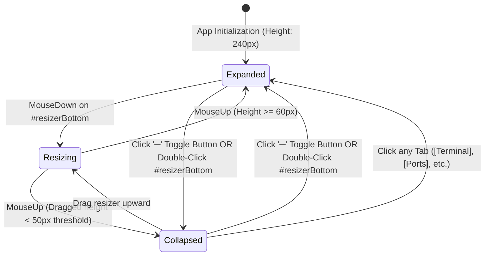

# High-Level Design (HLD): Collapsible Bottom Drawer

**Document ID:** `ORX-HLD-COLLAPSIBLE-BOTTOM-DRAWER-V1`  
**Version:** `1.0` (Synchronized with Implemented Vanilla JS & PyWebView Architecture)  
**Target Codebase:** `DeskAI`  
**Target Files:**
* `src/deskai/static/index.html` (Lines 95-163)
* `src/deskai/static/css/components.css` (Lines 316-360)
* `src/deskai/static/css/layout.css` (Resizer row & split pane layout)
* `src/deskai/static/js/events.js` (`initResizers` & centralized delegation)
**Status:** Approved  
**Date:** October 27, 2026  

---

## 1. Architectural Overview & Objective

The **Collapsible Bottom Drawer** (`#bottomDrawer`) is the central lower viewport container of the DeskAI studio workspace. Positioned directly underneath the Multi-Tab Editor Stage (`#editorStage`), it hosts all execution, diagnostic, logging, and networking subsystems within an interactive, resizable, and collapsible frame.

* **Current State:** Developers and autonomous coding agents require continuous access to command execution, build output, linting diagnostics, and active socket monitoring without sacrificing valuable vertical code editing real estate.
* **Target State (Implemented):** A unified, robust parent container that:
  1. **Hosts Core IDE Subsystems:** Encapsulates 5 dedicated sub-components:
     * `drawer-header-controls`: 32px fixed header with tablist and minimize toggle.
     * `terminal-panel`: Interactive host shell and process console.
     * `output-panel`: Monospace read-only supervisor telemetry and task channel logs.
     * `problems-panel`: Workspace diagnostics, linting errors, and language server warnings.
     * `ports-panel`: Real-time loopback TCP socket monitor and port forwarder.
  2. **Horizontal Draggable Resizer (`#resizerBottom`):** A bidirectional 4px split handle enabling smooth mouse dragging, keyboard step resizing (`ArrowUp`/`ArrowDown`), and double-click collapse/expand toggling.
  3. **Dual Viewport States:** Instant toggling between **Expanded Mode** (default 240px or user-dragged height) and **Collapsed Mode** (32px header-only docked strip).

```text
┌─────────────────────────────────────────────────────────────────────────────┐
│                          #editorStage (Code Editor)                         │
├─────────────────────────────────────────────────────────────────────────────┤
│ #resizerBottom [ 4px horizontal split resizer / cursor: row-resize ]        │
├─────────────────────────────────────────────────────────────────────────────┤
│ <section class="bottom-drawer" id="bottomDrawer">                           │
│   ├── .drawer-header (32px fixed height)                                    │
│   │     [Terminal] [Output] [Problems] [Ports]          [─] (toggle-drawer) │
│   └── .drawer-content (Scrollable panel viewport)                           │
│         ├── #terminalPanel  (Default active)                                │
│         ├── #outputPanel    (Hidden by default)                             │
│         ├── #problemsPanel  (Hidden by default)                             │
│         └── #portsPanel     (Hidden by default)                             │
└─────────────────────────────────────────────────────────────────────────────┘
```

---

## 2. Component Architecture & UI State Machine

The drawer container transitions across three primary operational states:



### 2.1 State Matrix

| State | CSS Modifier | Container Height | Visual Layout | User Capabilities |
| :--- | :--- | :--- | :--- | :--- |
| **Expanded (Default)** | `.bottom-drawer` | `240px` (or custom px) | Full 32px header + scrollable `.drawer-content` | Full panel interaction, terminal typing, port forwarding, height resizing |
| **Resizing (Active)** | `.bottom-drawer` + `body.resizing-row` | Dynamic ($60\text{px} \le h \le \text{viewport}-150\text{px}$) | Blue accent glow on `#resizerBottom`, cursor locked to `row-resize` | Real-time viewport calculation with user-select disabled |
| **Collapsed** | `.bottom-drawer.collapsed` | `32px` | Content hidden; 32px header docked at bottom | Click tab to restore, click `─` to restore, double-click resizer to restore |

---

## 3. End-to-End Interaction & Data Flow

```text
                       [User Interaction on Drawer Boundary]
                                        │
           ┌────────────────────────────┼────────────────────────────┐
           ▼                            ▼                            ▼
[Mouse Drag on Resizer]      [Double-Click Resizer]        [Click Toggle Button (─)]
           │                            │                            │
           ▼                            ▼                            ▼
[Calculate Delta Y]            [Check isCollapsed]           [classList.toggle('collapsed')]
  - Clamp 60px to max H         - If true: restore last H    - Height clamped to 32px
  - Auto-collapse if < 50px     - If false: add .collapsed
           │                            │
           └────────────────────────────┴────────────────────────────┐
                                                                     ▼
                                                      [Update Layout & CSS Styles]
                                                      - bottomDrawer.style.height
                                                      - ARIA attribute updates
```

### 3.1 Step-by-Step Execution
1. **Interactive Resizing:**
   * User presses mouse down on `#resizerBottom`.
   * `mousemove` event listeners compute `window.innerHeight - e.clientY`, clamping between minimum 60px and maximum `window.innerHeight - 150px`.
   * If dragged below 50px, the drawer automatically snaps to `.collapsed` (32px).
2. **Keyboard Step Resizing:**
   * Focusing `#resizerBottom` via `Tab` allows pressing `ArrowUp` to expand height by $+20\text{px}$ and `ArrowDown` to shrink height by $-20\text{px}$.
3. **Double-Click Toggle:**
   * Double-clicking `#resizerBottom` toggles `.collapsed`. If collapsed, it restores the previous height (`lastDrawerHeight || 240px`).
4. **Header Toggle Action:**
   * Clicking `<button class="close-drawer-btn" data-action="toggle-drawer">` toggles `.collapsed` directly.

---

## 4. Layout Constraints & Design Contracts

* **Parent Element:** Resides inside `<section class="center-workspace">` beneath `#editorStage`.
* **CSS Flex Behavior:** The center workspace operates as a flex column; shrinking the drawer automatically expands `#editorStage` without horizontal layout shift.
* **Minimum Operational Height:** `60px` (guarantees header plus at least one line of terminal or port content).
* **Maximum Operational Height:** `window.innerHeight - 150px` (preserves visible editor tab bar and breadcrumbs).
* **Collapsed Height:** Exactly `32px` (`.bottom-drawer.collapsed { height: 32px; }`).

---

## 5. Accessibility (WCAG 2.1 AA) Compliance

1. **Semantic Landmark Roles:**
   * Drawer container uses `<section class="bottom-drawer" role="region" aria-label="Output Drawer">`.
   * Resizer handle uses `<div id="resizerBottom" role="separator" aria-orientation="horizontal" tabindex="0" aria-label="Resize Bottom Drawer">`.
2. **Keyboard Navigation:**
   * Fully accessible via `Tab` sequence.
   * `ArrowUp` and `ArrowDown` keys adjust drawer height predictably.
3. **High Contrast Focus & Hover Rings:**
   * `:focus-visible` on `#resizerBottom` provides a 2px outline in `var(--accent-primary)`.
   * Hover state renders a 4px glow indicator using `var(--accent-primary)` with zero layout jump.

---

## 6. Verification & Test Strategy

| Test Area | Verification Target | Test Method |
| :--- | :--- | :--- |
| **DOM Semantics** | `#bottomDrawer` and `#resizerBottom` declared with ARIA roles | Static DOM Contract Test |
| **Height Clamping** | Height remains clamped within $[60\text{px}, \text{maxH}]$ | Playwright E2E Test |
| **Collapse Action** | `.collapsed` clamps computed height to `32px` | Playwright Style Test |
| **Double-Click Toggle** | Double-clicking `#resizerBottom` alternates collapsed/expanded | Playwright Mouse Event Test |
| **Keyboard Step** | `ArrowUp`/`ArrowDown` on focused resizer updates style height | Playwright Keyboard Test |
