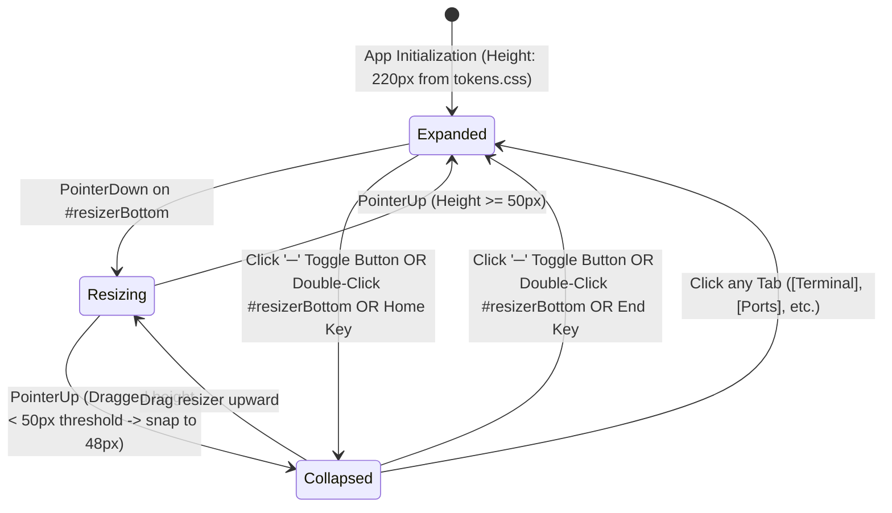

# High-Level Design (HLD): Collapsible Bottom Drawer

**Document ID:** `ORX-HLD-COLLAPSIBLE-BOTTOM-DRAWER-V1`  
**Version:** `1.1` (Synchronized with Implemented Vanilla JS & PyWebView Architecture)  
**Target Codebase:** `DeskAI`  
**Target Files:**
* `src/deskai/static/index.html`
* `src/deskai/static/css/components.css`
* `src/deskai/static/css/layout.css`
* `src/deskai/static/js/events.js` (`initResizers` & centralized delegation)
**Status:** Approved  
**Date:** October 27, 2026  

---

## 1. Architectural Overview & Objective

The **Collapsible Bottom Drawer** (`#bottomDrawer`) is the central lower viewport container of the DeskAI studio workspace. Positioned directly underneath the Multi-Tab Editor Stage (`#editorStage`), it hosts all execution, diagnostic, logging, and networking subsystems within an interactive, resizable, and collapsible frame.

* **Current State:** Developers and autonomous coding agents require continuous access to command execution, build output, linting diagnostics, and active socket monitoring without sacrificing valuable vertical code editing real estate.
* **Target State (Implemented):** A unified, robust parent container that:
  1. **Hosts Core IDE Subsystems:** Encapsulates 5 dedicated sub-components:
     * `drawer-header-controls`: 32px fixed header with tablist and minimize toggle (`#drawerToggleBtn`).
     * `terminal-panel`: Interactive host shell and process console.
     * `output-panel`: Monospace read-only supervisor telemetry and task channel logs.
     * `problems-panel`: Workspace diagnostics, linting errors, and language server warnings.
     * `ports-panel`: On-demand & visible-only polling TCP socket monitor and port watcher.
  2. **Horizontal Pointer-Captured Resizer (`#resizerBottom`):** A bidirectional 4px split handle using HTML5 Pointer Events (`setPointerCapture`) enabling smooth pointer dragging, keyboard step resizing (`ArrowUp`/`ArrowDown`/`Home`/`End`), and double-click collapse/expand toggling.
  3. **Dual Viewport States:** Instant toggling between **Expanded Mode** (default 220px or user-dragged height) and **Collapsed Mode** (32px header-only docked strip with `.drawer-content { display: none; }`).
  4. **Automatic Expansion on Tab Selection:** Clicking any tab ([Terminal], [Output], [Problems], [Ports]) immediately expands a collapsed drawer.

```text
┌─────────────────────────────────────────────────────────────────────────────┐
│                          #editorStage (Code Editor)                         │
├─────────────────────────────────────────────────────────────────────────────┤
│ #resizerBottom [ 4px horizontal split resizer / cursor: row-resize ]        │
├─────────────────────────────────────────────────────────────────────────────┤
│ <section class="bottom-drawer" id="bottomDrawer">                           │
│   ├── .drawer-header (32px fixed height)                                    │
│   │     [Terminal] [Output] [Problems] [Ports]          [─] (toggle-drawer) │
│   └── .drawer-content (Scrollable panel viewport, hidden when collapsed)    │
│         ├── #terminalPanel  (Default active)                                │
│         ├── #outputPanel    (Hidden by default)                             │
│         ├── #problemsPanel  (Hidden by default)                             │
│         └── #portsPanel     (Hidden by default)                             │
└─────────────────────────────────────────────────────────────────────────────┘
```

---

## 2. Component Architecture & UI State Machine

The drawer container transitions across three primary operational states:



### 2.1 State Matrix

| State | CSS Modifier | Container Height | Visual Layout | User Capabilities |
| :--- | :--- | :--- | :--- | :--- |
| **Expanded (Default)** | `.bottom-drawer` | `220px` (or persisted custom px) | Full 32px header + scrollable `.drawer-content` | Full panel interaction, terminal typing, port monitoring, height resizing |
| **Resizing (Active)** | `.bottom-drawer` + `#resizerBottom.is-resizing` | Dynamic ($48\text{px} \le h \le 0.8 \times \text{viewport}$) | Warm amber accent glow (`var(--color-primary)`), cursor locked to `row-resize` | High-frequency `requestAnimationFrame` calculation with pointer capture |
| **Collapsed** | `.bottom-drawer.collapsed` | `32px` | Content hidden (`display: none`); 32px header docked at bottom | Click tab to restore, click `─` to restore, double-click resizer to restore |

---

## 3. End-to-End Interaction & Data Flow

```text
                       [User Interaction on Drawer Boundary]
                                        │
           ┌────────────────────────────┼────────────────────────────┐
           ▼                            ▼                            ▼
[Pointer Drag on Resizer]    [Double-Click Resizer]        [Click Tab or Toggle (─)]
           │                            │                            │
           ▼                            ▼                            ▼
[Calculate Delta Y]            [Check isCollapsed]           [classList.toggle('collapsed')]
  - Clamp 48px to 80% vh        - If true: restore last H    - Expand on tab click
  - Auto-collapse if < 50px     - If false: add .collapsed   - Height clamped to 32px
           │                            │
           └────────────────────────────┴────────────────────────────┐
                                                                     ▼
                                                      [Update Layout & CSS Styles]
                                                      - --bottom-drawer-h property
                                                      - aria-valuenow & aria-expanded
                                                      - localStorage persistence
```

### 3.1 Step-by-Step Execution
1. **Pointer Event Resizing:**
   * User presses primary button on `#resizerBottom`.
   * `setPointerCapture` binds all pointer movements directly to the element.
   * `pointermove` calculates `startHeight + (startY - e.clientY)` clamped between floor 48px and `window.innerHeight * 0.8`, throttled via `requestAnimationFrame`.
   * If dragged below 50px, snaps to collapsed (`48px`).
   * On `pointerup` / `pointercancel`, releases capture and stores `lastExpandedHeight` in `localStorage`.
2. **Keyboard Roving & Navigation:**
   * `#resizerBottom`: `ArrowUp` (+16px), `ArrowDown` (-16px, collapses if < 50px), `Home` (collapses to 48px), `End` (expands to 80% viewport height), `Enter`/`Space` (toggles collapse).
   * `.drawer-tabs`: `ArrowLeft` / `ArrowRight` roving focus with automatic tab activation.
3. **Double-Click Height Restoration:**
   * Double clicking `#resizerBottom` toggles between collapsed and `lastExpandedHeight`.

---

## 4. Security & Performance Guarantees

1. **Focus Trapping Elimination:** When collapsed, `.bottom-drawer.collapsed .drawer-content { display: none; }` ensures interior buttons cannot receive keyboard focus while visually hidden.
2. **Design Token Integrity:** Resizer glow uses `--color-primary` (`#d99b26`), with `--border-subtle` dividers. Zero hardcoded colors.
3. **Overflow Protection:** `.bottom-drawer { overflow: hidden; }` prevents terminal or port table spillover.
4. **Lifecycle Resource Conservation:** Collapsing the drawer or switching away from the Ports tab automatically halts socket polling timers.
