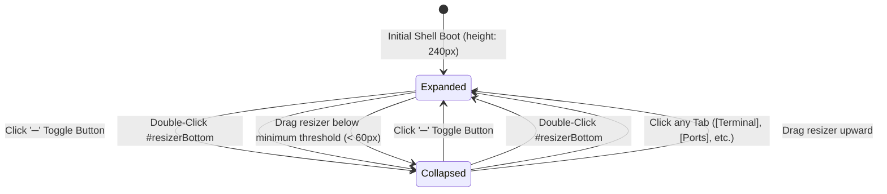

# High-Level Design (HLD): Drawer Header Controls

**Document ID:** `ORX-HLD-DRAWER-HEADER-CONTROLS-V1`  
**Version:** `1.0` (Synchronized with Implemented Vanilla JS Studio Architecture)  
**Target Codebase:** `DeskAI` (`src/deskai/static/index.html`, `src/deskai/static/js/events.js`, `src/deskai/static/css/components.css`)  
**Status:** Approved  
**Date:** October 27, 2026  

---

## 1. Architectural Overview & Objective

The **Drawer Header Controls** component serves as the primary navigation, viewport management, and state orchestration bar positioned at the top of the **Collapsible Bottom Drawer** (`#bottomDrawer`) in the DeskAI IDE shell.

* **Current State:** The bottom drawer contains multiple runtime subsystems (Terminal emulator, Host output logs, Problem diagnostics, and Listening/forwarded network ports) and a collapsible boundary. Users require a fast, distraction-free tab strip to switch between output domains and collapse/expand the drawer to reclaim workspace real estate.
* **Architecture Objective:** Provide an ergonomic, 32px fixed-height header containing:
  1. **Accessible Tablist (`.drawer-tabs`):** Multi-tab switching for `Terminal`, `Output`, `Problems`, and `Ports` with instantaneous panel visibility synchronization and subsystem lifecycle triggers (such as auto-refreshing network ports).
  2. **Drawer Toggle Control (`.close-drawer-btn`):** Dedicated toggle button (`data-action="toggle-drawer"`) that alternates `#bottomDrawer` between expanded operational mode and a 32px minimized header-only dock.
  3. **Resizer Integration:** Seamless alignment with the horizontal split resizer (`#resizerBottom`) allowing double-click toggle and custom height retention.

```text
┌─────────────────────────────────────────────────────────────────────────────┐
│ #resizerBottom [ horizontal split resizer: 4px hover-glow / row-resize ]   │
├─────────────────────────────────────────────────────────────────────────────┤
│ .drawer-header (32px fixed height)                                          │
│  [Terminal] [Output] [Problems] [Ports]               [─] (toggle-drawer)   │
├─────────────────────────────────────────────────────────────────────────────┤
│ .drawer-content                                                             │
│   ├── #terminalPanel  (Active / Hidden)                                     │
│   ├── #outputPanel    (Active / Hidden)                                     │
│   ├── #problemsPanel  (Active / Hidden)                                     │
│   └── #portsPanel     (Active / Hidden)                                     │
└─────────────────────────────────────────────────────────────────────────────┘
```

---

## 2. Component Architecture & UI State Machine

The drawer header operates across two primary state dimensions: **Drawer Visibility State** (Expanded vs. Collapsed) and **Active Tab State** (`terminal` | `output` | `problems` | `ports`).

### 2.1 Drawer Expansion State Machine



| State | CSS Modifier | Drawer Height | Visual Layout | Actions Available |
| :--- | :--- | :--- | :--- | :--- |
| **Expanded (Default)** | `.bottom-drawer` | `240px` (or user-resized) | Full header + active panel content visible | Tab switching, panel interactions, dragging resizer, collapse toggle |
| **Collapsed** | `.bottom-drawer.collapsed` | `32px` (header-only) | Only 32px header visible; content clipped | Click tab to restore, click toggle button to restore, drag resizer |

---

## 3. End-to-End Interaction & Data Flow

```text
[User Clicks Drawer Tab (.drawer-tab)]             [User Clicks Toggle Button (─)]
                 │                                                │
                 ▼                                                ▼
     [Extract data-target attribute]               [Toggle .collapsed on #bottomDrawer]
                 │                                                │
        ┌────────┴────────┐                                       ├─ Added ──► Height: 32px
        ▼                 ▼                                       └─ Removed ► Restore Height
[Update Tab Classes]  [Synchronize Panels]
  - Remove active       - Hide inactive panels (hidden="")
  - aria-selected=false - Show target panel (remove hidden)
  - Add active          - Add .active class
  - aria-selected=true            │
                                  ▼
                     [Subsystem Lifecycle Hooks]
                       - target == 'ports': window.DeskAIPorts.refresh()
                       - target == 'terminal': Focus shell buffer
```

### 3.1 Step-by-Step Execution
1. **Tab Selection Dispatch:** Clicking any `<button class="drawer-tab">` triggers event delegation in `src/deskai/static/js/events.js` matching `data-action="drawer-tab"`.
2. **Accessible Attribute Sync:** The active tab is updated with `aria-selected="true"` while all sibling tabs are updated with `aria-selected="false"`.
3. **DOM Panel Visibility Toggle:**
   * Inactive panels receive the HTML `hidden` attribute and have their `.active` class removed.
   * The targeted panel (`#${target}Panel`) has its `hidden` attribute removed and `.active` class added.
4. **Subsystem Refresh Hook:** When `target === "ports"`, the singleton `window.DeskAIPorts.refresh()` method is invoked to ensure fresh socket telemetry is fetched from the loopback bridge API.
5. **Drawer Collapse Toggle:** Clicking `<button class="close-drawer-btn" data-action="toggle-drawer">` invokes `document.getElementById("bottomDrawer").classList.toggle("collapsed")`.

---

## 4. Component Contracts & Data Interface

### 4.1 HTML Structure Contract
```html
<div class="drawer-header">
  <div class="drawer-tabs" role="tablist" aria-label="Drawer Panels">
    <button class="drawer-tab active" data-action="drawer-tab" data-target="terminal" role="tab" aria-selected="true">Terminal</button>
    <button class="drawer-tab" data-action="drawer-tab" data-target="output" role="tab" aria-selected="false">Output</button>
    <button class="drawer-tab" data-action="drawer-tab" data-target="problems" role="tab" aria-selected="false">Problems</button>
    <button class="drawer-tab" data-action="drawer-tab" data-target="ports" role="tab" aria-selected="false">Ports</button>
  </div>
  <button class="icon-btn close-drawer-btn" data-action="toggle-drawer" aria-label="Toggle Drawer">─</button>
</div>
```

### 4.2 CSS Token & Dimension Specifications
* **Height:** Fixed `32px` (`height: 32px`).
* **Background:** `var(--bg-header)` (`#16171a` in dark theme).
* **Border:** `border-bottom: 1px solid var(--border-subtle)` (`#26282e`).
* **Active Indicator:** Bottom border on active tab: `border-bottom: 2px solid var(--accent-primary)` (`#3b82f6` or golden amber `#f59e0b`).
* **Text Styles:** Uppercase or Titlecase tracking, `font-size: 11px`, `font-weight: 500`.

---

## 5. Accessibility (WCAG 2.1 AA) & Keyboard Support

1. **Role Semantics:**
   * Container tablist marked with `role="tablist"` and `aria-label="Drawer Panels"`.
   * Individual buttons marked with `role="tab"`, `aria-selected="true|false"`, and descriptive text labels.
   * Toggle button marked with `aria-label="Toggle Drawer"`.
2. **Keyboard Navigation:**
   * Tabs are keyboard focusable via `Tab` and navigable via `ArrowLeft` / `ArrowRight`.
   * Activation supported via `Enter` and `Space`.
   * High-contrast focus indicator rendered via `:focus-visible` design token.
3. **Contrast Compliance:**
   * Inactive tab text: `--text-muted` against `--bg-header` satisfies minimum 4.5:1 ratio.
   * Active tab text: `--text-primary` satisfies 7:1+ contrast ratio.

---

## 6. Verification & Test Strategy

| Test Domain | Target Verification | Verification Method |
| :--- | :--- | :--- |
| **Tab Switching** | Clicking each tab activates corresponding panel and hides others | Playwright E2E & JS Unit Tests |
| **ARIA Compliance** | `role="tablist"`, `role="tab"`, and `aria-selected` toggles properly | Automated DOM Contract Tests |
| **Drawer Toggling** | Clicking `─` toggles `.collapsed` class and clamps height to 32px | Playwright Visual & Style Tests |
| **Subsystem Hook** | Selecting `ports` tab automatically triggers `DeskAIPorts.refresh()` | Unit Test with Spies / Mocks |
| **Resizer Sync** | Resizing drawer and double-clicking resizer preserves header integrity | Integration Test Suite |
