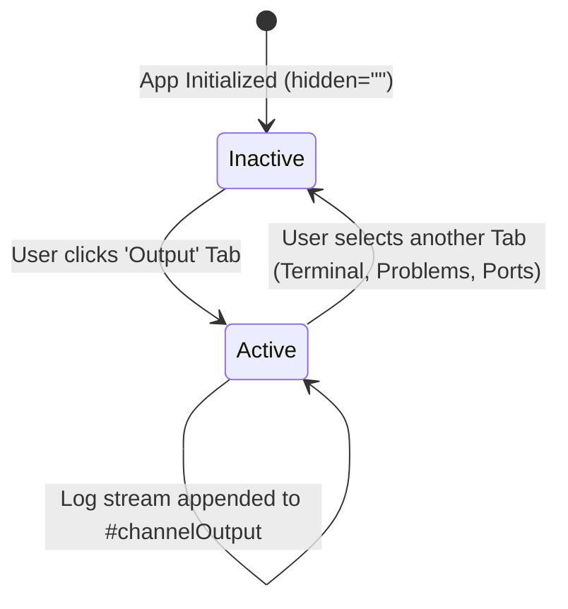

# High-Level Design (HLD): Output Panel (System & Channel Logs)

**Document ID:** `ORX-HLD-OUTPUT-PANEL-V1`  
**Version:** `1.0` (Synchronized with Implemented Vanilla JS & Bottom Drawer Architecture)  
**Target Codebase:** `DeskAI`  
**Target Files:**
* `src/deskai/static/index.html` (Lines 102, 115-117)
* `src/deskai/static/js/events.js` (`data-action="drawer-tab"`)
* `src/deskai/static/css/components.css` (Lines 356-376)
**Status:** Approved  
**Date:** October 27, 2026  

---

## 1. Architectural Overview & Objective

The **Output Panel** (`#outputPanel`) is a dedicated, read-only system log and channel telemetry viewport hosted within the Collapsible Bottom Drawer (`#bottomDrawer`) in DeskAI.

* **Current State:** Autonomous AI coding tasks, supervisor process management, background builds, and loopback IPC generate structured status messages and logs. Developers require a non-interactive, distraction-free log console distinct from the interactive shell (`#terminalPanel`).
* **Target State (Implemented):** A high-performance, monospace channel output view that:
  1. **Separates Concerns:** Isolates read-only host supervisor telemetry and channel logs from interactive user terminal input.
  2. **Seamless Navigation:** Instantly accessible via the `Output` tab in `.drawer-tabs`.
  3. **Streaming Log Viewport:** Leverages `<pre class="terminal-view" id="channelOutput">` styled with monospace typography, hardware-accelerated scrolling, and WCAG-compliant design tokens.

```text
┌─────────────────────────────────────────────────────────────────────────────┐
│ [Terminal]  [Output]  [Problems]  [Ports]                               [─] │
├─────────────────────────────────────────────────────────────────────────────┤
│ .drawer-panel #outputPanel                                                  │
│   <pre class="terminal-view" id="channelOutput">                           │
│     <code>[DeskAI System] Supervisor active on loopback. Ready for tasks.</code>│
└─────────────────────────────────────────────────────────────────────────────┘
```

---

## 2. Component Architecture & UI State Machine

The Output Panel transitions between two primary visibility states controlled by the drawer tab navigation system:



### 2.1 State Matrix

| State | CSS Modifier / Attribute | Panel Visibility | Interaction Behavior |
| :--- | :--- | :--- | :--- |
| **Inactive (Default)** | `hidden=""` | `display: none !important;` | Log buffer persists in background; no layout reflow. |
| **Active** | `.active` (hidden attribute removed) | Visible (`flex: 1; overflow: auto;`) | User can read, scroll, and copy system telemetry logs. |

---

## 3. End-to-End Interaction & Data Flow

```text
[User clicks 'Output' Tab]
            │
            ▼
[events.js: case 'drawer-tab']
  - Deselect sibling tabs (aria-selected="false")
  - Set active tab 'Output' (aria-selected="true")
  - Reveal #outputPanel (remove 'hidden')
            │
            ▼
[Telemetry & Log Stream Ingestion]
            │
  ┌─────────┴─────────┐
  ▼                   ▼
[FastAPI Supervisor] [Background Tasks]
  │                   │
  └─────────┬─────────┘
            ▼
[Append text to #channelOutput code block]
            ▼
[Auto-scroll to bottom of viewport]
```

### 3.1 Step-by-Step Execution
1. **User Action:** The user clicks `<button class="drawer-tab" data-target="output">Output</button>`.
2. **Tab Routing:** The event router in `events.js` activates the tab, hides sibling panels, and removes `hidden` from `#outputPanel`.
3. **Log Stream Presentation:** The pre-formatted `<pre>` container presents supervisor messages (e.g. `"[DeskAI System] Supervisor active on loopback. Ready for tasks."`).
4. **Buffer Append & Auto-Scroll:** New log entries append directly to the DOM with trailing-edge scroll management to keep the latest status in view.

---

## 4. Component Contracts & Data Interface

### 4.1 HTML Structure Contract
```html
<!-- Output Channel Panel -->
<div class="drawer-panel" id="outputPanel" role="tabpanel" aria-labelledby="tab-output" hidden>
  <pre class="terminal-view" id="channelOutput"><code>[DeskAI System] Supervisor active on loopback. Ready for tasks.</code></pre>
</div>
```

### 4.2 Associated Tab Header Contract
```html
<button 
  class="drawer-tab" 
  data-action="drawer-tab" 
  data-target="output" 
  role="tab" 
  aria-selected="false" 
  aria-controls="outputPanel"
  id="tab-output">
  Output
</button>
```

### 4.3 Log Channel Message Contract
```typescript
interface ChannelLogMessage {
  timestamp: string;               // ISO 8601 or HH:mm:ss timestamp
  channel: "system" | "task" | "git" | "lsp";
  level: "info" | "warn" | "error" | "debug";
  text: string;                    // Log line content
}
```

---

## 5. Security & Isolation Safeguards

1. **XSS Prevention via Text-Only Appends:** Log content rendered inside `#channelOutput` must strictly use `textContent` or text node insertion to neutralize any malicious HTML or script tags within build outputs or error traces.
2. **Read-Only Enclosure:** The `<pre>` block is strictly non-editable, preventing accidental user tampering with system telemetry.
3. **Memory Buffering Bounds:** Output buffers enforce line limits (e.g. max 5,000 lines) to prevent DOM memory bloat during prolonged execution.

---

## 6. Accessibility (WCAG 2.1 AA) Compliance

1. **Semantic Role Binding:**
   * Container uses `role="tabpanel"` linked to `#tab-output` via `aria-labelledby`.
   * Tab button enforces `role="tab"`, `aria-selected`, and `aria-controls="outputPanel"`.
2. **Color Contrast:**
   * Text color `var(--text-secondary)` (`#cbd5e1` / `#c9d1d9`) against `var(--bg-header)` (`#16171a`) satisfies $\ge 7:1$ contrast ratio.
3. **Keyboard Navigation & Copying:**
   * Content inside `<pre>` is selectable and focusable, allowing keyboard users to highlight and copy logs using standard `Ctrl+C` / `Cmd+C`.
