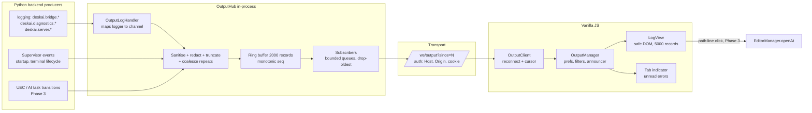
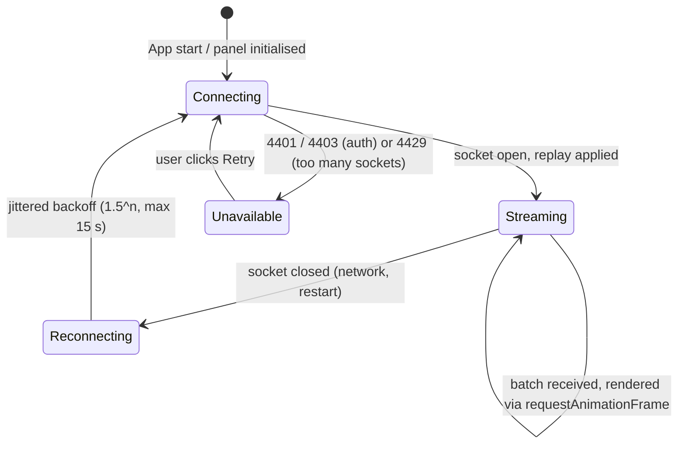
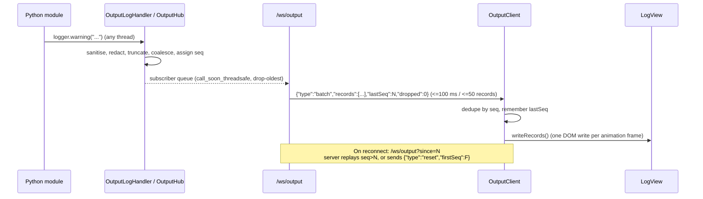

# High-Level Design (HLD): Output Panel (System & Channel Logs)

**Document ID:** `ORX-HLD-OUTPUT-PANEL-V2`  
**Version:** `2.0` (supersedes `ORX-HLD-OUTPUT-PANEL-V1`, which described a static, never-updated log line)  
**Target Codebase:** `DeskAI` (verified against `main` @ `5cc5434`)  
**Status:** Proposed (ready for implementation)  
**Date:** October 30, 2026  

**Target Files (to create / modify):**
* `src/deskai/server/output_hub.py` (NEW: `OutputHub`, `OutputLogHandler`, redaction)
* `src/deskai/server/supervisor.py` (add `/ws/output`, extract shared WebSocket authorisation helper, start/stop hub)
* `src/deskai/static/js/output/` (NEW: `client.js`, `view.js`, `index.js`)
* `src/deskai/static/js/terminal.js` (`LogView` extended, kept backward compatible)
* `src/deskai/static/js/app.js`, `events.js`, `src/deskai/static/index.html`, `css/components.css`, `css/tokens.css`

---

## 1. Objective & Scope

The Output Panel (`#outputPanel`) is the read-only **log console** of DeskAI. It shows what the application itself is doing (supervisor, bridge, git, ports, diagnostics, terminal lifecycle, AI task execution) so a developer can understand failures without opening a debugger or the host terminal.

### 1.1 Verified baseline (what exists today)

| Area | Current state in `main` | Consequence |
| :--- | :--- | :--- |
| Markup | `#outputPanel > pre#channelOutput.terminal-view > code` holding one static line (`[DeskAI System] Supervisor active on loopback. Ready for tasks.`) | The panel never changes |
| `LogView` (`js/terminal.js`) | Batched writes via `requestAnimationFrame`, ANSI stripped, `textContent` only, 10,000-line cap, pinned auto-scroll, `clear()`. Instantiated in `app.js` as `window.DeskAILogView` | Good foundation, keep and extend |
| Writers | **Nothing calls `DeskAILogView.write()`** outside tests | No log pipeline exists |
| Backend | Every module already uses `logging.getLogger(__name__)` (`deskai.bridge.*`, `deskai.diagnostics.*`) but nothing captures it | A single `logging.Handler` can feed the panel |
| Transport | `/ws` is request/response only (UEC state machine, per-connection `seq`, gap detection in `ws.js`); the server never pushes. `/ws/terminal/{id}` is a separate, per-session endpoint | A dedicated `/ws/output` endpoint is cleaner than overloading `/ws` |
| Styles | `.log-error`, `.log-warn`, `.log-info`, `.log-debug` are referenced by `LogView` but **no CSS defines them** | Severity styling is missing |
| Docs drift | V1 states a 5,000-line cap; code uses 10,000 | Reconciled in this document (section 7) |
| Tokens | `--color-danger`, `--color-warning`, `--color-info` (added by the Problems work), `--text-muted`, `--font-mono` | No new colours needed beyond what Problems introduced |
| Toolbar | The drawer header actions (new terminal, kill, maximize, toggle) are global; Output has no controls (no clear, copy, filter) | Add a panel-local toolbar (same pattern as Problems and Ports) |
| ARIA | `#channelOutput` is a plain `<pre>`; the terminal host already uses `role="log" aria-live="off"` | Align Output with the same pattern |

### 1.2 Goals
1. A real, live, bounded log stream from the Python backend to the panel, with replay on reconnect and no duplicates.
2. Useful controls: channel and level filters, text filter, clear, copy, wrap, timestamps, follow-latest.
3. Never leak secrets (launch token, session cookie, API keys) into logs shown in the UI.
4. Fully keyboard and screen-reader usable (WCAG 2.1 AA / WAI-ARIA 1.2) in dark and light themes; no layout shift.
5. Respect project rules: vanilla ES modules, custom store, tokens only, **no `innerHTML`**, loopback-only authenticated transport.

### 1.3 Non-goals (v2)
* Interactive input (the terminal is the interactive surface).
* Writing logs to disk or shipping them anywhere (privacy; in-memory only).
* Rendering ANSI colours (escape sequences are stripped; level colours come from tokens).
* Log search across sessions or history after app restart.

---

## 2. Architecture



**Design decisions**

| # | Decision | Rationale |
| :--- | :--- | :--- |
| D1 | Capture via **one `logging.Handler`** on the `deskai` logger namespace | Every module already logs through `logging`; no call-site changes needed |
| D2 | Dedicated **`/ws/output`** endpoint, not `/ws` | `/ws` carries the UEC state machine with a rate limiter and a strict per-connection `seq`; mixing a high-volume push stream would risk its gap detection. The terminal already sets the precedent for a dedicated socket |
| D3 | Server ring buffer with **monotonic `seq` cursor** | Reconnects send `?since=<lastSeq>`; the server replays exactly the missing records or says `reset` if they were evicted |
| D4 | Backpressure by **drop-oldest + `dropped` counter** | A slow or hidden page must never block backend threads or grow memory |
| D5 | **Coalesce identical consecutive records** (a summary record `Previous message repeated N more times` replaces the suppressed copies) | Protects the DOM from log storms |
| D6 | Keep the **`LogView` public API** (`write`, `clear`, `lineCount`, `pinned`) | Existing tests and any external callers keep working |
| D7 | Replace `<pre>` with a `div role="log"` that holds one element per record | Needed for per-record filtering and level styling; `#channelOutput` id is preserved |
| D8 | Panel-local toolbar | The drawer header toolbar is global to all panels |

---

## 3. UI Design

```text
┌────────────────────────────────────────────────────────────────────────────────────────┐
│ [Terminal] [Output •2] [Problems] [Ports]                                          [─] │
├────────────────────────────────────────────────────────────────────────────────────────┤
│ Channel [All ▾]  Level [Info+ ▾]  [Filter output…        ]  [⏱] [↵ Wrap] [⧉ Copy] [🗑 Clear] │
├────────────────────────────────────────────────────────────────────────────────────────┤
│ [DeskAI System] Supervisor active on loopback. Ready for tasks.                        │
│ 10:42:01.120  system   INFO   Terminal session t1 opened                               │
│ 10:42:07.884  git      WARN   Could not read HEAD for /project (permission denied)     │
│ 10:42:09.015  diag     ERROR  Checker timeout: flake8 (10 s)                           │
│ 10:42:09.016  diag     ERROR  Previous message repeated 3 more times                    │
│                                                              [ ↓ Jump to latest ]     │
└────────────────────────────────────────────────────────────────────────────────────────┘
```

* **Controls** (toolbar icons are SVG from `createSvgIcon`, no emoji; the sketch uses glyphs only for illustration): channel select, minimum-level select, text filter, timestamps toggle, wrap toggle, copy, clear.
* **Levels are never colour-only:** warn and error lines show a visible text tag (`WARN`, `ERROR`) in addition to the token colour.
* **Banner line** (`[DeskAI System] Supervisor active on loopback. Ready for tasks.`) stays at the top, is never trimmed, and keeps TC-OUT-05 valid.
* **Follow latest:** auto-scroll while the user is within 40 px of the bottom (existing `pinned` logic). When the user scrolls up, auto-scroll stops and a `Jump to latest` button appears (absolutely positioned, no layout shift).
* **Tab indicator:** while another tab is active, new warn/error records add an unread dot or count to the Output tab (`aria-label` updated, for example `Output, 2 new errors`). Cleared when the tab is opened.

### 3.1 Client state machine



| State | Visible | Announcement |
| :--- | :--- | :--- |
| Connecting / Reconnecting | Inline status note (`Reconnecting…`), existing lines stay | none (avoid noise) |
| Streaming | Normal | warn/error summary only (see section 7) |
| Unavailable | Notice with `Retry` button; local (client-side) logs still work | `Output stream unavailable` |

---

## 4. End-to-End Flow



---

## 5. Data Model

```typescript
type Level = "debug" | "info" | "warn" | "error";
type Channel = "system" | "task" | "git" | "ports" | "terminal" | "diagnostics";

interface LogRecord {
  seq: number;          // monotonic, server assigned, starts at 1
  ts: number;           // epoch milliseconds (server clock)
  channel: Channel;
  level: Level;
  text: string;         // sanitised, redacted, max 4096 chars, may contain \n (tracebacks)
}

// Server -> client frames on /ws/output (JSON text)
type OutputFrame =
  | { type: "batch"; records: LogRecord[]; lastSeq: number; dropped: number }
  | { type: "reset"; firstSeq: number; lastSeq: number }       // requested cursor was evicted
  | { type: "hello"; firstSeq: number; lastSeq: number; ringSize: number };
```

The client never sends data frames. Any inbound text over 1 KB closes the socket with code 1009.

---

## 6. Security Requirements (non-negotiable)

| ID | Requirement |
| :--- | :--- |
| S1 | `/ws/output` applies the **same checks as `/ws`** in the same order: Host header, strict Origin (`http://127.0.0.1:<port>`), valid `deskai_session` cookie, then a per-session cap (at most 2 output sockets). Close codes 4403 / 4401 / 4429. The three duplicated inline checks in `supervisor.py` are extracted to one `_authorize_ws(ws)` helper so they cannot drift. |
| S2 | **Redaction before storage**: launch token, session id, `deskai_session=` cookie values, `Authorization:` / `Cookie:` header values, `token=`/`key=`/`secret=`/`password=` query or assignment values, common API key shapes (`sk-...`, `ghp_...`, `AKIA...`, JWT-looking `xxx.yyy.zzz`). Replaced by `[REDACTED]`. The hub also redacts the exact runtime secrets it is told about (`register_secret(value)` for the launch token and each session id). |
| S3 | **Sanitise**: strip ANSI and control characters (keep `\n` and `\t`), cap 4096 chars per record and 40 lines per record (append `… [truncated]`). Messages are rendered with `textContent` only. |
| S4 | **No log injection**: records carry structured fields, so a message containing fake `[ERROR]` text cannot forge a level or channel. The view renders level and channel from the fields, never by parsing text. |
| S5 | **No input surface**: the endpoint ignores inbound data; oversize inbound frames are rejected. |
| S6 | **Bounded memory and CPU**: ring 2000 records; per-subscriber queue 1000 (drop-oldest); coalescing; handler never blocks (non-blocking emit, re-entrancy guard so the hub cannot log about itself recursively). |
| S7 | **Loopback only**: no external transport, no disk persistence. |
| S8 | Clickable `path:line:col` links (Phase 3) are rendered as buttons, never anchors, and resolved through the bridge sandbox (`_is_safe_path`) at click time. |

---

## 7. Accessibility (WCAG 2.1 AA / WAI-ARIA 1.2)

1. **Log region:** `#channelOutput` becomes `role="log"`, `aria-label="Output log"`, `aria-live="off"` (same pattern as the terminal host), `tabindex="0"` so keyboard users can scroll and select. Streaming text is **not** announced line by line.
2. **Summary announcements:** a debounced (1 s) message through the existing `announce()` helper, only for warn/error records that arrive while the Output tab is active, for example `2 new errors, 1 warning in Output`. Clear action announces `Output cleared`.
3. **Toolbar:** `role="toolbar"`, every control labelled (`<label>`/`aria-label`), toggles use `aria-pressed`, selects are native `<select>`.
4. **Keyboard:** `Tab` reaches toolbar then log; inside the log `PageUp/PageDown/Home/End` scroll, `End` re-enables follow-latest, `Ctrl+A` selects only the log contents (not the whole page), `Ctrl+C` copies the selection, `Esc` returns focus to the `Output` tab.
5. **Not colour-only:** `WARN` and `ERROR` text tags, in addition to token colours.
6. **Contrast:** level colours reuse `--color-danger`, `--color-warning`, `--color-info`, `--text-muted`; each pair is added to `tools/check_contrast.py` against the log background in both themes (4.5:1).
7. **Targets, size, motion:** toolbar controls at least 28 px, text at least 12 px, no smooth-scroll animation under `prefers-reduced-motion`.
8. **Focus:** `:focus-visible` ring with `--border-focus`; `Jump to latest` is a real button reachable by keyboard.

---

## 8. Performance & Resilience

* Server: batching window 100 ms or 50 records (whichever comes first); handler cost is O(1) (deque append plus queue put).
* Client: one DOM write per animation frame; DOM bounded to **5,000 records** in record mode (the legacy raw `write()` path keeps its 10,000-line cap); older nodes removed from the top; `content-visibility: auto` on lines.
* Filtering re-renders from the in-memory record array (max 5,000), never from DOM text.
* Hidden-tab behaviour: records keep arriving and are stored, but rendering is deferred until the panel is visible (re-render once on show) to avoid wasted work.
* Reconnect uses the same jittered exponential backoff as `ws.js`; resume by cursor means **no duplicates and no silent gaps** (a gap is shown as an explicit notice line, `N earlier lines were discarded`).
* Failure isolation: if the hub or socket fails, the app keeps working; the panel shows `Unavailable` with `Retry`.

---

## 9. Phased Delivery

| Phase | Scope | Exit criteria |
| :--- | :--- | :--- |
| **P1** | `OutputHub` + handler + redaction + `/ws/output` + auth helper refactor; `OutputClient`; `LogView` record mode; toolbar (channel, level, filter, clear, copy, wrap, timestamps); follow-latest + Jump button; severity CSS; a11y; tests | All TC-OUT tests green on Ubuntu and Windows x Python 3.11/3.12; contrast tool passes |
| **P2** | Unread indicator on the tab, per-channel counts, `Save log…` (save dialog + `writeFile`), persisted preferences (try/catch `localStorage`) | Prefs survive reload; save produces the visible lines |
| **P3** | UEC / AI task channel records, terminal lifecycle records, clickable `path:line:col` (via `EditorManager.openAt`), optional debug-level toggle in settings | Security test for S8 passes |

---

## 10. Risks & Open Questions

| Risk | Mitigation |
| :--- | :--- |
| Secret leakage through third-party log messages | Redaction at ingestion plus exact-secret registration; tests with realistic payloads (TC-OUT-22) |
| Log storm freezing the UI | Coalescing, batching, drop-oldest, DOM cap |
| `/ws/output` socket blocked or capped | Explicit `Unavailable` state with Retry; local client logs still shown |
| Merge conflicts with in-flight Problems work (shared `index.html`, `components.css`, `tokens.css`, `events.js`, `app.js`, `bridge.js`) | Implement on a separate branch from latest `main` and rebase after the Problems branch lands |
| Python `logging` records from other threads while the loop is closing | Handler swallows errors and checks `loop.is_closed()` |

**Open questions for the product owner:** (1) Should debug-level records be hidden by default (proposed: yes, level filter defaults to `Info+`)? (2) Should the log survive a window reload within the same app run (proposed: yes, via the server ring and the cursor)? (3) Which task events belong in the `task` channel in P3?

---

## 11. Traceability

Existing tests **TC-OUT-01 to TC-OUT-07** and `test_log_view_line_cap_and_scroll_preservation` / ANSI-strip tests in `tests/test_bottom_drawer_behavior.py` must keep passing. New tests are specified in `ORX-LLD-OUTPUT-PANEL-V2` section 10 (**TC-OUT-08 onward**).
