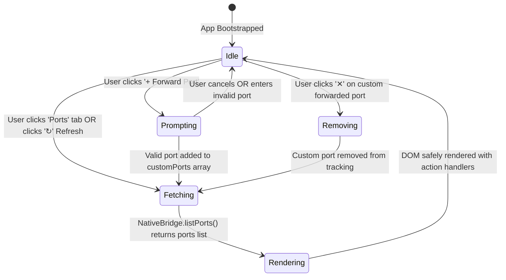

# High-Level Design (HLD): Ports Panel & Listening Ports Monitor

**Document ID:** `ORX-HLD-PORTS-PANEL-V1`  
**Version:** `1.0` (Synchronized with Implemented Vanilla JS & FastAPI Supervisor Codebase)  
**Target Codebase:** `DeskAI`  
**Target Files:**
* `src/deskai/static/index.html` (Lines 126-160)
* `src/deskai/static/js/ports.js`
* `src/deskai/static/js/bridge.js`
* `src/deskai/static/css/components.css` (Lines 389-550)
* `src/deskai/bridge/api.py` (`get_listening_ports`)
**Status:** Approved  
**Date:** October 27, 2026  

---

## 1. Architectural Overview & Objective

Modern local software development and agentic coding workflows frequently spawn external local servers, background dev processes (e.g. Vite on 5173, Next.js on 3000, FastAPI on 8000), language servers, and loopback socket listeners. Developers need visibility into what ports are currently listening, which processes own them, and immediate access to launch them in their default browser or copy their address.

* **Current State:** Previously, users running dev servers inside DeskAI or via the terminal had no integrated way to see active listening sockets without manually running terminal commands (`lsof -i`, `ss -tulpn`, `netstat`).
* **Target State (Implemented):** An integrated **Ports Panel** (`#portsPanel`) hosted within the Collapsible Bottom Drawer (`#bottomDrawer`) providing:
  1. **Real-Time Port Discovery:** Automatic backend enumeration of all active listening sockets across loopback (`127.0.0.1`, `::1`) and host interfaces (`0.0.0.0`, `::`) using `psutil`.
  2. **Supervisor Guarantee:** Unconditional inclusion of the host DeskAI Supervisor port (`8000` / ephemeral).
  3. **Manual Port Forwarding / Tracking:** Ability to manually track/forward specific ports (`+ Forward Port`) with input range validation (`1-65535`).
  4. **One-Click Native Interaction:** Actions to launch the URL directly into the host OS browser (`DesktopBridgeAPI.open_external_url`) and copy the loopback address to the clipboard (`navigator.clipboard`).

```text
┌─────────────────────────────────────────────────────────────────────────────┐
│ FORWARDED & LOCAL PORTS   [7 active]                 [+ Forward Port]  [↻]  │
├───────┬──────────┬────────────────────────┬───────────────────┬─────────────┤
│ Port  │ Protocol │ Local Address          │ Process / Service │ Actions     │
├───────┼──────────┼────────────────────────┼───────────────────┼─────────────┤
│ 34975 │ HTTP     │ http://localhost:34975 │ language_server   │ [🌐] [📋]   │
│ 35635 │ HTTP     │ http://127.0.0.1:35635 │ DeskAI Supervisor │ [🌐] [📋]   │
│ 3000  │ HTTP     │ http://localhost:3000  │ User Forwarded    │ [🌐][📋][✕] │
└───────┴──────────┴────────────────────────┴───────────────────┴─────────────┘
```

---

## 2. Component Architecture & UI State Machine

The Ports Panel operates within the **Collapsible Bottom Drawer** and integrates with the PyWebView/FastAPI bridge architecture:



### 2.1 State & Data Models

| State Mode | Data Source | Persistence | User Actions Available |
| :--- | :--- | :--- | :--- |
| **System Detected** | OS TCP table via `psutil.net_connections(kind="inet")` | Dynamic per scan | Open in Browser (`🌐`), Copy Address (`📋`) |
| **Supervisor Origin** | `self._manager.server.port` | Session lifetime | Open in Browser (`🌐`), Copy Address (`📋`) |
| **User Forwarded** | In-memory `this.customPorts` | Session lifetime | Open in Browser (`🌐`), Copy Address (`📋`), Stop Monitoring (`✕`) |

---

## 3. End-to-End Interaction & Data Flow

```text
[User selects Ports tab or clicks ↻]
               │
               ▼
[PortsManager.refresh() ──► NativeBridge.listPorts()]
                                     │
                                     ▼
                    [window.pywebview.api.get_listening_ports()]
                                     │
                    ┌────────────────┴────────────────┐
                    ▼                                 ▼
           [Origin Guard Check]           [Enumerate Listening Sockets]
           (current_url check)              - Add DeskAI Supervisor port
                    │                       - Scan psutil.net_connections
                    ▼                       - Resolve PID to process name
          [Return JSON Response] ◄────────────────────┘
                    │
                    ▼
[Merge Detected Ports with customPorts]
                    │
                    ▼
[Sort by port ascending & update #portsCountBadge]
                    │
                    ▼
[DOM-Safe Table Rendering (No innerHTML injection)]
```

### 3.1 Step-by-Step Flow
1. **Trigger:** User clicks the `Ports` tab in `#bottomDrawer` or clicks the `↻` refresh button.
2. **IPC Dispatch:** `NativeBridge.listPorts()` calls `window.pywebview.api.get_listening_ports()` over the secure loopback bridge.
3. **Origin & Security Validation:** `DesktopBridgeAPI._is_origin_allowed()` confirms the requesting origin matches `http://127.0.0.1:<port>` to prevent DNS rebinding or malicious origin access.
4. **Socket Scanning & Enrichment:**
   * Supervisor port is injected with origin `"System"`.
   * `psutil.net_connections(kind="inet")` discovers active `LISTEN` sockets on ports $\ge 1024$.
   * PIDs are mapped to friendly process names (e.g. `node`, `python`, `language_server`).
5. **Client-Side Deduplication & Merge:** `PortsManager.refresh()` merges detected sockets with user-forwarded entries, deduplicating by port number.
6. **DOM-Safe Display:** `PortsManager.render()` constructs table elements via native DOM methods (`createElement`, `textContent`) preventing XSS.

---

## 4. API & Backend Bridge Contract

### 4.1 Bridge API Endpoint: `get_listening_ports()`
* **Security Guard:** Origin validation required. Returns `{"status": "error", "message": "Unauthorized origin", "ports": []}` on violation.
* **Success Payload Schema:**
  ```json
  {
    "status": "ok",
    "ports": [
      {
        "port": 35635,
        "protocol": "HTTP",
        "address": "http://127.0.0.1:35635",
        "process": "DeskAI Supervisor",
        "status": "Listening",
        "origin": "System"
      },
      {
        "port": 3000,
        "protocol": "HTTP",
        "address": "http://localhost:3000",
        "process": "node",
        "status": "Listening",
        "origin": "Local"
      }
    ]
  }
  ```

---

## 5. Security & Isolation Safeguards

1. **Origin Hardening:** The bridge API rejects requests if the PyWebView window URL does not start with `http://127.0.0.1:<port>`.
2. **Privileged Port Exclusion:** System scans restrict discovery to unprivileged ports ($\ge 1024$), omitting sensitive root ports ($< 1024$).
3. **XSS Neutralization:** All dynamic process names and port addresses are written via `element.textContent`, never `innerHTML`.
4. **URL Validation for External Dispatch:** `openExternalUrl(url)` strictly allows only `http://`, `https://`, and `mailto:` protocols; `javascript:` and `file:` schemes are rejected.

---

## 6. Accessibility (WCAG 2.1 AA) Compliance

1. **Semantic Table Hierarchy:** The view uses a valid `<table>` structure with `<th scope="col">` headers for screen reader row/column association.
2. **Live Counter Updates:** `#portsCountBadge` informs screen readers of the active count (e.g. `"7 active"`).
3. **Contrast Compliance:**
   * Port badges (`var(--color-primary)`): $\ge 4.5:1$ contrast against surface background.
   * Status indicators (`var(--color-success)`): $\ge 4.5:1$ contrast with dual encoding (green color + text "Listening" / "Monitored").
