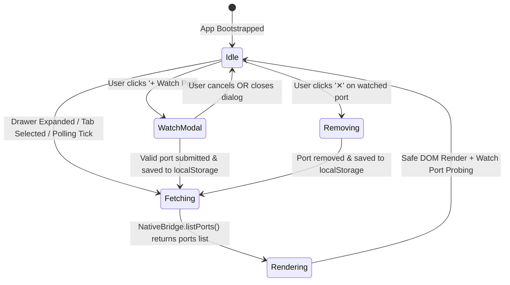

# High-Level Design (HLD): Ports Panel & Listening Ports Monitor

**Document ID:** `ORX-HLD-PORTS-PANEL-V1`  
**Version:** `1.1` (Synchronized with Implemented Vanilla JS & FastAPI Supervisor Codebase)  
**Target Codebase:** `DeskAI`  
**Target Files:**
* `src/deskai/static/index.html`
* `src/deskai/static/js/ports.js`
* `src/deskai/static/js/bridge.js`
* `src/deskai/static/css/components.css`
* `src/deskai/bridge/api.py` (`get_listening_ports`, `open_port`, `probe_port`, `open_external_url`)
**Status:** Approved  
**Date:** October 27, 2026  

---

## 1. Architectural Overview & Objective

Modern local software development and agentic coding workflows frequently spawn external local servers, background dev processes (e.g. Vite on 5173, Next.js on 3000, FastAPI on 8000), language servers, and loopback socket listeners. Developers need visibility into what ports are currently listening, which processes and PIDs own them, whether they are exposed to the local network or loopback only, and immediate access to launch them in their default browser or copy their address.

* **Current State:** Previously, users running dev servers inside DeskAI or via the terminal had no integrated way to see active listening sockets without manually running terminal commands (`lsof -i`, `ss -tulpn`, `netstat`).
* **Target State (Implemented):** An integrated **Ports Panel** (`#portsPanel`) hosted within the Collapsible Bottom Drawer (`#bottomDrawer`) providing:
  1. **On-Demand & Visible-Only Polling Port Discovery:** Automatic backend enumeration of all active listening sockets across loopback (`127.0.0.1`, `[::1]`) and host interfaces (`0.0.0.0`, `::`) using `psutil`. Active polling (3s) executes strictly when the drawer is expanded and the window is visible (`document.visibilityState === "visible"`).
  2. **Supervisor Guarantee & Cookie Isolation:** Unconditional inclusion of the host DeskAI Supervisor port with `openable: false` (since the supervisor requires an HttpOnly session cookie that external browsers do not possess).
  3. **Watched Port Tracking:** Ability to manually watch specific ports (`+ Watch Port`) with accessible `<dialog id="watchPortModal">` dialog, regex validation (`/^\d{1,5}$/`), range check (`1-65535`), and persistence in `localStorage`.
  4. **Active Reachability Probing:** Watched ports are asynchronously checked via `probe_port(port, host)` with 150ms socket connect probing, displaying `"Listening"` when reachable and `"Not responding"` when inactive.
  5. **Network Exposure & Noise Filtering:** System scans apply a port $\ge 1024$ noise reduction filter (omitting OS-reserved ports) and badge all-interface listeners (`0.0.0.0` or `::`) with a `"Network-exposed"` indicator.
  6. **Hardened One-Click Native Interaction:** Actions to launch validated local endpoints via `open_port(port, host)` (or hardened `open_external_url`), and copy addresses to clipboard with instantaneous inline vector checkmark (`✓`) feedback on both clean text Open and Copy buttons (auto-reverting in an ultra-fast 0.1s / 100ms, eliminating distracting corner toasts).

```text
┌────────────────────────────────────────────────────────────────────────────────────────┐
│ FORWARDED & LOCAL PORTS   [3 active]  [Filter: ...]  [✓ Show transient]  [+ Watch Port] [↻]│
├───────┬──────────┬────────────────────────┬───────────────────┬──────┬─────────┬───────────┤
│ Port  │ Protocol │ Local Address          │ Process / Service │ PID  │ Status  │ Actions   │
├───────┼──────────┼────────────────────────┼───────────────────┼──────┼─────────┼───────────┤
│ 3000  │ TCP      │ http://127.0.0.1:3000  │ node              │ 4120 │Listening│[Open][Copy]│
│ 8000  │ HTTP     │ http://127.0.0.1:8000  │ DeskAI Supervisor │ 3810 │Listening│[Open][Copy]│
│ 5173  │ TCP      │ http://127.0.0.1:5173  │ Watched           │ --   │Listening│[Open][Copy][✕]│
└───────┴──────────┴────────────────────────┴───────────────────┴──────┴─────────┴───────────┘
```

---

## 2. Component Architecture & UI State Machine

The Ports Panel operates within the **Collapsible Bottom Drawer** and integrates with the PyWebView/FastAPI bridge architecture:



### 2.1 State & Data Models

| State Mode | Data Source | Persistence | User Actions Available |
| :--- | :--- | :--- | :--- |
| **System Detected** | OS TCP table via `psutil.net_connections(kind="inet")` | Dynamic per scan | Open in Browser (`open_port`), Copy Address |
| **Supervisor Origin** | `self._manager.server.port` | Session lifetime | Copy Address, Open disabled (requires session auth) |
| **User Watched** | `localStorage` (`deskai_watched_ports_<workspace>`) | Persistent | Open, Copy, Stop Watching (`✕`), Background Probing |

---

## 3. End-to-End Interaction & Data Flow

```text
[User selects Ports tab, expands drawer, or 3s polling timer fires]
                               │
                               ▼
        [PortsManager.refresh() ──► NativeBridge.listPorts()]
                                       │
                                       ▼
                     [DesktopBridgeAPI.get_listening_ports()]
                                       │
                     ┌─────────────────┴─────────────────┐
                     ▼                                   ▼
            [Origin Guard Check]             [Enumerate Listening Sockets]
            (127.0.0.1:<port> match)          - Inject DeskAI Supervisor port (openable: false)
                     │                        - Scan psutil.net_connections(kind="inet")
                     ▼                        - Unwrap ::ffff:x, map 0.0.0.0/[::] exposure
           [Return JSON Response]             - Cache PIDs & process names
           (ports, status, warnings) ◄────────┘
                     │
                     ▼
[Merge Detected Ports with custom Watched Ports]
                     │
                     ▼
[Filter text/transient, sort column, skip re-render if signature identical]
                     │
                     ▼
[DOM-Safe Table Rendering (No innerHTML, restore focus, live region announcer)]
                     │
                     ▼
[Asynchronous Port Probing via NativeBridge.probePort for watched entries]
```

---

## 4. API & Backend Bridge Contract

### 4.1 Bridge API Method: `get_listening_ports()`
* **Security Guard:** Strict loopback origin check (`_is_origin_allowed`). Returns `{"status": "error", "message": "Unauthorized origin", "ports": []}` on violation.
* **Error Resilience:** Never raises bare exceptions. Appends `"psutil_missing"` or `"socket_table_denied"` to `warnings` list; returns `status: "ok"` with supervisor row.
* **Success Payload Schema:**
  ```json
  {
    "status": "ok",
    "ports": [
      {
        "port": 8000,
        "host": "127.0.0.1",
        "protocol": "HTTP",
        "address": "http://127.0.0.1:8000",
        "process": "DeskAI Supervisor",
        "pid": 3810,
        "status": "Listening",
        "origin": "System",
        "exposure": "loopback",
        "openable": false
      },
      {
        "port": 3000,
        "host": "127.0.0.1",
        "protocol": "TCP",
        "address": "http://127.0.0.1:3000",
        "process": "node",
        "pid": 4120,
        "status": "Listening",
        "origin": "Local",
        "exposure": "loopback",
        "openable": true
      }
    ],
    "warnings": []
  }
  ```

### 4.2 Bridge API Method: `open_port(port: int, host: str = "127.0.0.1") -> bool`
* **Parameters:** `port` strictly verified as non-bool integer `1..65535`; `host` restricted to `{"127.0.0.1", "[::1]"}`.
* **Security:** Refuses supervisor port (returns `False`); only validated integers and enum host values cross bridge into `webbrowser.open()`.

### 4.3 Bridge API Method: `probe_port(port: int, host: str = "127.0.0.1") -> bool`
* Performs 150ms timeout non-blocking loopback TCP socket connection probe to verify listener presence.

### 4.4 Bridge API Method: `open_external_url(url: str) -> bool`
* Hardened URL validator: maximum 2048 chars, no control characters, rejects userinfo (`user:pass@`), schemes restricted to `http`, `https`, `mailto`. Returns `bool`.

---

## 5. Security & Isolation Safeguards

1. **Origin Hardening:** The bridge API rejects requests if the PyWebView window URL does not start with `http://127.0.0.1:<port>`. Subdomains and other ports rejected.
2. **Noise Reduction Filtering:** System scans filter sockets $< 1024$ to eliminate low-level OS daemon noise, and non-loopback LAN IPs to prevent scanning external hosts.
3. **Session Cookie Isolation:** DeskAI Supervisor row is flagged `openable: false` with explanatory tooltip, preventing 401 Unauthorized errors in external browsers.
4. **XSS Neutralization:** Zero `innerHTML` usage. All rows, badges, and attributes built via `createElement` and `textContent`.
5. **No Window.Open Escape Hatch:** External URL opening delegates strictly to the bridge's validated `open_port` / `open_external_url`.

---

## 6. Accessibility (WCAG 2.1 AA) Compliance

1. **Semantic Table Hierarchy:** Semantic `<table>` structure with `<th scope="col" data-sort="..." aria-sort="...">` headers.
2. **Live Counter & Announcer:** `#screenReaderAnnouncer` (polite live region) announces active port count changes.
3. **Contrast Compliance:** Badges use `letter-spacing: 0.3px`, `font-weight: 500`, exceeding 4.5:1 text contrast.
4. **Accessible Action Names:** All action buttons have descriptive `aria-label`s (e.g. `"Open port 3000 on 127.0.0.1"`, `"Stop watching port 5173 on 127.0.0.1"`).
5. **Accessible Modal:** `<dialog id="watchPortModal">` provides native accessible dialog semantics, label associations, and polite error messaging.

---

## 7. Future Work (Out of Scope for Layer 1)

* **Process Termination / Kill Port:** Allowing users or agents to send SIGTERM/SIGKILL to rogue port holders.
* **Automatic Framework Detection:** Heuristic inspection of process command line to detect Next.js, Vite, Flask, etc.
* **HTTP Probing & Title Discovery:** Sending HTTP HEAD/GET requests to listening sockets to display page titles.
