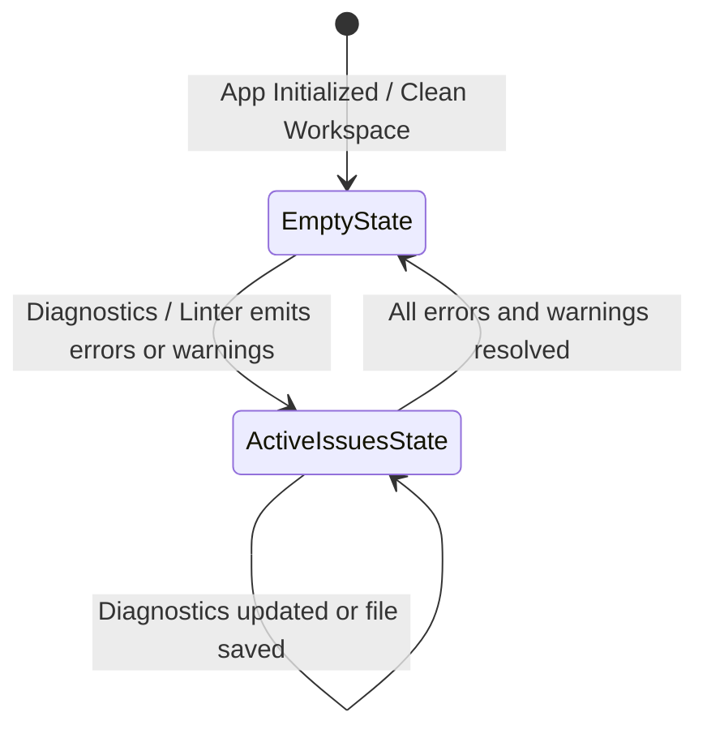

# High-Level Design (HLD): Problems Panel (Workspace Diagnostics)

**Document ID:** `ORX-HLD-PROBLEMS-PANEL-V1`  
**Version:** `1.0` (Synchronized with Implemented Vanilla JS & Bottom Drawer Architecture)  
**Target Codebase:** `DeskAI`  
**Target Files:**
* `src/deskai/static/index.html` (Lines 103, 120-124)
* `src/deskai/static/js/events.js` (`data-action="drawer-tab"`)
* `src/deskai/static/css/components.css` (Lines 378-386)
**Status:** Approved  
**Date:** October 27, 2026  

---

## 1. Architectural Overview & Objective

The **Problems Panel** (`#problemsPanel`) is an integrated diagnostic and linting view hosted within the Collapsible Bottom Drawer (`#bottomDrawer`) in the DeskAI IDE shell.

* **Current State:** Developers and autonomous AI coding agents continuously edit files, run linters, and generate code. An accessible, centralized surface is required to display syntax errors, linting warnings, and language server diagnostics without disrupting the main editor canvas.
* **Target State (Implemented):** A dedicated diagnostic panel that:
  1. **Integrates with Drawer Navigation:** Seamlessly selectable via the `Problems` tab in `.drawer-tabs`.
  2. **Zero-State Ergonomics:** Displays a clear, accessible placeholder when no workspace errors exist (`"No problems have been detected in the workspace."`).
  3. **Extensible Diagnostics Surface:** Provides the standardized DOM and CSS container ready to render categorized issue lists (Errors, Warnings, Infos) from workspace linters and language servers.

```text
┌─────────────────────────────────────────────────────────────────────────────┐
│ [Terminal]  [Output]  [Problems]  [Ports]                               [─] │
├─────────────────────────────────────────────────────────────────────────────┤
│ .drawer-panel #problemsPanel                                                │
│   .problems-view                                                            │
│     .problems-empty: "No problems have been detected in the workspace."     │
└─────────────────────────────────────────────────────────────────────────────┘
```

---

## 2. Component Architecture & UI State Machine

The Problems Panel transitions between two primary presentation states: **Empty State** (Clean Workspace) and **Active Issues State** (Linting / Syntax Issues Reported).



### 2.1 State Matrix

| State | Container Class | Visual Display | Interaction Behavior |
| :--- | :--- | :--- | :--- |
| **Empty State (Default)** | `.problems-view` | `.problems-empty` text message | Informs developer of 0 errors; clean working state. |
| **Active Issues State** | `.problems-view` | Grouped file trees with Error / Warning counts | Clicking an issue navigates editor cursor to specific line/col. |

---

## 3. End-to-End Interaction & Data Flow

```text
[User clicks 'Problems' Tab]
            │
            ▼
[events.js: case 'drawer-tab']
  - Deactivate other tabs
  - Activate 'Problems' tab (aria-selected="true")
  - Reveal #problemsPanel (remove 'hidden')
            │
            ▼
[Diagnostics Event Listener (LSP / Linter / Bridge)]
            │
            ├─ Zero Issues ──► Render .problems-empty ("No problems detected")
            └─ Issues Exist ─► Render Structured Problem List with Severity Icons
```

### 3.1 Step-by-Step Execution
1. **Navigation:** User clicks the `<button class="drawer-tab" data-target="problems">Problems</button>` tab or uses a shortcut.
2. **Visibility Synchronization:** Event delegation in `events.js` removes `hidden` from `#problemsPanel` and marks all other panels (`#terminalPanel`, `#outputPanel`, `#portsPanel`) with `hidden`.
3. **Empty State Display:** By default, `.problems-empty` communicates that no errors exist in the active workspace.
4. **Diagnostic Injection (Extensibility):** When language tools report diagnostics, issue items are rendered into `.problems-view` with severity pills and navigation links.

---

## 4. Component Contracts & Data Interface

### 4.1 HTML Structure Contract
```html
<!-- Problems Panel -->
<div class="drawer-panel" id="problemsPanel" role="tabpanel" aria-labelledby="tab-problems" hidden>
  <div class="problems-view">
    <span class="problems-empty">No problems have been detected in the workspace.</span>
  </div>
</div>
```

### 4.2 Diagnostic Item Data Schema (LSP / Linter Bridge)
```typescript
interface DiagnosticItem {
  id: string;                     // Unique issue identifier
  file: string;                   // Relative file path (e.g. "src/deskai/bridge/api.py")
  line: number;                   // 1-based line number
  column: number;                 // 1-based column number
  severity: "error" | "warning" | "info";
  message: string;                // Diagnostic explanation (e.g. "Undefined variable 'x'")
  source: string;                 // e.g. "flake8", "pylance", "typescript"
}
```

---

## 5. Accessibility (WCAG 2.1 AA) Compliance

1. **Semantic Role Binding:**
   * Container uses `role="tabpanel"` linked to `#tab-problems` via `aria-labelledby`.
   * When empty, screen readers announce the friendly status message directly.
2. **Contrast & Tokens:**
   * `.problems-empty` utilizes `var(--text-muted)` against `var(--bg-header)` with contrast ratio $\ge 4.5:1$.
   * Diagnostic severities utilize predefined semantic tokens:
     * Errors: `var(--color-error)` (`#ef4444`)
     * Warnings: `var(--color-warning)` (`#f59e0b`)
     * Info: `var(--color-primary)` (`#3b82f6`)
