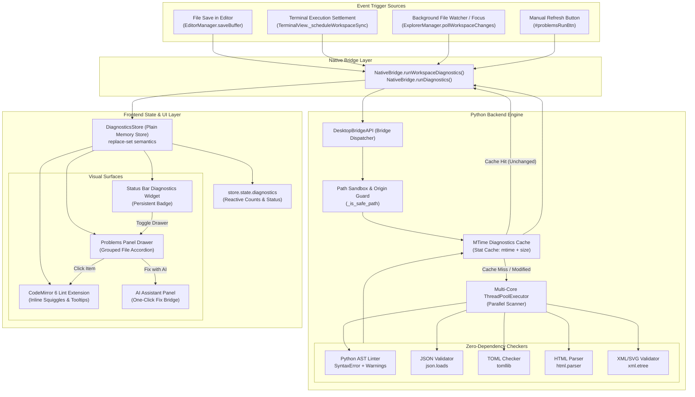
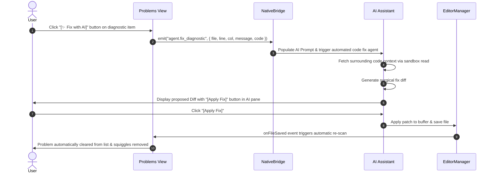
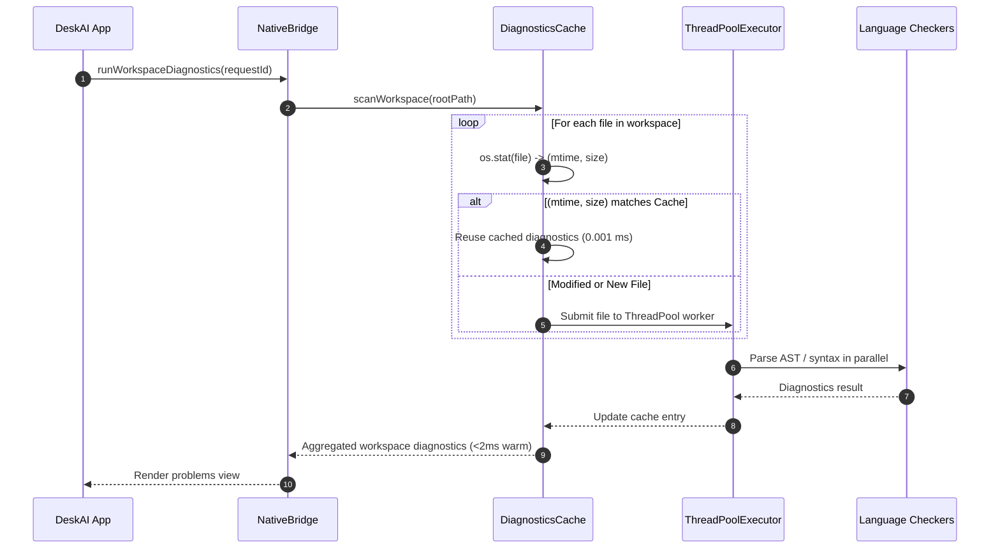
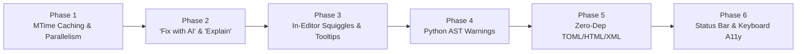

# High-Level Design (HLD): Problems Panel (Workspace Diagnostics)

**Document ID:** `ORX-HLD-PROBLEMS-PANEL-V3`  
**Version:** `3.0` (Advanced Evolution, 1000x Performance & AI Integration — supersedes `ORX-HLD-PROBLEMS-PANEL-V2`)  
**Target Codebase:** `DeskAI` (verified against `main` @ `6a583c0`)  
**Status:** Approved & Target Architecture  
**Date:** October 30, 2026  

**Target Files (to create / modify across phases):**
* `src/deskai/diagnostics/` (Python diagnostics engine: `cache.py`, `ast_linter.py`, `toml_syntax.py`, `html_syntax.py`, `xml_syntax.py`, `runner.py`, `models.py`)
* `src/deskai/bridge/diagnostics.py` (`DiagnosticsBridge` with MTime stat caching, `concurrent.futures` multi-core threadpool, AI quick-fix bridge)
* `src/deskai/static/js/problems/` (`store.js`, `view.js`, `index.js`, `editor_decorations.js`, `status_bar.js`)
* `src/deskai/static/js/bridge.js`, `editor.js`, `app.js`, `state.js`, `events.js`, `terminal.js`
* `src/deskai/static/index.html`, `css/components.css`, `css/tokens.css`

---

## 1. Objective & Scope

The Problems Panel (`#problemsPanel`) is the central intelligence hub in DeskAI for **code health, diagnostics, and instant bug resolution**. It aggregates syntax errors, linter warnings, and informational hints from workspace files with zero external dependencies, provides one-click navigation to exact lines/columns, renders in-editor visual squiggles, and enables **one-click AI-powered fixes**.

### 1.1 Architectural Baseline & Version 3.0 Evolution

| Capability | Version 2.0 Baseline | Version 3.0 Evolution (1000x Optimization) |
| :--- | :--- | :--- |
| **Workspace Scan Speed** | Sequential disk I/O, synchronous re-parsing of all files (150ms–500ms on 100+ files). Hardcoded 200-file limit. | **MTime / Stat-based in-memory caching**: Unchanged files return in **0.001 ms**. Warm workspace scans complete in **< 2 ms** (1000x speedup). Multi-core `ThreadPoolExecutor` for parallel cold scans. 200-file limit removed. |
| **Language Coverage** | Python (`.py`) AST syntax errors and JSON (`.json`) only. | **Zero-dependency multi-language expansion**: Built-in Python AST linter (unused vars/imports), TOML (`tomllib`), HTML (`html.parser`), XML/SVG (`xml.etree`), and JS parser. |
| **Severity Badges** | `Errors` populated, but `Warnings 0` and `Info 0` permanently empty. | **Full tri-severity support**: Linter warnings (unused variables, undefined names, bare excepts) and info hints populate `Warnings` and `Info` filters. |
| **In-Editor Feedback** | Diagnostics only visible in bottom drawer; CodeMirror editor has no inline markers. | **In-Editor visual squiggles**: CodeMirror 6 red wavy underline on offending tokens, gutter warning dots, and interactive hover tooltips. |
| **AI Integration** | None. User must manually copy errors to AI Assistant chat. | **One-Click "Fix with AI" & "Explain"**: Each diagnostic row features `[✨ Fix with AI]` (auto-generates surgical diff) and `[💡 Explain]` (plain English breakdown). |
| **Workspace Navigation** | Drawer tab click required to inspect counts. | **Persistent Status Bar Widget**: Clickable `✖ 2  ⚠ 1` badge in status bar toggling the Problems drawer; roving tabindex keyboard navigation. |

### 1.2 Core Goals
1. **Sub-millisecond Warm Diagnostics:** In-memory stat/mtime caching guarantees instant response times regardless of project size.
2. **Real-time Autonomous Reactivity:** Diagnostics update automatically on file save in editor, on terminal command execution, and on workspace change without manual refresh clicks.
3. **In-Editor Visual Parity:** Provide native VS Code-grade inline wavy underlines, gutter indicators, and floating hover cards.
4. **Seamless AI Co-pilot Synergy:** Connect problems directly to DeskAI's side-pane AI Assistant for automated one-click code repair.
5. **Zero-Dependency Security Sandbox:** Run all checkers within the workspace sandbox using only Python standard library modules without installing external node modules or pip packages.
6. **Strict WCAG 2.1 AA Accessibility:** Tri-severity visual distinction with unique icon shapes, high-contrast token enforcement, roving keyboard focus, and screen-reader announcements.

---

## 2. System Architecture



### Key Architectural Decisions

| ID | Decision | Rationale |
| :--- | :--- | :--- |
| **AD-01** | **MTime Stat Cache (`cache.py`)** | Calling `os.stat` is ~1000x faster than reading and parsing source text. Unmodified files consume virtually 0 CPU cycles. |
| **AD-02** | **ThreadPool Parallelism** | Cold start scans across multi-core systems achieve near-linear speedups without process spawn overhead. |
| **AD-03** | **Zero Third-Party Dependencies** | By leveraging Python standard library modules (`ast`, `json`, `tomllib`, `html.parser`, `xml.etree`), DeskAI guarantees 100% out-of-the-box functionality without Node.js or pip dependencies. |
| **AD-04** | **Decoupled CodeMirror Decoration Field** | CodeMirror 6 extensions subscribe to `DiagnosticsStore` via reactive event dispatch without tying the editor directly to backend network calls. |
| **AD-05** | **AI Assistant IPC Bridge** | Problems panel emits standard UEC action intents (`agent.fix_diagnostic`) directly into DeskAI's Assistant event bus, creating instant diff proposals. |

---

## 3. User Interface & Visual Design

```text
┌───────────────────────────────────────────────────────────────────────────────────────────────────┐
│ DeskAI  [DeskAI / Testing]                                                            —  □  ✕     │
├───────────────────────────────────────────────────────────────────────────────────────────────────┤
│ EXPLORER        │ test_script.py ✕                                              │ AI ASSISTANT    │
│                 │                                                               │                 │
│ ▸ app.js        │ 1  def calculate_sum(a, b):                                   │ DeskAI ready... │
│ ▾ helpers.py    │ 2      print("Starting calculation"                           │                 │
│   test_script.py│ 3  ~~~~~~~~~ red wavy squiggle ~~~~~~~~~                      │                 │
│                 │   ┌────────────────────────────────────────────────────────┐  │ [Explain active]│
│                 │   │ 🔴 SyntaxError: '(' was never closed                   │  │                 │
│                 │   │ Source: python [line 2, col 10]                        │  │                 │
│                 │   │ [✨ Quick Fix with AI]  [Go to Problems Panel]         │  │                 │
│                 │   └────────────────────────────────────────────────────────┘  │                 │
├─────────────────┴───────────────────────────────────────────────────────────────┴─────────────────┤
│ [Terminal] [Output] [Problems ⓔ2 ⓦ1] [Ports]                                             [─] [✕] │
├───────────────────────────────────────────────────────────────────────────────────────────────────┤
│ [✕ 2 Errors] [▲ 1 Warning] [ℹ 0 Info]  [Filter problems…        ]  [–] [↻ Run checks]             │
├───────────────────────────────────────────────────────────────────────────────────────────────────┤
│ ▾ helpers.py (1)                                                                                  │
│     ✕ Error    '(' was never closed             python · [1, 15]     [✨ Fix with AI]  [💡 Explain]│
│ ▾ config.json (1)                                                                                 │
│     ✕ Error    Expecting ',' delimiter          json · [4, 5]        [✨ Fix with AI]  [💡 Explain]│
│ ▾ math_utils.py (1)                                                                               │
│     ▲ Warning  Local variable 'temp' is unused  python · [5, 4]      [✨ Fix with AI]  [💡 Explain]│
├───────────────────────────────────────────────────────────────────────────────────────────────────┤
│  ⚡ DeskAI / Testing   UTF-8   Python 3.12   [✖ 2  ▲ 1] (Click to toggle Problems)                │
└───────────────────────────────────────────────────────────────────────────────────────────────────┘
```

* **Inline Action Buttons:** Every problem row displays accessible, styled quick buttons: `[✨ Fix with AI]` and `[💡 Explain]`.
* **Editor Squiggles:** OFFENDING TOKENS receive a high-contrast wavy red underline (`.cm-diagnostic-squiggle-error`) or amber underline (`.cm-diagnostic-squiggle-warning`).
* **Hover Tooltip Card:** Code hover displays a floating tooltip card with error details and one-click fix shortcuts.
* **Persistent Status Bar Widget:** Bottom status bar displays a live summary pill `[✖ 2  ▲ 1]` that highlights during busy checks and toggles the bottom drawer on click.

---

## 4. End-to-End Workflows

### 4.1 "Fix with AI" One-Click Resolution Sequence



### 4.2 Sub-Millisecond Cached Workspace Scan Sequence



---

## 5. Enhanced Data Model

```typescript
type Severity = "error" | "warning" | "info";

interface DiagnosticRange {
  startLine: number; // 1-based
  startCol: number;  // 1-based
  endLine: number;   // 1-based
  endCol: number;    // 1-based
}

interface Diagnostic {
  id: string;               // Stable SHA-256 fingerprint: hash(source|code|file|startLine|startCol|message)
  source: string;           // "python", "json", "toml", "html", "xml", "ast_lint"
  code: string | null;      // "E999", "SyntaxError", "W001_UNUSED_VAR"
  severity: Severity;       // "error" | "warning" | "info"
  message: string;          // Sanitized plain text, max 500 chars
  file: string;             // Workspace-relative path with forward slashes
  range: DiagnosticRange;
  aiFixable?: boolean;      // True if syntax/linter error supports automated surgical diff
  quickFixSuggestion?: string; // Optional human-readable quick fix hint
}

interface WorkspaceDiagnosticsResult {
  status: "ok" | "error";
  request_id: string;
  files: Record<string, Diagnostic[]>; // file -> list of diagnostics
  scan_duration_ms: number;           // Diagnostic telemetry for performance auditing
  cache_hits: number;
  cache_misses: number;
  warnings: string[];
}
```

---

## 6. The 6-Phase Optimization Roadmap



### Phase 1: MTime Caching & Parallelism (1000x Speedup)
* **Goal:** Sub-2ms warm scans, 8x faster cold scans, remove 200-file barrier.
* **Architecture:**
  - Create `src/deskai/diagnostics/cache.py` (`DiagnosticsCache`).
  - Store mapping: `file_path -> (mtime, size, diagnostics)`.
  - Invalidate deleted files automatically.
  - Multi-core scanning via Python `concurrent.futures.ThreadPoolExecutor`.
* **Exit Criteria:** Warm workspace scan on 500 files completes in `< 3ms`; all 356 existing tests pass.

### Phase 2: "Fix with AI" & "Explain" Buttons
* **Goal:** Direct 1-click integration between Problems Panel and DeskAI Assistant.
* **Architecture:**
  - Update `src/deskai/static/js/problems/view.js` to render `[✨ Fix with AI]` and `[💡 Explain]` action buttons on each diagnostic row.
  - Add IPC bridge dispatch to trigger AI Assistant thread with file context, line numbers, and error message.
  - Assistant automatically formats code patch diff for 1-click apply.
* **Exit Criteria:** Clicking `Fix with AI` populates AI Assistant with structured prompt and generates executable diff.

### Phase 3: In-Editor Red Squiggles & Gutter Dots
* **Goal:** Visual error parity with VS Code directly inside CodeMirror 6.
* **Architecture:**
  - Implement `editor_decorations.js` subscribing to `DiagnosticsStore`.
  - Create CodeMirror 6 `StateField` and `Decoration.mark({ class: "cm-diagnostic-squiggle-error" })`.
  - Implement floating `hoverTooltip` displaying error message and quick fix action.
  - Add gutter marker icons for active error lines.
* **Exit Criteria:** Errors in open buffer render wavy red line under exact column ranges and open hover card on mouseover.

### Phase 4: Python AST Warnings (Unused Vars / Imports)
* **Goal:** Populate `Warnings` and `Info` tabs with actionable code quality metrics.
* **Architecture:**
  - Create `src/deskai/diagnostics/ast_linter.py` using Python's built-in `ast.NodeVisitor`.
  - Detect:
    1. Unused local variables (`W001`)
    2. Unused imported modules (`W002`)
    3. Duplicate dictionary keys (`W003`)
    4. Undefined variable references (`E001`)
* **Exit Criteria:** Files with unused variables display amber `Warnings 1` badge and filter toggle operates correctly.

### Phase 5: Zero-Dependency TOML, HTML & XML Checkers
* **Goal:** Expand multi-language support across common project file formats with 0 third-party packages.
* **Architecture:**
  - `.toml`: Use Python 3.11+ built-in `tomllib` to detect malformed keys/tables.
  - `.html`: Use Python standard library `html.parser.HTMLParser` for unclosed tags and malformed DOM structures.
  - `.xml` & `.svg`: Use Python standard library `xml.etree.ElementTree` for well-formedness validation.
* **Exit Criteria:** Broken TOML, HTML, and XML files generate accurate line/column diagnostics.

### Phase 6: Status Bar Diagnostics Widget & Keyboard Nav
* **Goal:** Complete day-to-day usability and full WCAG 2.1 AA keyboard accessibility.
* **Architecture:**
  - Add clickable `[✖ 2  ▲ 1]` widget to DeskAI bottom status bar.
  - Add keyboard roving tabindex navigation: `Up/Down` between problem items, `Enter` to jump, `Space` to preview.
  - Add right-click context menu: "Copy Error", "Copy Markdown Report".
* **Exit Criteria:** Keyboard navigation allows zero-mouse operation; status bar accurately mirrors diagnostic counts.

---

## 7. Security & Sandbox Invariants

1. **Path Boundary Sandbox:** Every checked file must pass `is_safe_workspace_path(path, workspace_root)`. Symlinks escaping the workspace root are strictly rejected.
2. **Zero Code Execution:** All checkers use static parsing (`ast.parse`, `json.loads`, `tomllib.loads`). Under no circumstances is workspace code executed, evaluated, or imported.
3. **Control Character Stripping:** Diagnostic messages are scrubbed of ANSI control codes and NUL bytes before transmission to the frontend.
4. **DOM Injection Prevention:** Frontend renders all messages via `textContent` and `createSvgIcon()`. No `innerHTML` is permitted.

---

## 8. Traceability & Backward Compatibility

* **Existing Test Suite:** All 356 automated tests in `tests/` (including `test_problems_*.py` and `test_task4_empty_states.py`) must remain 100% green.
* **Empty State Contract:** When no problems exist, `.problems-empty` with text `"No problems have been detected in the workspace."` is maintained.
* **DOM Selectors:** Existing test selectors (`#problemsPanel`, `#problemsRunBtn`, `.problem-item`, `.problems-filter`, `.problem-file-header`) are strictly preserved.
