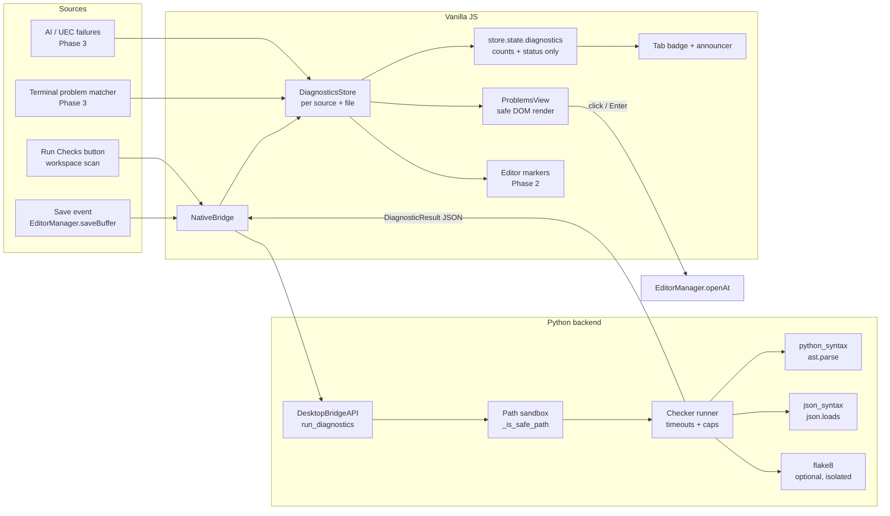
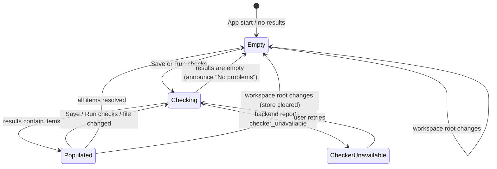
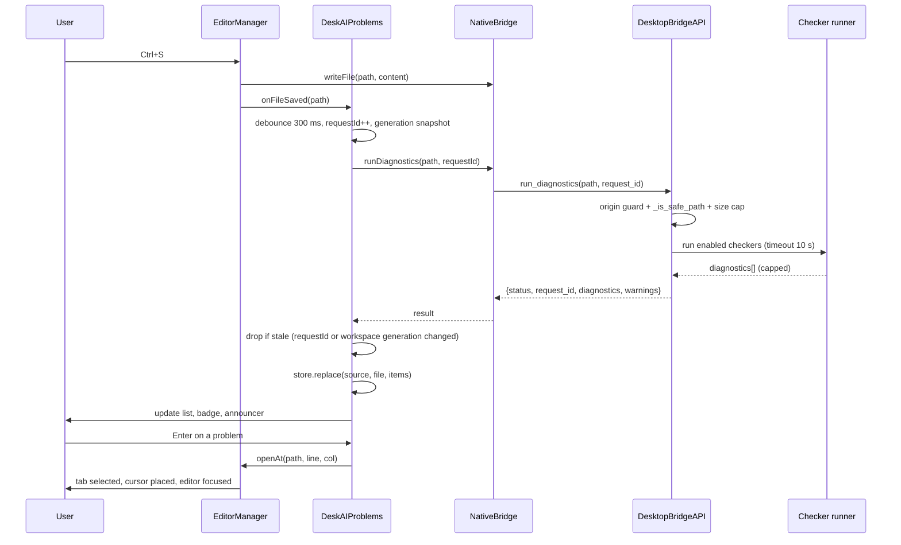

# High-Level Design (HLD): Problems Panel (Workspace Diagnostics)

**Document ID:** `ORX-HLD-PROBLEMS-PANEL-V2`  
**Version:** `2.0` (supersedes `ORX-HLD-PROBLEMS-PANEL-V1`, which only specified an empty-state placeholder)  
**Target Codebase:** `DeskAI` (verified against `main` @ `b0170b0`)  
**Status:** Proposed (ready for implementation)  
**Date:** October 29, 2026  

**Target Files (to create / modify):**
* `src/deskai/diagnostics/` (NEW: Python checker package)
* `src/deskai/bridge/diagnostics.py` (NEW `DiagnosticsBridge(BaseBridgeModule)` with `run_diagnostics`, `run_workspace_diagnostics`; added to the `DesktopBridgeAPI` facade bases in `bridge/api.py`, the same way `GitBridge` and `PortsBridge` are composed)
* `src/deskai/static/js/problems/` (NEW: `store.js`, `view.js`, `index.js`)
* `src/deskai/static/js/bridge.js`, `editor.js`, `app.js`, `state.js`, `events.js`
* `src/deskai/static/index.html`, `css/components.css`, `css/tokens.css`

---

## 1. Objective & Scope

The Problems Panel (`#problemsPanel`) is the single place where DeskAI shows **what is wrong in the workspace**: syntax errors, lint warnings and informational hints, grouped by file, with one-click navigation to the exact line and column in the editor.

### 1.1 Verified baseline (what exists today)

| Area | Current state in `main` | Consequence |
| :--- | :--- | :--- |
| Panel markup | `#problemsPanel` contains only `.problems-view > .problems-empty` (static text) | No data path exists |
| Data source | None. No checker, no bridge method, no store slice | Must be built |
| Editor | `EditorManager` (`window.EditorManager`) has `openFile`, `selectTab`, `saveBuffer`; **no method to move the cursor to a line/column** | Add `openAt()` / `revealPosition()` |
| CodeMirror | Vendored `vendor/codemirror.bundle.js` v6.0.1, a custom bundle. **`@codemirror/lint` is not included** | In-editor squiggles are Phase 2 and need a re-bundle |
| Tokens | `--color-danger`, `--color-warning`, `--color-primary` (amber) exist. There is **no** `--color-error` and **no** info colour token. V1 documented `--color-error: #ef4444` and info = blue `#3b82f6`, which do not match the code | Reuse danger/warning, add `--color-info` (dark + light) |
| Themes | Dark default plus a light theme with WCAG checker (`tools/check_contrast.py`) | New tokens must be added to the checker's pair list |
| Tab badge | Ports has a count badge (`#portsCountBadge`); Problems has none | Add a count badge on the tab |

### 1.2 Goals
1. Show diagnostics from **real checkers** with zero network access and no cloud dependency.
2. Update automatically when a file is saved, and on demand for the whole workspace.
3. Navigate to the problem: click or Enter opens the file and places the cursor.
4. Be fully keyboard and screen-reader usable (WCAG 2.1 AA / WAI-ARIA 1.2), in both themes.
5. Stay inside the project rules: vanilla ES modules, custom store, tokens only, **no `innerHTML`**, workspace sandbox on every file access.

### 1.3 Non-goals (v2)
* Full Language Server Protocol client (the data model is LSP-shaped so an adapter can be added later).
* Auto-fix / quick-fix actions.
* Checking on every keystroke (v2 checks on save and on demand).
* Running project-defined scripts or plugins from the workspace (see Security, S2).

---

## 2. Architecture



**Design decisions**

| # | Decision | Rationale |
| :--- | :--- | :--- |
| D1 | Checkers run in the **Python backend**, not in the page | Backend already enforces the workspace sandbox; the page cannot run subprocesses; consistent results across WebKitGTK / WebView2 / WKWebView |
| D2 | Built-in checkers need **no third-party install** (`ast`, `json`); `flake8` is optional | Works out of the box; degrades gracefully when flake8 is missing |
| D3 | Diagnostics are stored as **replace-sets keyed by (source, file)** | Re-checking a file replaces only that source's results, so stale items cannot pile up |
| D4 | Full list lives in a plain `DiagnosticsStore`; only **counts/status** go in the reactive `store.state.diagnostics` | Avoids deep-proxy cost on thousands of items; badge and status still reactive |
| D5 | Check **on save + manual**, not per keystroke | Predictable CPU use; avoids subprocess spam |
| D6 | LSP-shaped model (`range`, `code`, `source`, `severity`) | Future LSP adapter plugs into the same store |

---

## 3. UI Design

```text
┌─────────────────────────────────────────────────────────────────────────────────────────┐
│ [Terminal] [Output] [Problems ⓔ2 ⓦ3] [Ports]                                        [─] │
├─────────────────────────────────────────────────────────────────────────────────────────┤
│ [✕ 2 Errors] [▲ 3 Warnings] [ℹ 0 Info]  [Filter problems…        ]  [Group: File ▾] [↻ Run checks] │
├─────────────────────────────────────────────────────────────────────────────────────────┤
│ ▾ src/deskai/bridge/api.py                                                         (2)  │
│     ✕ Error    SyntaxError: invalid syntax                         python · [41, 9]     │
│     ▲ Warning  Module 'sys' imported but unused                    flake8 F401 · [3, 1] │
│ ▸ src/deskai/server/terminal.py                                                    (1)  │
└─────────────────────────────────────────────────────────────────────────────────────────┘
```

* **Severity is never colour-only:** each severity has a distinct icon *shape* plus a visible text label (`Error`, `Warning`, `Info`).
* **Tab badge** shows error and warning counts; its accessible name is `Problems, 2 errors, 3 warnings` (or `Problems, no problems`).
* **Counters double as filters** (toggle buttons with `aria-pressed`).
* **Empty state** keeps the existing text (`No problems have been detected in the workspace.`) and class `.problems-empty`, so existing tests TC-PRB-01 to 06 stay valid.

### 3.1 UI state machine



| State | Visible content | Announcement (polite, debounced) |
| :--- | :--- | :--- |
| Empty | `.problems-empty` message | `No problems detected` (only after a check completes, not at startup) |
| Checking | Toolbar button shows busy state, previous list stays visible (no flicker, no layout shift) | none |
| Populated | Grouped list | `Checks complete: 2 errors, 3 warnings` |
| CheckerUnavailable | Inline notice: `flake8 is not installed; showing syntax checks only` | `Some checks unavailable` |

---

## 4. End-to-End Flow (save to navigation)



---

## 5. Data Model (shared by backend and frontend)

```typescript
type Severity = "error" | "warning" | "info";

interface Diagnostic {
  id: string;              // stable fingerprint: hash(source|code|file|startLine|startCol|message)
  source: string;          // "python", "json", "flake8", ...
  code: string | null;     // "F401", "E999" ...
  severity: Severity;
  message: string;         // plain text, max 500 chars, control chars stripped
  file: string;            // workspace-relative, forward slashes ("src/app.py")
  range: { startLine: number; startCol: number; endLine: number; endCol: number }; // 1-based
}

interface DiagnosticResult {
  status: "ok" | "error";
  request_id: string;
  file: string;
  diagnostics: Diagnostic[];       // capped at 500 per file
  truncated: boolean;
  warnings: string[];              // e.g. "flake8_unavailable", "checker_timeout:flake8", "file_too_large"
  message?: string;                // when status = "error"
}
```

---

## 6. Security Requirements (non-negotiable)

| ID | Requirement |
| :--- | :--- |
| S1 | Every bridge call passes `_is_origin_allowed()` and `_is_safe_path()` (the same sandbox as `read_file`). Paths outside the workspace, in sensitive directories, or via symlink escape are rejected. |
| S2 | **Never execute workspace-controlled code.** Opening an untrusted folder must not run anything from it. flake8 is invoked with `--isolated` (ignores `setup.cfg`/`tox.ini`/`.flake8`, so `[flake8:local-plugins]` cannot load workspace code). Any future checker that loads project config or plugins (eslint, mypy, ruff with plugins) requires an explicit **workspace trust** prompt first. |
| S3 | Subprocesses use an argv list (`shell=False`), `stdin=DEVNULL`, cwd = workspace root, minimal env allowlist (reuse `build_terminal_env()` rules, strip `DESKAI_*` and `*TOKEN*`), hard timeout (10 s), whole process tree killed on timeout, output capped (1 MB). |
| S4 | `ast.parse` is used for Python syntax. It does not execute code, but adversarial input can raise `RecursionError` or `MemoryError`: both are caught and reported as a single diagnostic. Files over 1 MB or containing NUL bytes are skipped with a warning. |
| S5 | Messages come from tools or files and are rendered with `textContent` only; control characters and ANSI escapes are stripped server-side. No `innerHTML`. |
| S6 | Returned paths are workspace-relative. Absolute paths are never sent to the page. |
| S7 | Rate limit: at most 1 running check per file, at most 3 concurrent checks, latest request wins. |

---

## 7. Accessibility (WCAG 2.1 AA / WAI-ARIA 1.2)

1. **Pattern:** file groups are disclosure buttons (`aria-expanded`, `aria-controls`) containing `<ul role="list">` of problem buttons. This is simpler and more robust for screen readers than a custom `tree`.
2. **Item accessible name:** `Error, SyntaxError: invalid syntax, src/app.py line 41 column 9, source python`.
3. **Keyboard:** the list is a single Tab stop with roving `tabindex`; `Up/Down` move between items, `Left/Right` collapse/expand a group, `Home/End` jump, `Enter/Space` navigates, `Esc` returns focus to the drawer tab. Filter input and toolbar buttons are normal tab stops.
4. **Live region:** one debounced (500 ms) summary in `#screenReaderAnnouncer`; per-item announcements are forbidden (would spam).
5. **Contrast:** all text and icon colours use tokens; new `--color-info` must pass `tools/check_contrast.py` in both themes (4.5:1 text, 3:1 icons).
6. **Targets and size:** interactive rows at least 28 px tall; text at least 12 px (`--text-xs`).
7. **Motion:** spinner and transitions are wrapped in `prefers-reduced-motion`.
8. **Focus:** `:focus-visible` ring using `--border-focus`; focus is preserved across re-renders (re-focus by item `id`).

---

## 8. Performance & Resilience

* Debounce 300 ms after save; coalesce repeated saves, latest result wins (`requestId` guard).
* A workspace **generation counter** drops results that arrive after the workspace root changed.
* Render cap of 1000 visible items with a `Show N more` control; groups are rendered collapsed beyond 20 files.
* Skip re-render when the list signature (ids + collapsed state + filter) is unchanged.
* Checker failure never breaks the panel: timeouts and missing tools become `warnings`, shown as an inline notice.
* Switching workspace clears all diagnostics immediately.

---

## 9. Phased Delivery

| Phase | Scope | Exit criteria |
| :--- | :--- | :--- |
| **P1** | Store, view, tab badge, Python syntax + JSON checkers, save trigger, click-to-navigate, a11y, tests | All TC-PRB tests green on Ubuntu + Windows, 3.11/3.12 |
| **P2** | Optional flake8, workspace scan, filters/grouping, **editor squiggles** (re-bundle CodeMirror with `@codemirror/lint`), stale marking for unsaved edits | Squiggles match panel items, no duplicate sources |
| **P3** | Terminal problem matcher (`path:line:col: message`), AI/UEC failure diagnostics, additional language checkers behind workspace trust | Security tests for S2 pass |

---

## 10. Risks & Open Questions

| Risk | Mitigation |
| :--- | :--- |
| flake8 absent on user machines | Optional; clear inline notice; built-in checkers always work |
| Windows path case / drive letters causing duplicate groups | Single `normalizeKey()` used everywhere (lower-case on `win32`) |
| Custom CodeMirror bundle has no lint package | Defer squiggles to P2; panel works without it |
| Long-running checker blocks bridge thread | Per-check timeout, process-tree kill, concurrency cap |
| Untrusted workspace executes code via tool config | S2 (`--isolated`, trust prompt) |

**Open questions for the product owner:** (1) Should unsaved buffers be checked too (adds latency and complexity)? (2) Which languages after Python and JSON? (3) Should the badge also appear in the status bar?

---

## 11. Traceability

Existing tests **TC-PRB-01 to TC-PRB-06** remain valid and must keep passing. New tests are specified in `ORX-LLD-PROBLEMS-PANEL-V2` section 10 (**TC-PRB-07 onward**).
