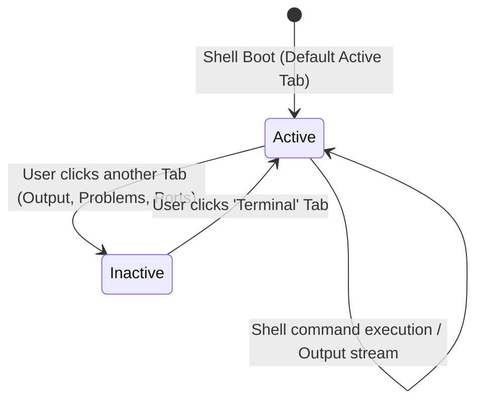

# High-Level Design (HLD): Terminal Panel (Host Shell & Execution View)

**Document ID:** `ORX-HLD-TERMINAL-PANEL-V1`  
**Version:** `1.0` (Synchronized with Implemented Vanilla JS & Bottom Drawer Architecture)  
**Target Codebase:** `DeskAI`  
**Target Files:**
* `src/deskai/static/index.html` (Lines 101, 109-113)
* `src/deskai/static/js/events.js` (`data-action="drawer-tab"`)
* `src/deskai/static/css/components.css` (Lines 350-376)
**Status:** Approved  
**Date:** October 27, 2026  

---

## 1. Architectural Overview & Objective

The **Terminal Panel** (`#terminalPanel`) is the default, primary command execution and host shell console embedded within DeskAI's Collapsible Bottom Drawer (`#bottomDrawer`).

* **Current State:** Developers and agentic coding workflows require immediate access to a host shell to run scripts, execute test suites, build packages, and inspect CLI commands without leaving the IDE environment.
* **Target State (Implemented):** A dedicated, active-by-default terminal viewport that:
  1. **Serves as Default Bottom Viewport:** Automatically selected on IDE launch (`.active` tab and `.active` panel).
  2. **Monospace Host Shell Typography:** Pre-formatted `<pre>` and `<code>` container configured with monospace typography and token-driven contrast compliance.
  3. **Seamless Drawer Tab Integration:** Controlled via the `Terminal` tab in `.drawer-tabs` with instantaneous visibility toggling and keyboard focus retention.

```text
┌─────────────────────────────────────────────────────────────────────────────┐
│ [Terminal*] [Output] [Problems] [Ports]                                 [─] │
├─────────────────────────────────────────────────────────────────────────────┤
│ .drawer-panel.active #terminalPanel                                         │
│   <pre class="terminal-view" id="terminalOutput">                          │
│     <code>DeskAI Host Shell Ready. Workspace active.</code>                       │
└─────────────────────────────────────────────────────────────────────────────┘
```

---

## 2. Component Architecture & UI State Machine

The Terminal Panel operates as the primary panel in the bottom drawer, transitioning across visibility states:



### 2.1 State Matrix

| State | CSS Modifier / Attribute | Tab State | Interaction Behavior |
| :--- | :--- | :--- | :--- |
| **Active (Default Boot)** | `.active` (no `hidden`) | `aria-selected="true"`, `.active` | Terminal output visible; keyboard focus ready for command execution. |
| **Inactive** | `hidden=""` | `aria-selected="false"` | Panel hidden; shell process continues running seamlessly in background. |

---

## 3. End-to-End Interaction & Data Flow

```text
[DeskAI Shell Boots]
        │
        ▼
[Default Active State: #terminalPanel visible, tab active]
        │
        ├──► User switches away: [Hidden attribute added, shell runs in background]
        │
        └──► User clicks 'Terminal' tab:
                    │
                    ▼
          [events.js: case 'drawer-tab']
            - Mark 'Terminal' tab active (aria-selected="true")
            - Remove 'hidden' from #terminalPanel
            - Focus terminal buffer for input
                    │
                    ▼
          [Process Runner / Shell Bridge IPC]
            - Stdout / Stderr streamed into #terminalOutput
            - Buffer auto-scrolls to latest prompt
```

### 3.1 Step-by-Step Execution
1. **Initial Boot:** During DOM initialization, `#terminalPanel` and the `Terminal` tab are assigned the `.active` class.
2. **Tab Switching:** When the user switches between drawer tabs, the event delegation router in `events.js` toggles `hidden` attributes cleanly without killing active shell sessions.
3. **Execution Stream Display:** Commands executed via the DeskAI supervisor or user terminal stream into `#terminalOutput` using pre-formatted monospace rendering.

---

## 4. Component Contracts & Data Interface

### 4.1 HTML Structure Contract
```html
<!-- Terminal Panel (Active by default) -->
<div class="drawer-panel active" id="terminalPanel" role="tabpanel" aria-labelledby="tab-terminal">
  <pre class="terminal-view" id="terminalOutput"><code>DeskAI Host Shell Ready. Workspace active.</code></pre>
</div>
```

### 4.2 Tab Header Contract
```html
<button 
  class="drawer-tab active" 
  data-action="drawer-tab" 
  data-target="terminal" 
  role="tab" 
  aria-selected="true" 
  aria-controls="terminalPanel"
  id="tab-terminal">
  Terminal
</button>
```

---

## 5. Security & Isolation Safeguards

1. **Origin Verification:** Interactive shell bridging is restricted to authenticated sessions with verified loopback origins.
2. **Text-Safe Output:** Streamed command outputs are appended as raw text nodes or sanitized content to prevent script injection in terminal logs.
3. **Buffer Clamping:** Output streams enforce maximum scrollback retention (e.g. 10,000 lines) to prevent DOM memory exhaustion.

---

## 6. Accessibility (WCAG 2.1 AA) Compliance

1. **Semantic Tabpanel Binding:**
   * Bound via `role="tabpanel"` and `aria-labelledby="tab-terminal"`.
   * Associated tab enforces `role="tab"` and dynamic `aria-selected`.
2. **Color Contrast:**
   * Text token `var(--text-secondary)` provides $\ge 7:1$ contrast against dark `var(--bg-header)`.
3. **Keyboard Accessibility:**
   * Tab switchable via standard `ArrowLeft`/`ArrowRight` within the tablist.
   * Terminal output selectable and copyable via standard keyboard shortcuts.
