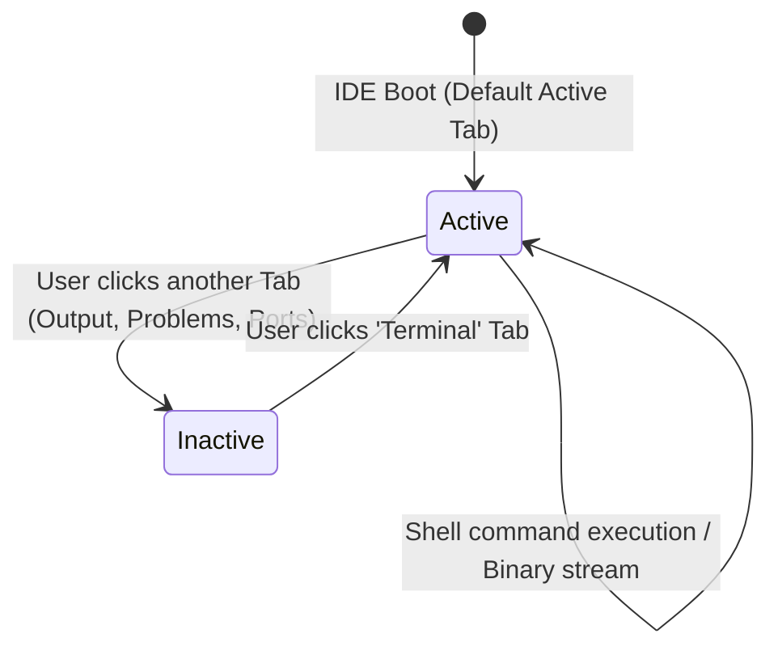

# High-Level Design (HLD): Terminal Panel (Host Shell & Execution View)

**Document ID:** `ORX-HLD-TERMINAL-PANEL-V1`  
**Version:** `1.2` (Implemented Interactive PTY-Backed Architecture)  
**Target Codebase:** `DeskAI`  
**Target Files:**
* `src/deskai/static/index.html`
* `src/deskai/static/js/events.js`
* `src/deskai/static/js/terminal.js`
* `src/deskai/static/css/components.css`
* `src/deskai/static/css/tokens.css`
* `src/deskai/server/terminal.py`
* `src/deskai/server/supervisor.py`
* `src/deskai/bridge/api.py`
* `src/deskai/bridge/lifecycle.py`
**Status:** Implemented  
**Date:** October 28, 2026  

---

## 1. Architectural Overview & Objective

The **Terminal Panel** (`#terminalPanel`) is the default, primary command execution and host shell console embedded within DeskAI's Collapsible Bottom Drawer (`#bottomDrawer`).

* **Implementation Reality:** DeskAI provides a fully interactive, secure, PTY-backed terminal powered by vendored `xterm.js` 5.3.0 (with fit addon 0.8.0), connecting via binary WebSocket to `src/deskai/server/terminal.py`. The legacy static placeholder `<pre><code>` has been completely replaced.
* **Architecture Pillars:**
  1. **Serves as Default Bottom Viewport:** Automatically selected on IDE launch (`.active` tab and `.active` panel).
  2. **Terminal Emulation via Vendored xterm.js:** Full VT100/xterm emulation (vendored under `static/vendor/` with `MANIFEST.json` entry, zero framework dependencies), supporting colors, cursor navigation, alternate screen, and text selection.
  3. **Seamless Drawer Tab Integration:** Controlled via the `Terminal` tab in `.drawer-tabs` with instantaneous visibility toggling, running status indicator chip (`●`), and keyboard focus retention (tab roving focus).
  4. **Strict Security Sandbox & Threat Model:** Highest-privilege surface controls, server-side `cwd` verification, environment sanitization, native user confirmation gate, and dedicated `/ws/terminal/{session_id}` transport.

```text
┌─────────────────────────────────────────────────────────────────────────────┐
│ [Terminal*] [Output] [Problems] [Ports]                                 [─] │
├─────────────────────────────────────────────────────────────────────────────┤
│ .drawer-panel.active #terminalPanel                                         │
│   <div id="terminalHost" role="log" aria-label="Terminal output"            │
│        aria-live="off"></div>                                               │
│   <div class="terminal-footer-hint">Ctrl+Shift+M: Move focus out</div>     │
└─────────────────────────────────────────────────────────────────────────────┘
```

---

## 2. Default Architectural Decisions (D1 - D3)

* **D1 (Scope):** Interactive **USER shell only**. AI/agent command execution is strictly **OUT OF SCOPE** (future feature routed exclusively through the UEC state machine and approval flow; agent commands are never silently injected into the user's interactive shell).
* **D2 (Renderer):** Vendor **`xterm.js`** (plus the fit addon) under `static/vendor/` with a `MANIFEST.json` entry, matching CodeMirror and DOMPurify. No custom hand-rolled VT emulator.
* **D3 (CSP Policy):** Keep `'unsafe-eval'` in the CSP for now, but execute a spike checking whether each pywebview backend truly requires it, and document the findings. Do not remove it blindly.

---

## 3. Threat Model & Security Architecture (P0)

A host terminal provides arbitrary command execution by design. It represents the highest-privilege attack surface in DeskAI.

1. **XSS to RCE Mitigation:**
   * DeskAI renders model output via `marked` + `DOMPurify` and the CSP currently contains `'unsafe-eval'`.
   * An XSS vulnerability in client scripts could escalate directly to host Remote Code Execution (RCE) if the page could arbitrarily spawn or write to a terminal.
   * **Mitigations:**
     * Spawning a shell requires an explicit native user confirmation dialog on the first invocation per session: `"Open a host shell in <workspace name>?"`. Page scripts alone cannot forge this native bridge prompt.
     * All bridge methods (`terminal_open`, `terminal_close`) strictly invoke `self._is_origin_allowed()` with verified local origins.
     * All terminal WebSocket and HTTP endpoints enforce strict Host (`127.0.0.1:{port}`), Origin (`http://127.0.0.1:{port}`), and cryptographic session-cookie checks.

2. **Server-Side Working Directory (`cwd`) Binding:**
   * The spawn gate verifies `workspace_root` entirely on the server side (`bridge.get_workspace_root()`).
   * It asserts `is_disallowed_workspace_root(root) == False` and `is_safe_workspace_path(root) == True`.
   * Client-supplied `cwd` paths are strictly rejected.

3. **Strict Environment Policy & Trade-Offs:**
   * The child process environment is constructed from an explicit allowlist:
     * Core identity & shell: `HOME`, `USER`, `LOGNAME`, `LANG`, `LANGUAGE`, `LC_*`, `PATH` (user's login PATH), `SHELL`, `TERM=xterm-256color`, `COLORTERM=truecolor`, `TERMINFO`.
     * Desktop & GUI session: `DISPLAY`, `WAYLAND_DISPLAY`, `XDG_RUNTIME_DIR`, `XDG_*`, `TMPDIR`.
     * Authentication agent: `SSH_AUTH_SOCK`.
     * Windows platform equivalents: `SystemRoot`, `USERPROFILE`, `APPDATA`, `LOCALAPPDATA`, `TEMP`, `TMP`, `ComSpec`, `PATHEXT`.
   * **Security Trade-Off Analysis (`SSH_AUTH_SOCK`):**
     * *Benefit:* Exposing `SSH_AUTH_SOCK` enables the developer's interactive shell to interact with remote git repositories (`git push`, `git fetch`), SSH tunnels, and commit signing without repeatedly prompting for SSH key passphrases.
     * *Risk / Exposure:* Any process executing within the user's terminal gains access to the local UNIX domain socket of `ssh-agent`. If untrusted code is executed inside the terminal, it could request the SSH agent to sign challenge requests using loaded keys.
     * *Mitigation & Justification:* Under Decision **D1**, this terminal is an interactive **USER shell only**. AI agent execution is completely isolated from this process and routed through separate, sandboxed UEC approval paths.
   * **Unconditional Stripping:**
     * All variables starting with `DESKAI_*` (internal secrets) and any environment variable whose key contains `TOKEN` (case-insensitive, e.g. `DESKAI_LAUNCH_TOKEN`, `AUTH_TOKEN`) are strictly stripped before process spawn.
   * The user's personal dotfiles (`.bashrc`, `.profile`) are trusted as the user's own configuration.

4. **Resource Constraints & Concurrency:**
   * Maximum 6 concurrent terminal sessions per application instance.
   * Unguessable cryptographically random session IDs (`secrets.token_urlsafe(32)`).
   * Bounded server-side ring replay buffer (256 KB) per session to allow reconnects and tab-switches without unbounded memory growth.

5. **Lifecycle & Clean Teardown:**
   * Process group termination: `SIGHUP` delivered to process group, escalating to `SIGKILL` after 3 seconds, followed by process reaping.
   * Hooked into `DesktopServer.stop()` and `WindowLifecycleHandler` on window close.
   * Exit confirmation dialog checks for active running shells and warns the user.

---

## 4. Component Architecture & UI State Machine

The Terminal Panel operates within the bottom drawer, transitioning across visibility states:



### 4.1 State Matrix

| State | CSS Modifier / Attribute | Tab State | Interaction Behavior |
| :--- | :--- | :--- | :--- |
| **Active (Default Boot)** | `.active` (no `hidden`) | `aria-selected="true"`, `.active` | Terminal output visible; keyboard focus remains on tab until user presses Tab/Enter. |
| **Inactive** | `hidden=""` | `aria-selected="false"` | Panel hidden; backend PTY process continues running seamlessly in background. |

---

## 5. End-to-End Interaction & Data Flow

```text
[DeskAI Shell Boots]
        │
        ▼
[Default Active State: #terminalPanel visible, tab active]
        │
        ├──► User switches away: [hidden attribute added, PTY runs in background]
        │
        └──► User interacts with Terminal:
                    │
                    ▼
          [Native Confirmation Prompt (First time per session)]
            - "Open a host shell in <workspace name>?"
                    │
                    ▼
          [Dedicated Transport: /ws/terminal/{session_id}]
            - Strict Host, Origin, and Session Cookie validation
            - Server -> Client: Binary frames (raw PTY output)
            - Client -> Server: Binary frames (keystrokes), JSON (resize, close)
            - Flow-controlled with high/low watermarks (1 MB buffer limit)
                    │
                    ▼
          [Frontend Rendering via Vendored xterm.js]
            - Canvas/DOM VT100 rendering with token-driven ANSI colors
            - Fit addon adapts to drawer dimensions on drag / resize
```

---

## 6. Component Contracts & Data Interface

### 6.1 HTML Structure Contract
```html
<!-- Terminal Panel (Active by default) -->
<div class="drawer-panel active" id="terminalPanel" role="tabpanel" aria-labelledby="tab-terminal">
  <div id="terminalHost" role="log" aria-label="Terminal output" aria-live="off"></div>
</div>
```

### 6.2 Tab Header Contract
```html
<button 
  class="drawer-tab active" 
  data-action="drawer-tab" 
  data-target="terminal" 
  role="tab" 
  aria-selected="true" 
  aria-controls="terminalPanel"
  id="tab-terminal">
  Terminal
</button>
```

---

## 7. Accessibility (WCAG 2.1 AA) Compliance & Verification

1. **Implemented & Verified Behaviors:**
   * Semantic tabpanel binding (`role="tabpanel"`, `role="tab"`, `aria-selected`, `aria-controls`, `aria-labelledby`).
   * Drawer auto-expansion when clicking any tab (verified in `test_clicking_any_tab_expands_collapsed_drawer`).
   * Roving focus navigation with `ArrowLeft` / `ArrowRight` (verified in `test_tablist_roving_arrow_key_focus`).
2. **Keyboard Navigation & Trap Avoidance (WCAG 2.1.2):**
   * Selecting the Terminal tab does **NOT** steal focus from the tablist.
   * Focus enters terminal on `Tab` or `Enter`.
   * Dedicated escape hatch: `Ctrl+Shift+M` (macOS `Cmd+Shift+M`) returns focus to the tablist.
   * While terminal is focused, global app hotkeys (`Ctrl+S`, `Ctrl+W`, `Ctrl+Enter`) are suppressed so they reach the shell.
3. **Screen Reader Support:**
   * Output region marked with `role="log"` and `aria-live="off"` (preventing noisy continuous speech during high-throughput logs).
   * Discrete lifecycle events announced via polite `#screenReaderAnnouncer`.
4. **Color Contrast:**
   * Text token `var(--text-secondary)` (`#9ca0a6`) on `var(--bg-header)` (`#17181b`) provides 6.76:1 contrast (exceeds WCAG AA 4.5:1 requirement).
   * Primary accent token `var(--color-primary)` is `#d99b26`.
   * Error states use token `var(--color-danger)` (`#ef4444`). Note: `--color-error` does not exist in `tokens.css`.
   * Terminal ANSI foregrounds defined via new `--ansi-*` tokens in `tokens.css`, all verified for $\ge 4.5:1$ contrast against `--terminal-bg`.

---

## 8. Verification & Traceability Matrix

| Test ID | Test Target | Verification Scope | Method | Status |
| :--- | :--- | :--- | :--- | :--- |
| **TC-TRM-01** | Tab Declaration | `index.html` declares `data-target="terminal"` tab button | DOM Contract Test | Implemented |
| **TC-TRM-02** | Initial Active State | `Terminal` tab has `.active` class and `aria-selected="true"` at boot | DOM Assertion | Implemented |
| **TC-TRM-03** | Panel Declaration | `index.html` declares `#terminalPanel` with `.active` class | DOM Contract Test | Implemented |
| **TC-TRM-04** | Default Visible | `#terminalPanel` does NOT have `hidden` attribute on initial page load | DOM Assertion | Implemented |
| **TC-TRM-05** | Host Element | `#terminalHost` has `role="log"`, accessible name, and `aria-live="off"` | DOM Assertion | Implemented |
| **TC-TRM-06** | Font Family | `.terminal-view` computes to monospace font stack (`JetBrains Mono`, `Fira Code`, monospace) | CSS Computed Style Test | Implemented |
| **TC-TRM-07** | ARIA Binding | `aria-controls="terminalPanel"` matches panel id | DOM Contract Test | Implemented |
| **TC-TRM-08** | Spawn Gate & Security | Server-side workspace check, origin validation, env token stripping | Backend Unit Test (`test_terminal_backend.py`) | Implemented |
| **TC-TRM-09** | PTY Lifecycle & Signals | Resize (`TIOCSWINSZ`), SIGINT (0x03), clean close / reap | Backend Unit Test (`test_terminal_backend.py`) | Implemented |
| **TC-TRM-10** | Transport Flow Control | Binary stream over `/ws/terminal/{id}`, high/low watermarks, replay ring buffer | Backend Unit Test (`test_terminal_transport.py`) | Implemented |
| **TC-TRM-11** | Keyboard Trap Escape | `Ctrl+Shift+M` moves focus out to tablist; `Tab` moves into xterm | Playwright Behavioral (`test_bottom_drawer_behavior.py`) | Implemented |
| **TC-TRM-12** | Hotkey Isolation | `Ctrl+W` and `Ctrl+S` suppressed when terminal focused (passes to shell) | Playwright Behavioral (`test_bottom_drawer_behavior.py`) | Implemented |
| **TC-TRM-13** | Scrollback Clamp | Max lines clamped to 10,000; zero `innerHTML` in terminal modules | Playwright Behavioral (`test_bottom_drawer_behavior.py`) | Implemented |
| **TC-TRM-14** | WCAG Contrast | ANSI palette & terminal tokens meet $\ge 4.5:1$ against `--terminal-bg` | Static CSS Audit (`test_task10_theme_a11y.py`) | Implemented |
| **TC-TRM-15** | Exit Lifecycle | Active session running chip (`●`), dirty-exit confirmation warning, graceful kill | Backend / E2E Test (`test_bottom_drawer_behavior.py`) | Implemented |
| **TC-TRM-16** | CSP Backend Spike | PyWebView engine eval dependency audit documented in LLD | Architecture Spike (`pywebview.md`) | Implemented |

---

## 9. Future Work

1. **Multi-Session Terminal Tabs:**
   * Support multiple concurrent shells via a `+` button in the drawer header and session switcher tabs/dropdown.
   * Session tabs with renameable titles, per-session scrollback buffers, and kill buttons.
2. **AI / Agent Command Execution Flow:**
   * Automated command proposals from AI agents routed exclusively through the UEC (Unified Execution Context) state machine and explicit user approval modal (`uec.approve` / `uec.reject`).
   * Agent execution rendered in distinct, read-only audit cards or dedicated non-interactive run targets; never typed silently into the user's interactive shell.
3. **Dynamic Terminal Configuration:**
   * User preference controls for font family, line height, cursor blink, and custom ANSI color themes synchronized via `tokens.css`.

