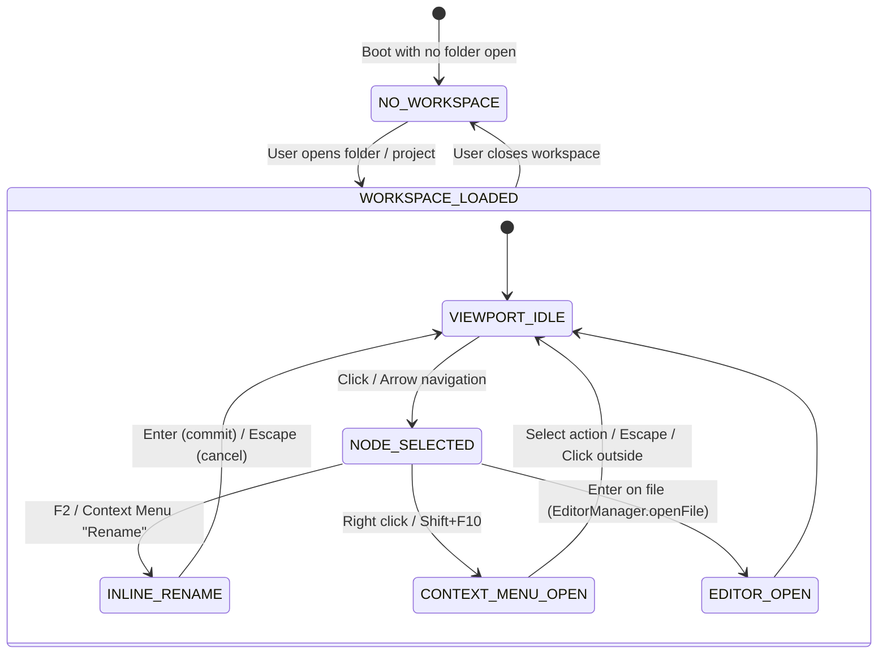

# High-Level Design (HLD): File Explorer Tree

**Document ID:** `ORX-HLD-FILE-EXPLORER-TREE-V1`  
**Version:** `1.0` (Unified File Explorer Studio Architecture)  
**Target Codebase:** `DeskAI`  
**Target Files:**
* `src/deskai/static/index.html`
* `src/deskai/static/js/explorer.js`
* `src/deskai/static/js/editor.js`
* `src/deskai/static/js/bridge.js`
* `src/deskai/static/js/events.js`
* `src/deskai/bridge/api.py`
* `src/deskai/static/css/components.css`
* `src/deskai/static/css/tokens.css`
**Status:** Approved  
**Date:** October 28, 2026  

---

## 1. Architectural Overview & Objective

The **File Explorer Tree** (`.explorer-container` inside `#sidebarLeft`) is the primary workspace file management and project browsing interface in the DeskAI IDE. Positioned in the left sidebar above the Hardware Status Dock, it provides comprehensive directory browsing, file and folder creation, inline renaming, guarded deletion, path copying, and file activation synchronized with the Multi-Tab Editor Stage.

```text
┌─────────────────────────────────────────────────────────────────────────────┐
│ #sidebarLeft (Left Sidebar)                                                 │
│ ┌─────────────────────────────────────────────────────────────────────────┐ │
│ │ 1. Tree Header Toolbar (.panel-header)                                  │ │
│ │    EXPLORER                 [📄+ New] [📁+ New] [🔄 Refresh] [⊟ Collapse]│ │
│ ├─────────────────────────────────────────────────────────────────────────┤ │
│ │ 2. Tree Viewport (#fileTreeViewport role="tree")                        │ │
│ │    (Scrollable container, empty state prompt, scroll retention)         │ │
│ │    ┌──────────────────────────────────────────────────────────────────┐ │ │
│ │    │ 3. Tree Node Items (.tree-item role="treeitem")                  │ │ │
│ │    │    ▼ 📂 src/                           (level="1", aria-expanded)│ │ │
│ │    │      ├── 🐍 server.py                  (level="2", F2 inline)    │ │ │
│ │    │      └── 🟨 app.js                     (level="2", active)       │ │ │
│ │    │    ► 📁 tests/                         (level="1")               │ │ │
│ │    │    📝 README.md                        (level="1")               │ │ │
│ │    │    📦 package.json                     (level="1")               │ │ │
│ │    └──────────────────────────────────────────────────────────────────┘ │ │
│ └─────────────────────────────────────────────────────────────────────────┘ │
│ 4. Floating Context Menu (#treeContextMenu role="menu")                     │
│    [New File...] [New Folder...] [Rename (F2)] [Delete] [Copy Path]         │
└─────────────────────────────────────────────────────────────────────────────┘
```

### 1.1 The Four Subcomponents

1. **`tree-header-toolbar` (`.panel-header` / `#explorerToolbar`):**  
   Header and quick-action toolbar containing section title and accessible buttons: New File (`📄+`), New Folder (`📁+`), Refresh Tree (`🔄`), and Collapse All (`⊟`), compliant with WAI-ARIA `role="toolbar"`.
2. **`tree-viewport` (`#fileTreeViewport`):**  
   Scrollable DOM container implementing WAI-ARIA `role="tree"` with roving tabindex, vertical arrow navigation (`ArrowUp`/`ArrowDown`), boundary jumping (`Home`/`End`), empty state prompt, and scroll position retention across disk refreshes.
3. **`tree-node-item` (`.tree-item`):**  
   Individual hierarchical file and folder rows with precision indentation (`aria-level="N"`), folder expansion chevrons (`►`/`▼`), semantic filetype badges (`🐍`, `🟨`, `🔷`, `📦`, `🌐`, `🎨`, `📝`, `🐚`, `🗄️`, `📄`), and inline rename input mode (`F2`).
4. **`context-menu-actions` (`#treeContextMenu`):**  
   Floating accessible context menu triggered on right-click (`contextmenu`) or keyboard invocation (`Shift+F10`), featuring coordinate clamping, path copying to clipboard, and guarded deletion.

---

## 2. Architectural Decisions & Scope

* **D1 (Zero-Framework Vanilla ES6 Architecture):** All explorer DOM components are authored in pure ES6 JavaScript without virtual DOM overhead, strictly using DOM APIs (`createElement`, `textContent`).
* **D2 (Strict XSS & Sandboxing Guard Rails):** Absolute prohibition of `innerHTML` for dynamic filenames, file paths, or directory entries. All file system operations (`listDir`, `createDir`, `writeFile`, `renamePath`, `deletePath`) are validated against workspace root containment in the Python supervisor backend.
* **D3 (Bi-Directional Editor Synchronization):** Opening a file from the tree activates the corresponding buffer in `EditorManager`. Renaming a file on disk updates open buffer paths, tab labels, and badges. Deleting a file closes the corresponding editor tab.
* **D4 (Token-Driven Obsidian Matte Theming):** Strict CSS variable adherence: zero hardcoded hex or rgba color codes outside `src/deskai/static/css/tokens.css`.
* **D5 (WAI-ARIA 1.2 Tree & Menu Compliance):** Full keyboard accessibility, roving focus, aria attributes (`role="tree"`, `role="treeitem"`, `role="group"`, `role="menu"`, `role="menuitem"`, `aria-expanded`, `aria-level`).

---

## 3. High-Level Component State Machine



---

## 4. Verification & Testing Matrix

The complete File Explorer Tree component is covered by 28 dedicated Playwright end-to-end tests:
* `tests/test_tree_header_toolbar.py` (6 tests)
* `tests/test_tree_viewport.py` (8 tests)
* `tests/test_tree_node_item.py` (7 tests)
* `tests/test_context_menu_actions.py` (7 tests)
* CSS Token & Variable Hygiene check (`tests/test_ports_tab.py`)
