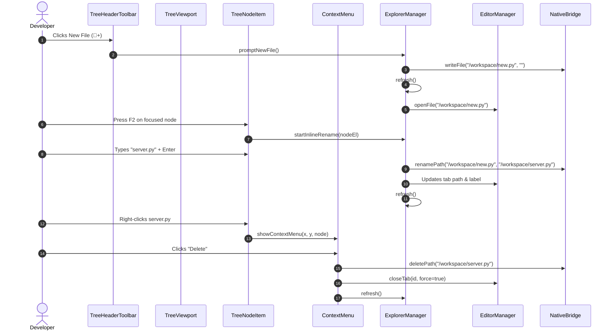

# Low-Level Design (LLD): File Explorer Tree

**Document ID:** `ORX-LLD-FILE-EXPLORER-TREE-V1`  
**Version:** `1.0` (Unified File Explorer Studio Architecture)  
**Parent Document:** `ORX-HLD-FILE-EXPLORER-TREE-V1`  
**Target Codebase:** `DeskAI`  
**Target Files:**
* `src/deskai/static/index.html`
* `src/deskai/static/js/explorer.js`
* `src/deskai/static/js/editor.js`
* `src/deskai/static/js/bridge.js`
* `src/deskai/static/js/events.js`
* `src/deskai/bridge/api.py`
* `src/deskai/static/css/components.css`
* `src/deskai/static/css/tokens.css`
* `tests/test_tree_header_toolbar.py`
* `tests/test_tree_viewport.py`
* `tests/test_tree_node_item.py`
* `tests/test_context_menu_actions.py`
**Status:** Approved  
**Date:** October 28, 2026  

---

## 1. Executive Summary & Objective

The **File Explorer Tree** (`.explorer-container`) coordinates filesystem browsing, directory tree visualization, inline renaming, context menu actions, and tab synchronization in DeskAI.

This Low-Level Design defines:
1. The master DOM layout structure within `#sidebarLeft`.
2. Inter-component data flows between `ExplorerManager`, `EditorManager`, `StudioStore`, and `NativeBridge`.
3. Complete CSS styling tokens and layout rules.
4. Comprehensive testing checklist across all 4 subcomponents.

---

## 2. Master DOM Hierarchy

```html
<!-- Left Column: File Explorer & Hardware Dock -->
<aside class="sidebar-left" id="sidebarLeft" role="region" aria-label="Explorer & System Dock">
  <section class="explorer-container">
    
    <!-- 1. Header Toolbar -->
    <div class="panel-header" id="explorerHeader">
      <span class="panel-title" id="explorerPanelTitle">EXPLORER</span>
      <div class="panel-actions" id="explorerToolbar" role="toolbar" aria-label="Explorer Actions" aria-controls="fileTreeViewport">
        <button type="button" class="icon-btn" id="btnNewFile" data-action="new-file" title="New File" aria-label="New File" tabindex="0">📄+</button>
        <button type="button" class="icon-btn" id="btnNewFolder" data-action="new-folder" title="New Folder" aria-label="New Folder" tabindex="-1">📁+</button>
        <button type="button" class="icon-btn" id="btnRefreshTree" data-action="refresh-tree" title="Refresh Tree" aria-label="Refresh Tree" tabindex="-1">🔄</button>
        <button type="button" class="icon-btn" id="btnCollapseAll" data-action="collapse-all-folders" title="Collapse Folders" aria-label="Collapse All Folders" tabindex="-1">⊟</button>
      </div>
    </div>

    <!-- 2. Scrollable Tree Viewport -->
    <div class="tree-viewport" id="fileTreeViewport" role="tree" tabindex="0" aria-label="Project Files">
      <!-- 3. Hierarchical Node Items -->
      <div class="tree-item is-folder expanded active" role="treeitem" data-path="/workspace/src" data-is-dir="true" aria-expanded="true" aria-level="1" tabindex="0">
        <span class="tree-arrow" aria-hidden="true">▼</span>
        <span class="tree-icon" aria-hidden="true">📂</span>
        <span class="tree-label">src</span>
      </div>
      <div class="tree-group" role="group">
        <div class="tree-item is-file" role="treeitem" data-path="/workspace/src/app.py" data-is-dir="false" aria-level="2" tabindex="-1">
          <span class="tree-indent" style="width: 14px;" aria-hidden="true"></span>
          <span class="tree-icon" aria-hidden="true">🐍</span>
          <span class="tree-label">app.py</span>
        </div>
      </div>
    </div>

  </section>

  <!-- 4. Floating Context Menu -->
  <div class="context-menu" id="treeContextMenu" role="menu" aria-label="File Actions" hidden>
    <div class="menu-item" role="menuitem" data-action="ctx-new-file" tabindex="-1">...</div>
    <div class="menu-item" role="menuitem" data-action="ctx-new-folder" tabindex="-1">...</div>
    <div class="menu-separator" role="separator" aria-hidden="true"></div>
    <div class="menu-item" role="menuitem" data-action="ctx-rename" tabindex="-1">...</div>
    <div class="menu-item destructive" role="menuitem" data-action="ctx-delete" tabindex="-1">...</div>
    <div class="menu-separator" role="separator" aria-hidden="true"></div>
    <div class="menu-item" role="menuitem" data-action="ctx-copy-path" tabindex="-1">...</div>
    <div class="menu-item" role="menuitem" data-action="ctx-copy-relative-path" tabindex="-1">...</div>
  </div>
</aside>
```

---

## 3. Subcomponent Coordination Sequence



---

## 4. Verification Test Suite Matrix

| Test Suite File | Subcomponent Tested | Assertions & Behaviors Verified |
| :--- | :--- | :--- |
| `test_tree_header_toolbar.py` | `tree-header-toolbar` | 6 tests: toolbar semantics, new-file, new-folder, refresh-tree, collapse-all, roving arrow keyboard navigation. |
| `test_tree_viewport.py` | `tree-viewport` | 8 tests: WAI-ARIA `role="tree"`, empty state prompt, roving tabindex, `ArrowDown`/`ArrowUp`, `Home`/`End`, folder expand/collapse, `Enter` activation, scroll preservation. |
| `test_tree_node_item.py` | `tree-node-item` | 7 tests: semantic filetype badges, folder chevrons, hierarchical indent spacing, F2 inline rename, commit on `Enter`, cancel on `Escape`, editor tab synchronization. |
| `test_context_menu_actions.py` | `context-menu-actions` | 7 tests: right-click invocation, Shift+F10 invocation, coordinate clamping, copy path / relative path, rename trigger, guarded delete, escape / click outside dismissal. |
| `test_ports_tab.py` | CSS Hygiene | Token hygiene: zero raw hex or rgba color codes outside `tokens.css`. |
