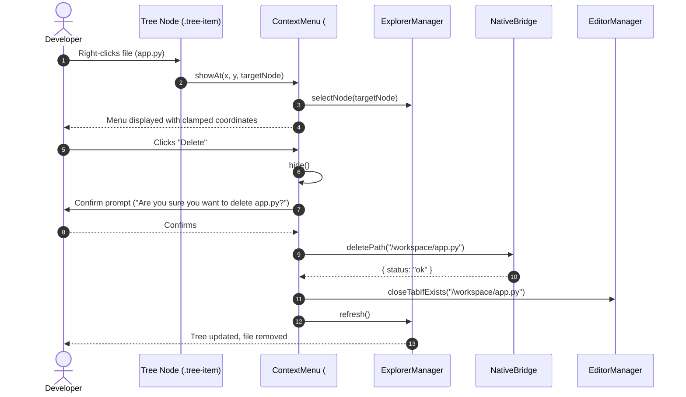

# High-Level Design (HLD): Context Menu Actions

**Document ID:** `ORX-HLD-CONTEXT-MENU-ACTIONS-V1`  
**Version:** `1.0` (File Explorer Context Menu Architecture)  
**Target Codebase:** `DeskAI`  
**Target Files:**
* `src/deskai/static/index.html`
* `src/deskai/static/js/explorer.js`
* `src/deskai/static/js/bridge.js`
* `src/deskai/bridge/api.py`
* `src/deskai/static/css/components.css`
* `src/deskai/static/css/tokens.css`
**Status:** Approved  
**Date:** October 28, 2026  

---

## 1. Architectural Overview & Objective

The **Context Menu Actions** subsystem provides an accessible floating context menu (`#treeContextMenu`) triggered on right-click (`contextmenu`) or keyboard invocation (`Shift+F10`) across filesystem nodes in `#fileTreeViewport`. It exposes rapid contextual operations directly at the pointer or focused item coordinates.

```text
┌─────────────────────────────────────────────────────────────────────────────┐
│ #fileTreeViewport                                                           │
│   ├── 📁 src/                                                               │
│   └── 🐍 app.py ────────┐ [Right Click / Shift+F10]                         │
│                         ▼                                                   │
│   ┌─────────────────────────────────────────────────────────────────────┐   │
│   │ #treeContextMenu [role="menu", aria-label="File Actions"]           │   │
│   │   ├── 📄 New File...                   (role="menuitem")            │   │
│   │   ├── 📁 New Folder...                 (role="menuitem")            │   │
│   │   ├─────────────────────────────────────────────────────────────┤   │
│   │   ├── ✏️ Rename (F2)                   (role="menuitem")            │   │
│   │   ├── 🗑️ Delete (Delete)               (role="menuitem", destructive)│  │
│   │   ├─────────────────────────────────────────────────────────────┤   │
│   │   ├── 📋 Copy Path                     (role="menuitem")            │   │
│   │   └── 🔗 Copy Relative Path            (role="menuitem")            │   │
│   └─────────────────────────────────────────────────────────────────────┘   │
└─────────────────────────────────────────────────────────────────────────────┘
```

### 1.1 Problem Statement & Gaps in Initial Architecture
1. **Desktop Ergonomics Absence:** Web applications without right-click menus force developers to navigate distant header toolbars for routine operations.
2. **Missing Deletion Workflow:** No safe mechanism existed to delete obsolete files or directories from the UI.
3. **Clipboard Utility Void:** Developers could not rapidly copy canonical or relative paths for terminal or chat prompts.
4. **Accessibility Violation:** Native browser context menus override IDE functionality unless properly intercepted and replaced with a WAI-ARIA `role="menu"` compliant overlay.

### 1.2 Target Architectural State
The enhanced Context Menu Actions architecture establishes:
* **Context-Aware Targeting:** Right-clicking any file or folder automatically selects the node and tailors available actions.
* **Guarded Destruction:** Deleting a file or folder prompts confirmation, removes the path from disk via backend PyWebView RPC (`delete_path`), closes any corresponding open editor buffers in `EditorManager`, and refreshes the tree.
* **Clipboard Integration:** Asynchronously writes canonical or workspace-relative paths to the system clipboard via `navigator.clipboard.writeText()`.
* **WAI-ARIA Menu Semantics:** Full compliance with `role="menu"` and `role="menuitem"`, supporting keyboard roving focus (`ArrowDown`/`ArrowUp`), activation (`Enter`), and dismissal (`Escape`).
* **Viewport Clamping:** Dynamic coordinate calculation preventing the popup menu from overflowing past window boundaries.

---

## 2. Architectural Decisions & Scope

* **D1 (Single Reusable Menu Portal):** A single DOM menu container (`#treeContextMenu`) positioned with `position: fixed` and high z-index (`var(--z-modal, 500)`). Shown on trigger and hidden on dismissal.
* **D2 (Dismissal Triggers):** The menu dismisses on:
  1. Clicking outside the menu (`pointerdown` outside `#treeContextMenu`).
  2. Pressing `Escape`.
  3. Window blur or window resizing.
  4. Selecting any menu item.
* **D3 (Guarded Deletion Safety):** Deleting is destructive. It requires explicit user confirmation. When confirmed, `NativeBridge.deletePath()` executes sandboxed deletion on the Python supervisor backend.
* **D4 (Token-Driven Obsidian Matte Theming):** Background, borders, dividers, hover highlights, and destructive text colors strictly reference `tokens.css`.
* **D5 (Strict DOM Sanitization):** Actions and labels are statically defined text elements, avoiding `innerHTML`.

---

## 3. Threat Model & Security Architecture (P0)

### 3.1 Path Traversal in Deletion Operations
* **Threat:** Malicious payload attempting to delete files outside the workspace root (e.g. `../../../../etc`).
* **Mitigation:**
  * All deletion requests execute exclusively through `NativeBridge.deletePath()`.
  * The Python backend enforces `_is_safe_path()` inside `workspace_root`.
  * Attempting to delete `workspace_root` itself or files outside workspace is blocked with HTTP 403 / status `error`.

### 3.2 Accidental Deletion Data Loss
* **Threat:** Erroneous clicks leading to permanent file loss.
* **Mitigation:**
  * Mandatory confirmation dialog (`confirm("Are you sure you want to delete ${filename}?")`).
  * Cancel immediately aborts operation.

---

## 4. Component Sequence Flow



---

## 5. Verification Plan

1. **Context Menu Invocation:** Verifies right-click on tree item opens menu with `role="menu"` at pointer coordinates.
2. **Keyboard Invocation:** Verifies pressing `Shift+F10` on focused tree item opens menu.
3. **Menu Clamping:** Verifies menu coordinates are clamped when opened near bottom/right viewport boundaries.
4. **Copy Path Actions:** Verifies clicking "Copy Path" and "Copy Relative Path" writes to clipboard.
5. **Rename Action Dispatch:** Verifies clicking "Rename" dismisses menu and triggers inline rename mode (`F2`).
6. **Guarded Delete Action:** Verifies clicking "Delete" prompts confirmation, calls `NativeBridge.deletePath()`, closes open editor tab, and reloads tree.
7. **Menu Dismissal:** Verifies pressing `Escape` or clicking outside cleanly hides the menu and restores focus.
