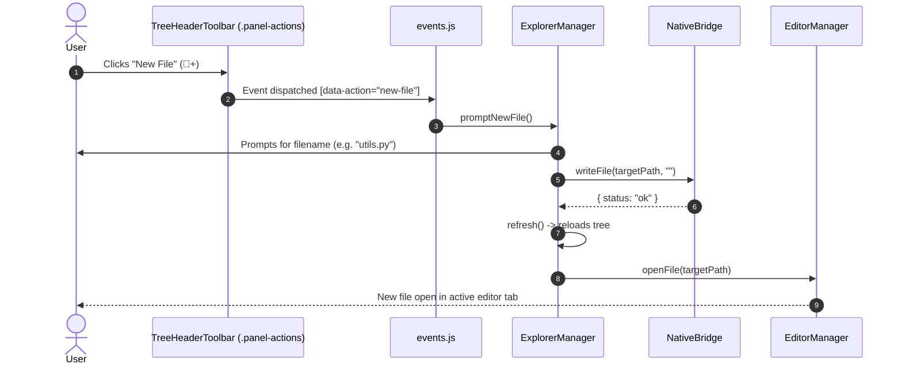

# High-Level Design (HLD): Tree Header Toolbar

**Document ID:** `ORX-HLD-TREE-HEADER-TOOLBAR-V1`  
**Version:** `1.0` (File Explorer Toolbar Architecture)  
**Target Codebase:** `DeskAI`  
**Target Files:**
* `src/deskai/static/index.html`
* `src/deskai/static/js/events.js`
* `src/deskai/static/js/explorer.js`
* `src/deskai/static/css/components.css`
* `src/deskai/static/css/tokens.css`
**Status:** Approved  
**Date:** October 28, 2026  

---

## 1. Architectural Overview & Objective

The **Tree Header Toolbar** (`.panel-header` within `.explorer-container`) is the header and quick-action bar anchored at the top of the Left Sidebar (`#sidebarLeft`). It provides section identification and primary workspace file operations:
1. Creating a new file in the active folder or workspace root.
2. Creating a new directory/folder.
3. Refreshing the file tree against disk modifications.
4. Collapsing all open folders back to the root level.

```text
┌─────────────────────────────────────────────────────────────────────────────┐
│ .panel-header                                                               │
│ ┌───────────────────────────────┐ ┌───────────────────────────────────────┐ │
│ │ EXPLORER                      │ │ [📄+] [📁+] [🔄] [⊟]                  │ │
│ │ (.panel-title)                │ │ (.panel-actions role="toolbar")       │ │
│ └───────────────────────────────┘ └───────────────────────────────────────┘ │
└─────────────────────────────────────────────────────────────────────────────┘
```

### 1.1 Problem Statement & Gaps in Initial Architecture
In initial builds, the explorer header had static HTML with placeholder click events:
* Clicking `new-file` prompted for a filename via native `prompt()` and created an untitled scratch tab, but did not persist a file to disk or place it in the file tree.
* Clicking `new-folder` called `prompt()` without invoking any backend filesystem operation.
* Clicking `refresh-tree` only emitted a `console.log("Refreshing workspace tree...")` stub without reloading the directory tree from `NativeBridge.listDir()`.
* Missing keyboard roving focus within the toolbar (`ArrowLeft`/`ArrowRight`), failing WCAG 2.1 AA toolbar specifications.

### 1.2 Target Architectural State
The enhanced Tree Header Toolbar operates as a fully functional, keyboard-accessible action bar:
* **Interactive File Creation (`new-file`):** Triggers creation of a real file inside the selected folder (or workspace root) via `NativeBridge.writeFile()` and instantly opens it in `EditorManager`.
* **Interactive Directory Creation (`new-folder`):** Calls backend directory creation or native dialog, refreshing the tree immediately.
* **Disk Re-synchronization (`refresh-tree`):** Triggers `ExplorerManager.refresh()`, clearing cached directory states and re-scanning filesystem entries via `NativeBridge.listDir()`.
* **WAI-ARIA Toolbar Compliance:** Accessible `role="toolbar"` with roving tabindex (`ArrowLeft` / `ArrowRight` navigation).

---

## 2. Architectural Decisions & Scope

* **D1 (Action Delegation):** Action buttons emit standard dataset actions (`data-action="new-file"`, `data-action="new-folder"`, `data-action="refresh-tree"`, `data-action="collapse-all"`), handled by the centralized event delegator in `src/deskai/static/js/events.js`.
* **D2 (Context-Aware Placement):** When creating a new file or folder, the target directory defaults to the currently selected folder in the tree. If a file node or nothing is selected, creation defaults to `store.state.workspace.rootPath`.
* **D3 (Token-Driven Obsidian Matte Palette):** Visual styles for buttons, hover states, active states, and focus rings strictly reference CSS custom properties defined in `tokens.css`.
* **D4 (Zero Frameworks & DOM Sanitization):** Header labels and dynamic notifications are injected using `textContent` and `createElement`.

---

## 3. Threat Model & Security Architecture (P0)

### 3.1 Path Traversal in File/Folder Creation
* **Threat:** A developer enters a malicious path such as `../../evil.sh` or `/etc/passwd` when creating a file or folder.
* **Mitigation:**
  * Input is sanitized on the frontend to extract valid relative names or strictly bounded paths.
  * The Python backend enforces canonicalization and verifies `_is_safe_path()` inside `workspace_root`. Any traversal attempt is rejected with HTTP 403 / status `error`.

### 3.2 DOM-Based Script Injection via Workspace or Directory Names
* **Threat:** Workspace directory or created file contains HTML or script payload tags (e.g. `<svg onload=alert(1)>`).
* **Mitigation:**
  * All labels, button titles, and aria attributes use `textContent` and `setAttribute`. No `innerHTML`.

---

## 4. Component Sequence Flow



---

## 5. Verification Plan

1. **Toolbar Semantics & A11y:** Verifies `role="toolbar"` and `aria-label="Explorer Actions"`.
2. **New File Workflow:** Verifies clicking `new-file` prompts for filename, writes file via `NativeBridge.writeFile`, refreshes the tree, and opens the tab.
3. **New Folder Workflow:** Verifies clicking `new-folder` creates directory and updates tree view.
4. **Refresh Tree Workflow:** Verifies clicking `refresh-tree` calls `ExplorerManager.refresh()` and queries `NativeBridge.listDir()`.
5. **Keyboard Roving Navigation:** Verifies `ArrowLeft` and `ArrowRight` cycle focus across toolbar buttons with `tabindex="0"` for the active button.
