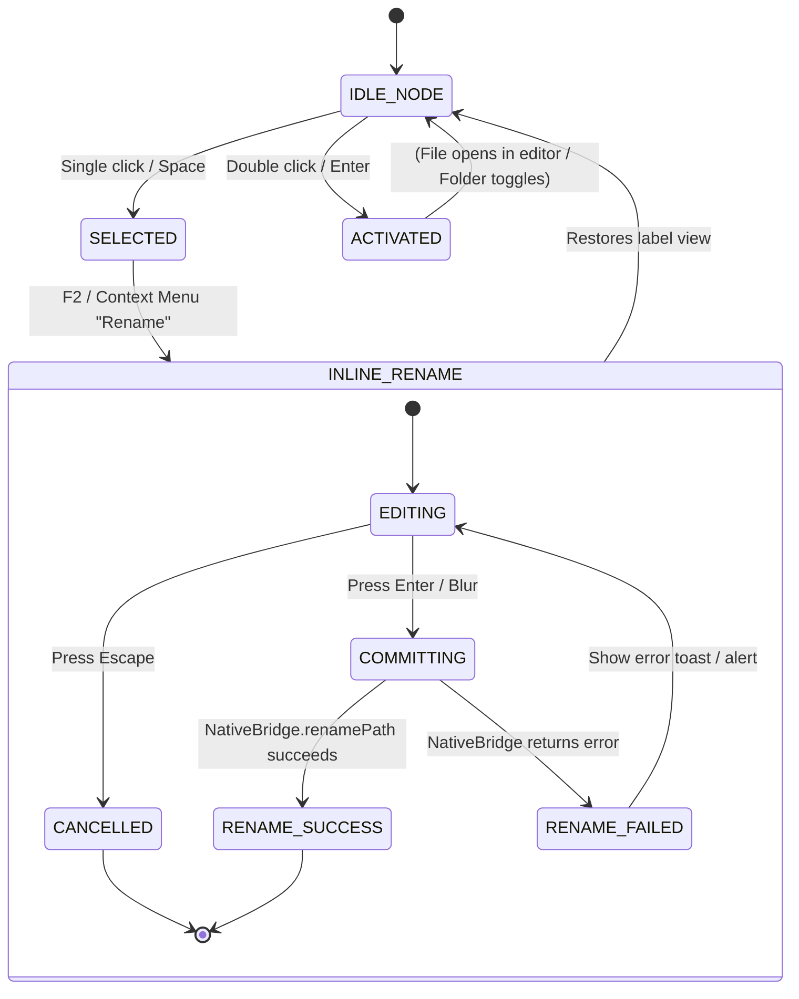

# High-Level Design (HLD): Tree Node Item

**Document ID:** `ORX-HLD-TREE-NODE-ITEM-V1`  
**Version:** `1.0` (File Explorer Node Item Architecture)  
**Target Codebase:** `DeskAI`  
**Target Files:**
* `src/deskai/static/js/explorer.js`
* `src/deskai/static/js/bridge.js`
* `src/deskai/bridge/api.py`
* `src/deskai/static/css/components.css`
* `src/deskai/static/css/tokens.css`
**Status:** Approved  
**Date:** October 28, 2026  

---

## 1. Architectural Overview & Objective

The **Tree Node Item** (`.tree-item`) is the visual representation of an individual filesystem entity (either a directory or a file) rendered within `#fileTreeViewport`. It encapsulates visual hierarchy, semantic filetype badges, selection states, folder expansion chevrons, and inline rename interaction.

```text
┌─────────────────────────────────────────────────────────────────────────────┐
│ .tree-item (.is-folder .expanded .active)                                   │
│ ┌───────────────┬────────────┬────────────┬───────────────────────────────┐ │
│ │ .tree-indent  │ .tree-arrow│ .tree-icon │ .tree-label                   │ │
│ │ (14px * level)│ (▼ or ►)   │ (📂 / 📁)  │ src                           │ │
│ └───────────────┴────────────┴────────────┴───────────────────────────────┘ │
├─────────────────────────────────────────────────────────────────────────────┤
│ .tree-item (.is-file)                                                       │
│ ┌───────────────┬────────────┬────────────┬───────────────────────────────┐ │
│ │ .tree-indent  │ (spacer)   │ .tree-icon │ .tree-label                   │ │
│ │ (14px * level)│            │ (🐍 / 🟨)  │ app.py                        │ │
│ └───────────────┴────────────┴────────────┴───────────────────────────────┘ │
└─────────────────────────────────────────────────────────────────────────────┘
```

### 1.1 Problem Statement & Implementation Reality
In basic file tree UIs:
1. **Generic Iconography:** All files display a plain emoji or text bullet without language distinction.
2. **Brittle Renaming:** File renaming requires modal dialogs or prompt popups that disrupt focus and context.
3. **Hierarchy Ambiguity:** Sub-directories lack explicit indentation guides, confusing deep directory navigation.
4. **XSS Exposure:** Rendering filenames with `innerHTML` opens vulnerability doors for malicious repos.

### 1.2 Target Architectural State
The enhanced Tree Node Item architecture provides:
* **Rich Semantic File Badges:** Dynamic filetype badges matching the Editor Tab Strip standard (`🐍` Python, `🟨` JavaScript, `🔷` TypeScript, `📦` JSON, `🌐` HTML, `🎨` CSS, `📝` Markdown, `🐚` Shell, `🗄️` SQL, `📂`/`📁` Folder, `📄` Plaintext).
* **Inline Rename Editing (F2 Shortcut):** Double-clicking a label or pressing `F2` switches the label into an inline input field `<input class="tree-rename-input">` committing via `Enter` or cancelling via `Escape`.
* **Precision Indentation:** Mathematical indentation padding (`aria-level="N"` and computed pixel width) maintaining visual alignment.
* **Strict DOM Construction:** Pure text nodes via `textContent` preventing DOM XSS injection.
* **Backend Path Sandbox Integration:** Renaming operations call `NativeBridge.renamePath()` with canonical containment checks.

---

## 2. Architectural Decisions & Scope

* **D1 (Two Distinct Item Variants):** Node items have explicit CSS classes: `.is-folder` for directories and `.is-file` for files. Folders render chevron toggles (`.tree-arrow`) and `aria-expanded` attributes.
* **D2 (Inline Rename State Machine):** Node items support temporary transition to `INLINE_EDIT` mode. While in this mode, keystrokes inside the `<input>` are isolated from tree navigation (`e.stopPropagation()`).
* **D3 (Theming & Token Adherence):** Active borders, background hover, focus outline, and text colors strictly bind to `tokens.css` variables (`--bg-hover`, `--bg-active`, `--color-primary`, `--border-regular`).
* **D4 (Editor Tab Synchronization):** Renaming a file on disk automatically updates any open buffer in `EditorManager` (`buffer.path`, `buffer.name`, `tab-label`, and tab title).

---

## 3. Threat Model & Security Architecture (P0)

### 3.1 Path Traversal in Rename Operations
* **Threat:** Renaming `app.py` to `../../etc/shadow` or outside workspace boundaries.
* **Mitigation:**
  * Input value is sanitized to extract basename or validate target relative path.
  * Python backend enforces `_is_safe_path()` on both `old_path` and `new_path`. Traversal attempts return status `error` with `Access denied`.

### 3.2 File Overwrite Collisions
* **Threat:** Renaming a file to an existing destination filename, silently overwriting existing code.
* **Mitigation:**
  * Backend verifies destination path existence; if destination already exists, prompts user or rejects operation with `Destination already exists`.

---

## 4. Component State Machine



---

## 5. Verification Plan

1. **Semantic Icon Mapping:** Verifies accurate badge rendering based on file extension (`.py` -> `🐍`, `.js` -> `🟨`, `.md` -> `📝`, etc.).
2. **Hierarchy Indentation:** Verifies child nodes in level 2 and level 3 have computed indent spacing and `aria-level`.
3. **Folder Chevron Toggle:** Verifies chevron arrow toggles between `►` and `▼` on expansion.
4. **F2 Inline Rename Mode:** Verifies pressing `F2` mounts `<input class="tree-rename-input">` prefilled with existing filename.
5. **Rename Commit:** Verifies pressing `Enter` calls `NativeBridge.renamePath()`, reloads tree, and updates open editor tabs.
6. **Rename Cancellation:** Verifies pressing `Escape` restores original label without modifying disk.
