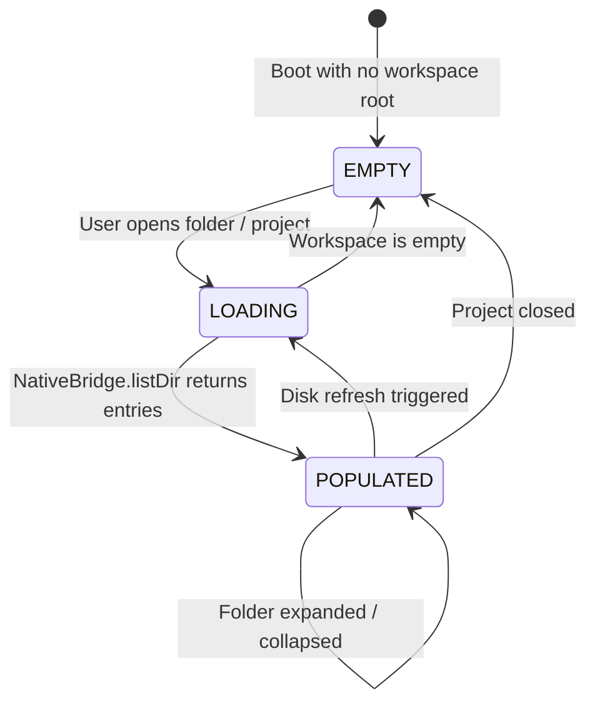

# High-Level Design (HLD): Tree Viewport

**Document ID:** `ORX-HLD-TREE-VIEWPORT-V1`  
**Version:** `1.0` (File Explorer Tree Viewport Architecture)  
**Target Codebase:** `DeskAI`  
**Target Files:**
* `src/deskai/static/index.html`
* `src/deskai/static/js/explorer.js`
* `src/deskai/static/js/events.js`
* `src/deskai/static/css/components.css`
* `src/deskai/static/css/tokens.css`
**Status:** Approved  
**Date:** October 28, 2026  

---

## 1. Architectural Overview & Objective

The **Tree Viewport** (`#fileTreeViewport`) is the scrollable, interactive container located directly below `.panel-header` inside `.explorer-container` within the Left Sidebar (`#sidebarLeft`). It functions as the visual and interactive surface representing the directory structure of the loaded workspace.

```text
┌─────────────────────────────────────────────────────────────────────────────┐
│ .panel-header (EXPLORER toolbar: [📄+] [📁+] [🔄] [⊟])                      │
├─────────────────────────────────────────────────────────────────────────────┤
│ .tree-viewport #fileTreeViewport [role="tree", aria-label="Project Files"]   │
│   ┌─────────────────────────────────────────────────────────────────────┐   │
│   │ ▼ 📁 src/                             (aria-expanded="true")        │   │
│   │   │   ├── 📄 app.js                   (role="treeitem", level="2")  │   │
│   │   │   └── 🐍 server.py                (role="treeitem", level="2")  │   │
│   │   ▼ 📁 static/                        (aria-expanded="true")        │   │
│   │       ├── 🎨 style.css                (role="treeitem", level="3")  │   │
│   │       └── 🌐 index.html               (role="treeitem", level="3")  │   │
│   │   ► 📁 tests/                         (aria-expanded="false")       │   │
│   │   📄 README.md                        (role="treeitem", level="1")  │   │
│   │   📦 package.json                     (role="treeitem", level="1")  │   │
│   └─────────────────────────────────────────────────────────────────────┘   │
└─────────────────────────────────────────────────────────────────────────────┘
```

### 1.1 Problem Statement & Implementation Reality
A modern desktop IDE requires a fluid, highly accessible file tree. Flaws in traditional web trees include:
1. **Broken Keyboard Accessibility:** Lack of standard desktop WAI-ARIA Treeview navigation (`ArrowDown`/`ArrowUp`, `ArrowRight` to expand, `ArrowLeft` to collapse/parent, `Enter` to open).
2. **Scroll Desynchronization:** Refreshing the tree resets scroll position to the top, disrupting developer context during background agent operations.
3. **Ghost Loading / Flash of Unstyled Content:** Failure to gracefully handle empty workspaces or network/IPC latency during large folder scans.
4. **DOM Bloat & XSS Ingestion:** Evaluating arbitrary filenames with `innerHTML` opens XSS vulnerabilities when cloning untrusted repositories.

### 1.2 Target Architectural State
The enhanced Tree Viewport establishes:
* **Strict WAI-ARIA 1.2 Tree Pattern:** Full compliance with `role="tree"`, hierarchical `role="treeitem"`, and roving `tabindex="0"` for the active item with `tabindex="-1"` for inactive items.
* **Ergonomic Keyboard Navigation:** Comprehensive keyboard state machine supporting vertical roving (`ArrowUp`/`ArrowDown`), folder toggling (`ArrowRight`/`ArrowLeft`), boundary navigation (`Home`/`End`), and activation (`Enter`/`Space`).
* **Scroll Preservation:** Internal tracking of `scrollTop` during disk refreshes to maintain scroll position seamlessly.
* **Contextual Viewport States:** Clear transitions between **EMPTY** (helpful onboarding prompt), **LOADING** (subtle indicator), and **POPULATED** (interactive tree).
* **Obsidian Matte + Amber Styling:** Strict CSS custom properties from `tokens.css` with responsive scrollbars and clear focus-visible rings.

---

## 2. Architectural Decisions & Scope

* **D1 (Standard WAI-ARIA Treeview):** The viewport container implements `role="tree"` with `aria-label="Project Files"`. Direct child items or nested groups implement `role="treeitem"` and `role="group"`.
* **D2 (Roving Focus Management):** Exactly one visible treeitem has `tabindex="0"`; all other treeitems have `tabindex="-1"`. When the viewport gains focus via Tab, focus lands on the previously selected or first visible item.
* **D3 (Scroll & Expansion State Preservation):** The controller retains `expandedDirs: Set<string>` and `scrollTop: number`. Refreshing the tree re-applies expanded folder states and restores `scrollTop`.
* **D4 (Zero Frameworks & DOM Sanitization):** Every node, label, and badge is built via `document.createElement()` and `textContent`. No raw HTML injection.
* **D5 (Non-Blocking Lazy Expansion):** Root directory entries are loaded initially; expanding a folder dynamically scans and loads subdirectories on demand via `NativeBridge.listDir(folderPath)`.

---

## 3. Threat Model & Security Architecture (P0)

### 3.1 Script Injection via Malicious Directory Entries
* **Threat:** A cloned repository contains filenames with HTML markup or script tags (`<script>alert(1)</script>`, `img src=x onerror=...`).
* **Mitigation:**
  * Strict DOM construction: labels are assigned solely via `node.textContent = entry.name`.
  * Path references are bound to DOM datasets (`data-path`) via `setAttribute` without HTML decoding.

### 3.2 Directory Traversal Beyond Workspace Root
* **Threat:** Symlinks or crafted relative paths attempting to navigate outside `store.state.workspace.rootPath`.
* **Mitigation:**
  * Frontend normalizes paths to forward slashes.
  * Backend PyWebView RPC (`list_dir()`) calls `canonicalize_path()` and enforces `_is_safe_path()`. Access outside workspace returns status `error` with `Access denied`.

---

## 4. Viewport State Machine



---

## 5. Keyboard Navigation Logic (WAI-ARIA Treeview)

| Key | Focused Node Type | Viewport Behavior |
| :--- | :--- | :--- |
| **`ArrowDown`** | Any visible node | Moves focus to the next visible tree item. |
| **`ArrowUp`** | Any visible node | Moves focus to the previous visible tree item. |
| **`ArrowRight`** | Collapsed folder | Expands the folder (`aria-expanded="true"`). |
| **`ArrowRight`** | Expanded folder | Moves focus to the first child inside the folder. |
| **`ArrowRight`** | File node | No action. |
| **`ArrowLeft`** | Expanded folder | Collapses the folder (`aria-expanded="false"`). |
| **`ArrowLeft`** | Child node or collapsed folder | Moves focus to the parent folder. |
| **`Home`** | Any visible node | Moves focus to the first visible node in the tree. |
| **`End`** | Any visible node | Moves focus to the last visible node in the tree. |
| **`Enter`** | File node | Opens the file in the editor (`EditorManager.openFile()`). |
| **`Enter`** | Folder node | Toggles folder expansion. |
| **`Space`** | Any node | Selects the node without opening. |

---

## 6. Verification Plan

1. **WAI-ARIA Semantics:** Verifies `#fileTreeViewport` has `role="tree"` and `aria-label="Project Files"`.
2. **Empty State Display:** Verifies helpful empty message rendered when no entries exist.
3. **Roving Tabindex Lifecycle:** Verifies active item has `tabindex="0"` and inactive items have `tabindex="-1"`.
4. **Keyboard Arrow Navigation:** Verifies `ArrowDown` and `ArrowUp` move focus sequentially across visible nodes.
5. **Folder Expand/Collapse on Key:** Verifies `ArrowRight` expands collapsed folders and `ArrowLeft` collapses expanded folders.
6. **File Activation on Enter:** Verifies pressing `Enter` on a file node calls `EditorManager.openFile(path)`.
7. **Scroll Position Retention:** Verifies `scrollTop` is recorded before refresh and restored after re-render.
