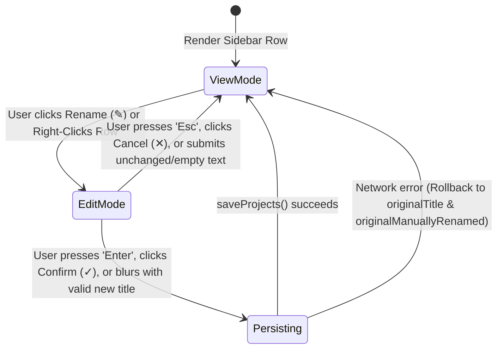

# Low-Level Design (LLD): Inline Chat Renaming (Quick & Native)

**Document ID:** `ORX-LLD-INLINE-CHAT-RENAMING-V2`  
**Version:** `2.0` (Defect-Resolved & Synchronized with HLD V2)  
**Parent Document:** `ORX-HLD-INLINE-CHAT-RENAMING-V2`  
**Target Codebase:** `DeskAI`  
**Primary Target File:** `src/deskai/static/index.html`  
**Status:** Approved for Implementation  
**Date:** October 24, 2026  

---

## 1. Executive Summary & Objective

In the current implementation of Desktop AI Studio, clicking the rename icon (`✎`) or right-clicking a chat session triggers the browser's native modal dialog:
```javascript
const newTitle = prompt('Enter new chat title:', sess.title);
```
In WebKitGTK / PyWebView on Linux (GNOME/X11/Wayland), this synchronous call yields severe usability drawbacks:
1. **Thread Blocking:** Halts the WebKit rendering thread and JavaScript event loop until closed.
2. **Visual Immersion Break:** Renders an unstyled OS-level pop-up displaying `http://127.0.0.1:8765` and internal session tokens, disrupting the dark aesthetic.
3. **Ergonomic Friction:** Forces mouse movement away from the sidebar into the center of the display.

**Objective:** Replace the modal prompt with an **in-place, non-blocking inline editor**. Clicking the rename button or right-clicking a session row will instantly transform the static session row into a focused text input accompanied by inline Confirm (`✓`) and Cancel (`✕`) action buttons, matching modern IDE conventions (VS Code, Cursor, JetBrains).

---

## 2. Component Architecture & UI State Machine

The chat session listing resides within `#projectsTree` inside the sidebar. Each session row (`.task-item-row`) transitions across three states:



### 2.1 State Matrix

| State | CSS Modifier | Title Element | Action Icons Displayed | Interaction Behavior |
| :--- | :--- | :--- | :--- | :--- |
| **View Mode (Default)** | `.task-item-row` | Static `<span>` with text truncation | Edit (`✎`), Delete (`🗑`) | Clicking row switches active session; clicking `✎` or right-clicking enters Edit Mode. |
| **Edit Mode (Active)** | `.task-item-row.is-editing` | Controlled `<input type="text">` | Confirm (`✓`), Cancel (`✕`) | Auto-focused; clicking row does NOT switch session; `Enter`/`✓` saves; `Esc`/`✕` cancels. |
| **Persisting Mode** | `.task-item-row.is-editing.is-saving` | Disabled `<input>` (muted) | Disabled Confirm (`✓`) & Cancel (`✕`) | Concurrency lock active; duplicate submissions and blur handlers ignored. |

---

## 3. Data Structures & State Model

To maintain single-instance editing throughout the sidebar without polluting persistent project models, a singleton state object is maintained in JavaScript scope:

```javascript
/**
 * Singleton tracker for the active inline rename operation.
 * Guarantees that only ONE session across all projects can be in edit mode at a time.
 */
let activeInlineRename = {
  projectId: null,                // string | null: target project ID (e.g. 'proj_1729729800000')
  sessionId: null,                // string | null: target session ID (e.g. 'sess_1729729812345')
  originalTitle: '',              // string: backup of title prior to editing
  originalManuallyRenamed: false, // boolean: backup of manuallyRenamed flag for clean rollback
  isSaving: false,                // boolean: concurrency lock preventing multi-trigger
  isClosing: false                // boolean: guard preventing synchronous DOM-unmount blur races
};
```

---

## 4. DOM Hierarchy & Component Layout

### 4.1 View Mode DOM Structure (Existing)
```html
<div class="task-item-row" onclick="switchSession('proj_1', 'sess_1')">
  <div class="task-title-wrapper">
    <svg class="chat-icon">...</svg>
    <span>Project Architecture Analysis</span>
  </div>
  <div class="task-actions" style="display: flex; align-items: center; gap: 2px;">
    <button class="project-action-btn" title="Rename Chat">
      <svg class="edit-icon">...</svg>
    </button>
    <button class="project-action-btn project-del-btn" title="Delete Chat">
      <svg class="trash-icon">...</svg>
    </button>
  </div>
</div>
```

### 4.2 Edit Mode DOM Structure (Target)
When `activeInlineRename.sessionId === sess.id`, `renderProjectsTree()` renders:

```html
<div class="task-item-row is-editing" onclick="event.stopPropagation()">
  <div class="inline-rename-wrapper">
    <span class="inline-rename-glyph">
      <!-- SVG_ICONS.chat -->
    </span>
    <input 
      type="text" 
      class="inline-rename-input" 
      id="inline_rename_input_sess_1"
      value="Project Architecture Analysis" 
      maxlength="100"
      autocomplete="off"
      spellcheck="false"
    />
  </div>
  <div class="inline-rename-actions">
    <button 
      type="button" 
      class="inline-action-btn btn-confirm" 
      title="Save (Enter)" 
      onmousedown="event.preventDefault()" 
      onclick="commitInlineRenameSession('proj_1', 'sess_1')"
    >
      <!-- SVG_ICONS.check -->
    </button>
    <button 
      type="button" 
      class="inline-action-btn btn-cancel" 
      title="Cancel (Esc)" 
      onmousedown="event.preventDefault()" 
      onclick="cancelInlineRenameSession()"
    >
      <!-- SVG_ICONS.cross -->
    </button>
  </div>
</div>
```

---

## 5. CSS Styling Specifications

```css
/* =========================================================================
   Inline Chat Renaming Styles (ORX-LLD-INLINE-CHAT-RENAMING-V2)
   ========================================================================= */

/* Parent row in editing state */
.task-item-row.is-editing {
  background: var(--bg-surface, #1e2024) !important;
  border-color: #3b82f6 !important;
  cursor: default !important;
  padding: 3px 6px !important;
  box-shadow: 0 0 0 1px rgba(59, 130, 246, 0.25);
}

/* Flex container for icon and text input */
.inline-rename-wrapper {
  display: flex;
  align-items: center;
  gap: 6px;
  flex: 1;
  min-width: 0;
  margin-right: 6px;
}

.inline-rename-glyph {
  display: inline-flex;
  align-items: center;
  color: var(--accent, #7c4dff);
  flex-shrink: 0;
}

/* Styled text input box */
.inline-rename-input {
  width: 100%;
  background: #141517;
  color: var(--text-main, #e2e8f0);
  border: 1px solid #475569;
  border-radius: 4px;
  padding: 2px 6px;
  font-size: 12px;
  font-family: inherit;
  line-height: 18px;
  outline: none;
  box-sizing: border-box;
  transition: border-color 0.15s ease, box-shadow 0.15s ease;
}

.inline-rename-input:focus {
  border-color: #3b82f6;
  box-shadow: 0 0 0 2px rgba(59, 130, 246, 0.2);
  background: #101113;
}

/* Action button group (Confirm / Cancel) */
.inline-rename-actions {
  display: flex;
  align-items: center;
  gap: 3px;
  flex-shrink: 0;
}

.inline-action-btn {
  background: transparent;
  border: 1px solid transparent;
  border-radius: 4px;
  padding: 2px;
  width: 20px;
  height: 20px;
  display: inline-flex;
  align-items: center;
  justify-content: center;
  cursor: pointer;
  color: var(--text-muted, #94a3b8);
  transition: all 0.12s ease;
}

.inline-action-btn:hover {
  background: rgba(255, 255, 255, 0.08);
}

/* Confirm Button hover state: green accent */
.inline-action-btn.btn-confirm:hover {
  color: #4ade80;
  border-color: rgba(74, 222, 128, 0.3);
  background: rgba(74, 222, 128, 0.1);
}

/* Cancel Button hover state: red accent */
.inline-action-btn.btn-cancel:hover {
  color: #f87171;
  border-color: rgba(248, 113, 113, 0.3);
  background: rgba(248, 113, 113, 0.1);
}

/* Disabled saving state */
.task-item-row.is-saving .inline-rename-input,
.task-item-row.is-saving .inline-action-btn {
  opacity: 0.6;
  pointer-events: none;
}
```

---

## 6. End-to-End Control Flow & Algorithms

```mermaid
sequenceDiagram
    autonumber
    actor User
    participant Row as Session Row (.task-item-row)
    participant State as activeInlineRename State
    participant Tree as renderProjectsTree()
    participant Header as updateHeaderTitles()
    participant Disk as saveProjects() (/api/projects/save)

    User->>Row: Click Rename Icon (✎) or Right-Click
    Note over Row: e.stopPropagation() & e.preventDefault()
    Row->>State: startInlineRenameSession(projId, sessId)
    State->>Tree: Re-render sidebar (Render <input>)
    Tree->>Row: requestAnimationFrame -> focus() & select()
    
    alt User cancels (Escape or Click ✕)
        User->>Row: Press Escape or Click ✕
        Row->>State: cancelInlineRenameSession() (sets isClosing = true)
        State->>Tree: Re-render sidebar (Restore static title)
    else User confirms (Enter, Click ✓, or Blur)
        User->>Row: Press Enter, Click ✓, or Click Outside
        Row->>State: commitInlineRenameSession(projId, sessId)
        State->>State: Validate sanitizedTitle (1..100 chars & !== originalTitle)
        alt Invalid (Empty or Unchanged)
            State->>Tree: cancelInlineRenameSession()
        else Valid (Modified string)
            State->>State: Cache backupTitle & backupManuallyRenamed locally
            State->>State: Mutate sess.title & sess.manuallyRenamed = true
            State->>Header: updateHeaderTitles() (if active session)
            State->>Tree: Clear activeInlineRename & renderProjectsTree()
            State->>Disk: await saveProjects()
            alt Persistence Error
                Disk-->>State: Throw Error
                State->>State: Rollback sess.title = backupTitle & manuallyRenamed = backupManuallyRenamed
                State->>Header: updateHeaderTitles()
                State->>Tree: renderProjectsTree()
            end
        end
    end
```



---

## 7. Concrete Code Implementation Details

### 7.1 Lifecycle Functions

#### Function 1: `resetInlineRenameState()`
Internal helper to cleanly reset the singleton tracker:

```javascript
function resetInlineRenameState() {
  activeInlineRename = {
    projectId: null,
    sessionId: null,
    originalTitle: '',
    originalManuallyRenamed: false,
    isSaving: false,
    isClosing: false
  };
}
```

#### Function 2: `startInlineRenameSession(projectId, sessionId, event)`
Initiates editing mode, cancels any active edit session on other chats, and auto-focuses the input:

```javascript
function startInlineRenameSession(projectId, sessionId, event) {
  if (event) {
    event.stopPropagation();
    event.preventDefault();
  }

  if (activeInlineRename.isSaving) return;

  const proj = projects.find(p => p.id === projectId);
  if (!proj) return;
  const sess = (proj.sessions || []).find(s => s.id === sessionId);
  if (!sess) return;

  // Guard against synchronous blur on previous input if switching active edit rows
  activeInlineRename.isClosing = true;

  // Single edit lock: initialize state for target session
  activeInlineRename = {
    projectId: projectId,
    sessionId: sessionId,
    originalTitle: sess.title || '',
    originalManuallyRenamed: Boolean(sess.manuallyRenamed),
    isSaving: false,
    isClosing: false
  };

  renderProjectsTree();

  // Focus and select all text after DOM paint
  requestAnimationFrame(() => {
    const inputEl = document.getElementById(`inline_rename_input_${sessionId}`);
    if (inputEl) {
      inputEl.focus();
      inputEl.select();
    }
  });
}
```

#### Function 3: `cancelInlineRenameSession()`
Restores View Mode without applying modifications, safely suppressing unmount blur events:

```javascript
function cancelInlineRenameSession() {
  if (!activeInlineRename.sessionId || activeInlineRename.isClosing) return;
  activeInlineRename.isClosing = true;
  resetInlineRenameState();
  renderProjectsTree();
}
```

#### Function 4: `commitInlineRenameSession(projectId, sessionId)`
Validates input, caches rollback state locally, optimistically updates UI, synchronizes breadcrumbs, and persists to disk:

```javascript
async function commitInlineRenameSession(projectId, sessionId) {
  if (activeInlineRename.isSaving || activeInlineRename.isClosing) return;
  if (activeInlineRename.projectId !== projectId || activeInlineRename.sessionId !== sessionId) return;

  const proj = projects.find(p => p.id === projectId);
  if (!proj) {
    cancelInlineRenameSession();
    return;
  }
  const sess = (proj.sessions || []).find(s => s.id === sessionId);
  if (!sess) {
    cancelInlineRenameSession();
    return;
  }

  const inputEl = document.getElementById(`inline_rename_input_${sessionId}`);
  const rawValue = inputEl ? inputEl.value : '';
  const sanitizedTitle = rawValue.trim();

  // Rule: Empty title or unchanged -> cancel edit safely without network call
  if (!sanitizedTitle || sanitizedTitle === activeInlineRename.originalTitle) {
    cancelInlineRenameSession();
    return;
  }

  // Capture rollback values locally BEFORE resetting singleton state
  const backupTitle = activeInlineRename.originalTitle;
  const backupManuallyRenamed = activeInlineRename.originalManuallyRenamed;

  // Lock state to prevent duplicate Enter/Blur triggers during DOM unmount
  activeInlineRename.isSaving = true;
  activeInlineRename.isClosing = true;

  // Optimistic UI Update
  sess.title = sanitizedTitle;
  sess.manuallyRenamed = true;

  // Synchronize top header breadcrumbs if active session was renamed
  if (currentProjectId === projectId && currentSessionId === sessionId) {
    updateHeaderTitles();
  }

  // Clear active rename state and re-render View Mode immediately
  resetInlineRenameState();
  renderProjectsTree();

  // Asynchronous Persistence to local disk
  try {
    await saveProjects();
  } catch (err) {
    console.error('Failed to persist renamed session:', err);
    // Accurate Rollback using cached local variables
    sess.title = backupTitle;
    sess.manuallyRenamed = backupManuallyRenamed;
    if (currentProjectId === projectId && currentSessionId === sessionId) {
      updateHeaderTitles();
    }
    renderProjectsTree();
  }
}
```

#### Function 5: Keyboard Event Dispatcher
Handles `Enter`, `Escape`, and suppresses event bubbling:

```javascript
function handleInlineRenameKeyDown(event, projectId, sessionId) {
  // Prevent hotkeys from firing global Studio actions
  event.stopPropagation();

  if (event.key === 'Enter') {
    event.preventDefault();
    commitInlineRenameSession(projectId, sessionId);
  } else if (event.key === 'Escape') {
    event.preventDefault();
    cancelInlineRenameSession();
  }
}
```

#### Function 6: Blur (Click Outside) Handler
Safely ignores unmount-triggered blurs and action-button clicks, auto-committing valid edits on outside clicks:

```javascript
function handleInlineRenameBlur(event, projectId, sessionId) {
  // Guard: Ignore blur if triggered by DOM removal during Enter/Escape/Cancel/Save
  if (activeInlineRename.isClosing || activeInlineRename.isSaving) {
    return;
  }
  if (activeInlineRename.projectId !== projectId || activeInlineRename.sessionId !== sessionId) {
    return;
  }

  // If focus shifted to confirm/cancel button, let button onclick handle it
  const related = event.relatedTarget;
  if (related && related.closest && related.closest('.inline-rename-actions')) {
    return;
  }

  // Auto-commit on blur if text is valid and modified, otherwise cancel
  const inputEl = document.getElementById(`inline_rename_input_${sessionId}`);
  const val = inputEl ? inputEl.value.trim() : '';
  if (val && val !== activeInlineRename.originalTitle) {
    commitInlineRenameSession(projectId, sessionId);
  } else {
    cancelInlineRenameSession();
  }
}
```

---

## 8. Edge Cases & Defensive Safeguards

| Scenario | Potential Failure Mode | Defensive Mitigation |
| :--- | :--- | :--- |
| **DOM Unmount Blur Race** | Pressing `Enter` or `Esc` calls `renderProjectsTree()`, removing `<input>` from DOM and synchronously firing `onblur`. | `activeInlineRename.isClosing = true` is set prior to DOM re-render; `handleInlineRenameBlur()` exits immediately when `isClosing` is true. |
| **Rollback Empty Title Bug** | Resetting `activeInlineRename.originalTitle = ''` before `await saveProjects()` caused `catch` rollback to set `sess.title = ''`. | `backupTitle` and `backupManuallyRenamed` are cached in local `const` variables before state reset and used in the `catch` block. |
| **Blur vs. Button Click Race** | Clicking Confirm (`✓`) or Cancel (`✕`) fires `onblur` on `<input>` before button `onclick`. | `onmousedown="event.preventDefault()"` is bound to Confirm and Cancel buttons, retaining input focus during click. |
| **Accidental Session Switch** | Clicking inside `<input>` bubbles up to `.task-item-row.onclick`. | `stopPropagation()` is attached to both `taskRow.onclick` and `input.onclick` in Edit Mode. |
| **Multiple Concurrent Edits** | Clicking rename on Session B while Session A is in edit mode. | `startInlineRenameSession` sets `isClosing = true` for Session A before initializing Session B and calling `renderProjectsTree()`. |
| **Special Characters / XSS** | User inputs `<script>` or HTML entities as session title. | Input uses DOM property `.value = sess.title`; View Mode renders via `escapeHtml(sess.title)`. |

---

## 9. Verification & Test Plan

| Test ID | Test Scenario | Steps | Expected Outcome |
| :--- | :--- | :--- | :--- |
| **TC-IR-01** | **Enter Edit Mode** | Click the `✎` icon on any chat item. | Static title changes into `<input>`, Confirm and Cancel icons appear, input is auto-focused with text highlighted. No `window.prompt` appears. |
| **TC-IR-02** | **Save via Enter Key** | Edit text to "Backend Refactoring", press `Enter`. | `commitInlineRenameSession` executes exactly once; `onblur` is ignored via `isClosing`; title updates in sidebar, breadcrumb, and disk. |
| **TC-IR-03** | **Save via Checkmark** | Edit text, click `✓` icon. | Input closes immediately with updated title; no layout shift occurs. |
| **TC-IR-04** | **Cancel via Escape Key** | Type new text, press `Esc`. | Input closes without triggering `onblur` auto-save; original title remains untouched. |
| **TC-IR-05** | **Cancel via Cross Icon** | Type new text, click `✕` icon. | Input closes, reverting to original title without dispatching network calls. |
| **TC-IR-06** | **Blur Auto-Commit** | Modify text, click elsewhere in the sidebar. | Changes are committed and saved; sidebar returns to View Mode smoothly. |
| **TC-IR-07** | **Empty String Rejection** | Clear all text in `<input>`, press `Enter`. | Edit aborts; title reverts to previous name without saving empty string. |
| **TC-IR-08** | **Single Lock Transition** | Open edit mode on Chat 1, then click `✎` on Chat 2. | Chat 1 closes cleanly without side effects; Chat 2 enters edit mode. |
| **TC-IR-09** | **Right-Click Integration** | Right-click on a chat item. | Enters inline edit mode directly without browser context popups. |
| **TC-IR-10** | **Network Failure Rollback** | Simulate `/api/projects/save` error after renaming "Task Session" to "New Name". | Catch block restores `"Task Session"` and original `manuallyRenamed` boolean in both sidebar and header breadcrumb. |
