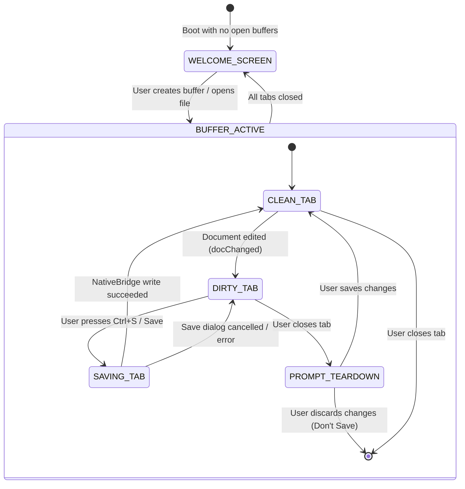

# High-Level Design (HLD): Multi-Tab Editor Stage

**Document ID:** `ORX-HLD-MULTI-TAB-EDITOR-STAGE-V1`  
**Version:** `1.0` (Unified Multi-Buffer Studio Architecture)  
**Target Codebase:** `DeskAI`  
**Target Files:**
* `src/deskai/static/index.html`
* `src/deskai/static/js/editor.js`
* `src/deskai/static/js/welcome.js`
* `src/deskai/static/js/bridge.js`
* `src/deskai/static/js/state.js`
* `src/deskai/static/js/events.js`
* `src/deskai/static/css/components.css`
* `src/deskai/static/css/tokens.css`
**Status:** Approved  
**Date:** October 28, 2026  

---

## 1. Architectural Overview & Objective

The **Multi-Tab Editor Stage** (`#editorStage`) is the central code editing and document workspace in the DeskAI IDE. Positioned between the Left Explorer Sidebar (`#sidebarLeft`) and the Right Telemetry/Agent Sidebar (`#sidebarRight`), directly above the Collapsible Bottom Drawer (`#bottomDrawer`), it unifies all document rendering, editing, tab navigation, and welcome screen quick-action workflows.

```text
┌─────────────────────────────────────────────────────────────────────────────┐
│ #editorStage (Multi-Tab Editor Stage Container)                             │
│ ┌─────────────────────────────────────────────────────────────────────────┐ │
│ │ 1. Editor Tab Strip (#editorTabStrip)                                   │ │
│ │    [ 🐍 main.py ✕ ] [ 📄 app.js ● ✕ ] [ 📝 README.md ✕ ]                 │ │
│ └─────────────────────────────────────────────────────────────────────────┘ │
│ ┌─────────────────────────────────────────────────────────────────────────┐ │
│ │ .editor-viewport (#editorViewport)                                      │ │
│ │   ┌───────────────────────────────────────────────────────────────────┐ │ │
│ │   │ 2. Welcome Screen Overlay (#welcomeScreen)                        │ │ │
│ │   │    (Visible when 0 tabs open: Recent Projects, Open File, New)    │ │ │
│ │   └───────────────────────────────────────────────────────────────────┘ │ │
│ │   ┌───────────────────────────────────────────────────────────────────┐ │ │
│ │   │ 3. CodeMirror Surface Host (#codeEditorHost)                      │ │ │
│ │   │    • Active .editor-view-container (display: block)               │ │ │
│ │   │    • Inactive .editor-view-container (display: none)              │ │ │
│ │   └───────────────────────────────────────────────────────────────────┘ │ │
│ └─────────────────────────────────────────────────────────────────────────┘ │
│ 4. Headless Core: Editor Buffer Controller (EditorManager in editor.js)     │
└─────────────────────────────────────────────────────────────────────────────┘
```

### 1.1 The Four Unified Subcomponents

The Multi-Tab Editor Stage synthesizes four dedicated subcomponents:

1. **`welcome-screen-overlay` (`#welcomeScreen` / `welcome.js`):**  
   The zero-buffer overlay that automatically reveals when all tabs are closed. Provides quick-action cards (*New File*, *Open File*, *Open Folder*, *Clone Repo*) and persistent Recent Projects history backed by `localStorage` and `NativeBridge`.
2. **`editor-tab-strip` (`#editorTabStrip` / `editor.js`):**  
   The horizontal WAI-ARIA `tablist` container rendering open document pills, filetype icon badges (`🐍`, `🟨`, `🔷`, `📦`, `🌐`, `🎨`, `📝`, `🐚`, `🗄️`, `📄`), unsaved changes dirty indicators (`●`), middle-click tab closure, horizontal mouse wheel translation, and roving keyboard focus.
3. **`codemirror-surface-host` (`#codeEditorHost` / `editor.js`):**  
   The viewport mounting CodeMirror 6 `EditorView` surfaces for each open buffer. Retains state in DOM memory across tab switches without teardown, applies the Obsidian Matte + Amber palette via `tokens.css`, reflows automatically on split-pane resizes via `ResizeObserver`, and prevents keyboard trapping with `Escape` disengagement.
4. **`editor-buffer-controller` (`EditorManager` in `editor.js`):**  
   The underlying headless controller managing `BufferEntity` memory maps, canonical path indexing for duplicate open prevention, file system persistence via `NativeBridge`, dirty modification tracking, and store synchronization (`store.state.editor`).

---

## 2. Architectural Decisions & Scope

* **D1 (Zero-Framework Vanilla ES6 Architecture):** Zero virtual DOM, React, Vue, or Angular overhead. All UI rendering executes natively through strict DOM APIs (`createElement`, `textContent`, `setAttribute`).
* **D2 (Strict XSS & Sandboxing Guard Rails):** Absolute prohibition of `innerHTML` for dynamic filenames, file paths, or buffer contents. All I/O operations are validated against workspace sandboxes by the Python backend.
* **D3 (DOM-Retained Surface Strategy):** CodeMirror surfaces are preserved in DOM memory (`display: block` for active, `display: none` for inactive), ensuring zero latency tab switching, instant cursor restoration, and intact undo/redo stacks.
* **D4 (Token-Driven Obsidian Matte Theme):** Strict hygiene: zero hardcoded hex or rgba color codes outside `src/deskai/static/css/tokens.css`.
* **D5 (Guarded Unsaved Changes Teardown):** Closing a dirty buffer or shutting down the IDE triggers an explicit confirmation dialog before destructive teardown.

---

## 3. High-Level Component State Machine



---

## 4. Verification & Testing Matrix

The Multi-Tab Editor Stage is protected by 35 dedicated Playwright end-to-end and unit tests:
* `tests/test_welcome_screen_overlay.py` (8 tests)
* `tests/test_editor_tab_strip.py` (9 tests)
* `tests/test_codemirror_surface_host.py` (9 tests)
* `tests/test_editor_buffer_controller.py` (9 tests)
* CSS Token & Variable Hygiene check (`tests/test_ports_tab.py`)
