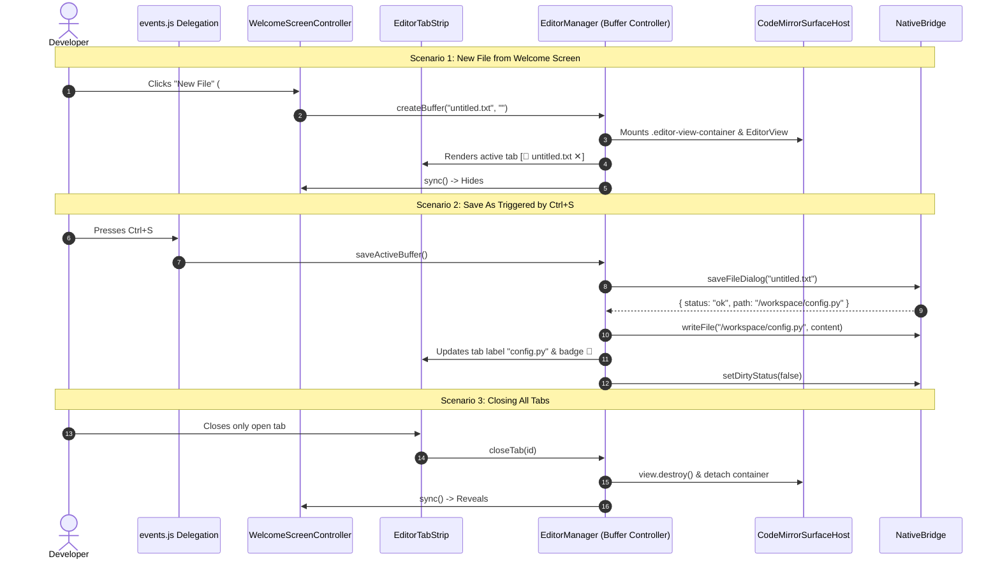

# Low-Level Design (LLD): Multi-Tab Editor Stage

**Document ID:** `ORX-LLD-MULTI-TAB-EDITOR-STAGE-V1`  
**Version:** `1.0` (Unified Multi-Buffer Studio Architecture)  
**Parent Document:** `ORX-HLD-MULTI-TAB-EDITOR-STAGE-V1`  
**Target Codebase:** `DeskAI`  
**Target Files:**
* `src/deskai/static/index.html`
* `src/deskai/static/js/editor.js`
* `src/deskai/static/js/welcome.js`
* `src/deskai/static/js/bridge.js`
* `src/deskai/static/js/state.js`
* `src/deskai/static/js/events.js`
* `src/deskai/static/css/components.css`
* `src/deskai/static/css/tokens.css`
* `tests/test_welcome_screen_overlay.py`
* `tests/test_editor_tab_strip.py`
* `tests/test_codemirror_surface_host.py`
* `tests/test_editor_buffer_controller.py`
**Status:** Approved  
**Date:** October 28, 2026  

---

## 1. Executive Summary & Objective

The **Multi-Tab Editor Stage** (`#editorStage`) coordinates document editing, tabbed navigation, welcome screen overlays, and file lifecycle persistence in the DeskAI desktop IDE.

This Low-Level Design defines:
1. The master DOM layout structure within `#editorStage`.
2. Inter-subcomponent event flows and data contracts between `WelcomeScreenController`, `EditorTabStrip`, `CodeMirrorSurfaceHost`, and `EditorManager`.
3. Complete CSS styling tokens and layout rules.
4. Comprehensive testing checklist across all 4 subcomponents.

---

## 2. Master DOM Hierarchy

```html
<main class="editor-stage" id="editorStage" role="main" aria-label="Editor Stage">
  <!-- 1. Editor Tab Strip -->
  <div class="editor-tab-strip" id="editorTabStrip" role="tablist" aria-label="Open Files">
    <div class="editor-tab active" role="tab" id="tab-8f3b211a" data-tab-id="tab-8f3b211a"
         aria-selected="true" aria-controls="editorViewport" tabindex="0" title="/workspace/main.py">
      <span class="tab-icon" aria-hidden="true">🐍</span>
      <span class="tab-label">main.py</span>
      <!-- tab-dirty-indicator appended when dirty -->
      <button type="button" class="tab-close-btn" data-action="tab-close" data-param="tab-8f3b211a"
              aria-label="Close main.py" tabindex="-1">✕</button>
    </div>
  </div>

  <!-- 2. Editor Viewport (Hosts Welcome Screen & Code Surfaces) -->
  <div class="editor-viewport" id="editorViewport" role="tabpanel" aria-label="Active File Editor">
    
    <!-- Welcome Screen Overlay (Hidden when tabs > 0) -->
    <div class="welcome-screen" id="welcomeScreen" role="region" aria-label="Welcome and Quick Actions" hidden>
      <div class="welcome-card">
        <h1 class="welcome-title">DeskAI Studio</h1>
        <p class="welcome-subtitle">Local-first autonomous AI desktop development environment</p>
        <div class="welcome-actions">
          <button type="button" class="welcome-btn primary" id="welcomeBtnNew" data-action="welcome-new-file">New File</button>
          <button type="button" class="welcome-btn" id="welcomeBtnOpenFile" data-action="welcome-open-file">Open File</button>
          <button type="button" class="welcome-btn" id="welcomeBtnOpenFolder" data-action="welcome-open-folder">Open Folder</button>
        </div>
        <div class="recent-projects-list" id="recentProjectsList"></div>
      </div>
    </div>

    <!-- CodeMirror Surface Host -->
    <div class="codemirror-host" id="codeEditorHost" role="region" aria-label="Code Surface" tabindex="-1">
      <div class="editor-view-container" id="editor-container-tab-8f3b211a" data-buffer-id="tab-8f3b211a" style="display: block;">
        <!-- CodeMirror 6 Mount Point (.cm-editor, .cm-gutters, .cm-scroller, .cm-content) -->
      </div>
    </div>

  </div>
</main>
```

---

## 3. Subcomponent Coordination & Data Contracts



---

## 4. CSS Design Tokens & Variable Bindings

All styles strictly derive from `src/deskai/static/css/tokens.css`:

```css
/* Multi-Tab Editor Layout */
.editor-stage {
  display: flex;
  flex-direction: column;
  width: 100%;
  height: 100%;
  position: relative;
  overflow: hidden;
  background-color: var(--bg-surface);
}

.editor-tab-strip {
  display: flex;
  height: 36px;
  background-color: var(--bg-header);
  border-bottom: 1px solid var(--border-subtle);
  overflow-x: auto;
  overflow-y: hidden;
  scrollbar-width: none;
}

.editor-viewport {
  flex: 1;
  position: relative;
  overflow: hidden;
  background-color: var(--bg-surface);
}

.codemirror-host {
  width: 100%;
  height: 100%;
  position: relative;
  overflow: hidden;
}

.editor-view-container .cm-activeLine {
  background-color: var(--cm-active-line);
}

.editor-view-container .cm-selectionBackground,
.editor-view-container ::selection {
  background-color: var(--cm-selection) !important;
}
```

---

## 5. Verification Test Suite Matrix

| Test Suite File | Subcomponent Tested | Assertions & Behaviors Verified |
| :--- | :--- | :--- |
| `test_welcome_screen_overlay.py` | `welcome-screen-overlay` | 8 tests: empty boot detection, quick-action routing, recent projects localStorage persistence, a11y focus rings, safe escaping. |
| `test_editor_tab_strip.py` | `editor-tab-strip` | 9 tests: WAI-ARIA roving tablist focus, wheel scroll translation, middle-click closure, semantic badges, guarded discard. |
| `test_codemirror_surface_host.py` | `codemirror-surface-host` | 9 tests: surface mounting, gutter line numbering, theme token bindings, escape key disengagement, resize reflow. |
| `test_editor_buffer_controller.py` | `editor-buffer-controller` | 9 tests: scratch model, canonical path deduping, dirty sync, save-as, disk revert, guarded teardown, bulk close. |
| `test_ports_tab.py` | CSS Hygiene | Token hygiene: zero raw hex or rgba color codes outside `tokens.css`. |
