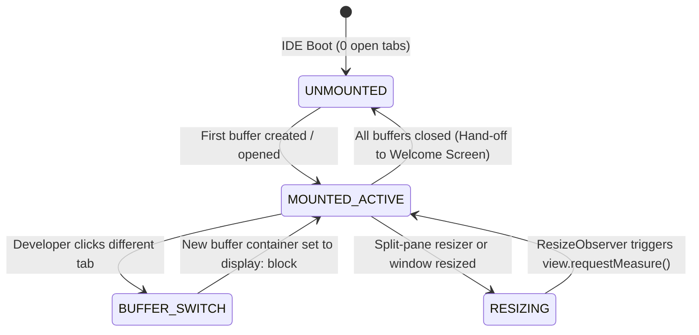

# High-Level Design (HLD): CodeMirror Surface Host

**Document ID:** `ORX-HLD-CODEMIRROR-SURFACE-HOST-V1`  
**Version:** `1.0` (Vendored CodeMirror 6 Studio Surface Architecture)  
**Target Codebase:** `DeskAI`  
**Target Files:**
* `src/deskai/static/index.html`
* `src/deskai/static/vendor/codemirror.bundle.js`
* `src/deskai/static/vendor/MANIFEST.json`
* `src/deskai/static/js/editor.js`
* `src/deskai/static/js/events.js`
* `src/deskai/static/css/components.css`
* `src/deskai/static/css/tokens.css`
**Status:** Approved  
**Date:** October 28, 2026  

---

## 1. Architectural Overview & Objective

The **CodeMirror Surface Host** (`#codeEditorHost`) is the core code editing viewport inside the Multi-Tab Editor Stage (`#editorStage` > `#editorViewport`). Positioned directly beneath `#editorTabStrip`, it hosts, mounts, and manages the lifecycle of CodeMirror 6 (`EditorView`) surfaces for all open editor document buffers.

### 1.1 Problem Statement & Implementation Reality
DeskAI requires a local-first, zero-framework, high-performance code editor capable of syntax highlighting, gutter line numbering, multi-cursor editing, undo/redo state preservation, and accessible keyboard navigation without bundle bloat or runtime framework overhead.

* **Vendored Invariant:** CodeMirror 6 (v6.0.1) is vendored under `src/deskai/static/vendor/codemirror.bundle.js` with SHA-256 integrity verification pinned in `MANIFEST.json`. No external CDN or npm downloads occur at runtime.
* **Surface Host Responsibilities:**
  1. **DOM Host & Container Management:** Serves as the mounting root (`#codeEditorHost`) for individual `.editor-view-container` instances corresponding to open buffers.
  2. **View State Retention:** Toggles visibility (`display: block` vs `display: none`) during tab switches without tearing down the underlying `EditorView` or `EditorState`, preserving undo history, cursor position, selection ranges, and scroll offsets.
  3. **Obsidian Matte + Amber Theming:** Binds editor background, foreground, selection, cursor, and syntax token colors directly to design tokens in `tokens.css`.
  4. **Dynamic Geometry & Resize Measurement:** Automatically updates CodeMirror internal layout measurements (`view.requestMeasure()`) when sidebars or bottom drawers are resized via pointer dragging.
  5. **WCAG 2.1 AA Accessibility:** Prevents keyboard trapping by providing standard keyboard escape routes (`Escape` / `Ctrl+Shift+M`) out of the multiline text surface.

```text
┌─────────────────────────────────────────────────────────────────────────────┐
│ [Editor Tab Strip]                                                          │
├─────────────────────────────────────────────────────────────────────────────┤
│ .editor-viewport #editorViewport                                            │
│   ┌───────────────────────────────────────────────────────────────────────┐ │
│   │ .codemirror-host #codeEditorHost [role="region", aria-label="Code"]   │ │
│   │   ┌─────────────────────────────────────────────────────────────────┐ │ │
│   │   │ .editor-view-container (style="display: block;")                │ │ │
│   │   │   ┌───────────────────────────────────────────────────────────┐ │ │ │
│   │   │   │ .cm-editor [role="textbox", aria-multiline="true"]        │ │ │ │
│   │   │   │   ├── .cm-gutters (.cm-lineNumbers)                       │ │ │ │
│   │   │   │   └── .cm-scroller                                        │ │ │ │
│   │   │   │         └── .cm-content (editable text surface)           │ │ │ │
│   │   │   └───────────────────────────────────────────────────────────┘ │ │ │
│   │   └─────────────────────────────────────────────────────────────────┘ │ │
│   └───────────────────────────────────────────────────────────────────────┘ │
└─────────────────────────────────────────────────────────────────────────────┘
```

---

## 2. Architectural Decisions & Scope

* **D1 (Rendering Engine):** CodeMirror 6 vendored bundle (`codemirror.bundle.js`). No custom canvas or hand-rolled contenteditable surface.
* **D2 (DOM Retention Strategy):** Maintain active `EditorView` instances in DOM memory per buffer (`Map<id, buffer>`). Do NOT recreate the `EditorView` on every tab switch. Switching tabs sets `display: block` on the active buffer container and `display: none` on inactive containers.
* **D3 (Theming & Token Mapping):** CodeMirror visual attributes (background, foreground, gutters, active line, caret, selection) must strictly bind to CSS variables from `src/deskai/static/css/tokens.css`.
* **D4 (Isolation from AI Agent Streams):** CodeMirror surfaces display user document buffers. Autonomous agent command execution or diff reviews do not directly mutate user buffers without developer approval through the UEC review flow.

---

## 3. Threat Model & Security Architecture (P0)

A code editor surface renders arbitrary user and repository content. It operates under strict security boundaries:

### 3.1 Zero `innerHTML` & Safe Text Injection
* **Attack Vector:** An untrusted codebase contains files with embedded HTML, script tags, or terminal escape sequences (e.g. `<script>alert(1)</script>` in a JavaScript or Python source file). If rendered via `innerHTML`, arbitrary code executes in the privileged desktop webview.
* **Mitigation:**
  * CodeMirror 6 creates text nodes via native DOM `createTextNode` inside `.cm-line`. Code is never parsed or evaluated as HTML.
  * Line numbers, gutters, and diagnostic highlights operate strictly through text node assignments.

### 3.2 Memory Protection & File Size Constraints
* **Attack Vector:** Opening huge binary files (e.g. 500MB ISO or 1GB database dump) causes catastrophic webview memory consumption and process crash.
* **Mitigation:**
  * File reads are gated by `NativeBridge.readFile()` which enforces a strict 10MB maximum file size limit (`File exceeds maximum 10MB size limit`).
  * Non-text files return a clean error (`File is not valid UTF-8 text`).

### 3.3 Safe Clipboard & Copy/Paste Sanitization
* **Attack Vector:** Pasting content into the editor could trigger unsanctioned clipboard reading or execution.
* **Mitigation:**
  * Standard paste events pass into CodeMirror's document transaction pipeline as raw plaintext strings.
  * No script evaluation or HTML DOM insertion occurs on paste.

---

## 4. Component Architecture & UI State Machine

The CodeMirror Surface Host transitions across operational states based on the presence of open editor buffers:



### 4.1 State Matrix

| State | Condition | Surface Visibility | Viewport Behavior | Focus Behavior |
| :--- | :--- | :--- | :--- | :--- |
| **`UNMOUNTED`** | `openTabs.length === 0` | `#codeEditorHost` hidden / empty | `#welcomeScreen` overlay active (`display: flex`) | Focus routed to Welcome Screen primary CTA |
| **`MOUNTED_ACTIVE`** | `openTabs.length > 0` | Active `.editor-view-container` visible (`display: block`) | Code editing active, gutters visible, syntax highlighting rendered | Keyboard focus on `.cm-content` |
| **`BUFFER_SWITCH`** | Tab switch triggered | Previous container hidden (`display: none`), target container shown | Instant view swap without state loss | Focus transferred to active buffer's `view.focus()` |
| **`RESIZING`** | Sidebar/Drawer resize | Unchanged | `ResizeObserver` calls `requestMeasure()` to reflow lines | Focus retained on active line |

---

## 5. End-to-End Interaction & Data Flow

```text
[User / System Event: Open File / Create Buffer]
                        │
                        ▼
            [EditorManager.createBuffer()]
                        │
                        ├─────────────────────────────────────────────────┐
                        ▼                                                 ▼
             [CodeMirror.EditorState.create()]               [Create Container <div>]
             - Language syntax grammar                       - .editor-view-container
             - deskaiTheme & deskaiHighlightStyle            - Append to #codeEditorHost
             - UpdateListener for dirty tracking             - Hide other containers
                        │                                                 │
                        └───────────────────────┬─────────────────────────┘
                                                ▼
                                    [CodeMirror.EditorView()]
                                    - Mounted inside container
                                    - Gutters, line numbers initialized
                                                │
                                                ▼
                                   [EditorManager.selectTab()]
                                   - Set active container display: block
                                   - Hide #welcomeScreen
                                   - view.focus()
                                                │
                                                ▼
                               [Developer types or edits code]
                                                │
                                                ▼
                                 [UpdateListener: docChanged]
                                 - Mark buffer.isDirty = true
                                 - Update tab dirty indicator (●)
                                 - NativeBridge.setDirtyStatus(true)
```

### 5.1 Step-by-Step Scenarios

#### Scenario A: Buffer Mounting & Language Detection
1. Developer opens `utils.py`.
2. `EditorManager.detectLanguage("utils.py")` resolves `"python"`.
3. `CodeMirror.createBasicExtensions({ language: "python", extensions: [updateListener] })` configures the grammar parser, theme, and gutter extensions.
4. A dedicated `.editor-view-container` is appended to `#codeEditorHost`.
5. `EditorView` mounts into the container.
6. The container becomes visible (`display: block`), and `#welcomeScreen` is hidden.

#### Scenario B: Seamless Tab Switching (Zero View Re-creation)
1. Developer switches from `utils.py` to `index.html`.
2. `EditorManager.selectTab(newId)` iterates over `this.buffers`:
   * `utils.py` container is set to `display: none`.
   * `index.html` container is set to `display: block`.
3. `index.html`'s `view.focus()` restores the caret and scroll offset exactly as left.
4. CodeMirror's internal state remains untouched, preserving full undo/redo stacks.

#### Scenario C: Resizer Drag & Dynamic Geometry Reflow
1. Developer drags `#resizerLeft` to expand the Explorer sidebar or `#resizerBottom` to resize the drawer.
2. A `ResizeObserver` attached to `#codeEditorHost` detects geometry changes.
3. For the active buffer, `view.requestMeasure()` is called in `requestAnimationFrame`.
4. Line wrapping, visible line ranges, and cursor positions update seamlessly without layout glitches.

#### Scenario D: WCAG 2.1 AA Keyboard Escape
1. Developer navigates the page via keyboard only (Tab key).
2. Inside `.cm-content`, pressing `Tab` inserts indentation.
3. Pressing `Escape` toggles keyboard navigation mode.
4. The subsequent `Tab` press moves focus out of the editor to the bottom drawer tab strip (`#tab-terminal`).

---

## 6. Component Contracts & Interfaces

### 6.1 DOM Hierarchy Contract

```html
<div class="codemirror-host" id="codeEditorHost" role="region" aria-label="Code Surface">
  <!-- Active Buffer Container -->
  <div class="editor-view-container" id="editor-container-{id}" style="display: block;">
    <div class="cm-editor cm-focused cm-deskai-theme">
      <div class="cm-gutters" aria-hidden="true">
        <div class="cm-gutter cm-lineNumbers">
          <div class="cm-gutterElement">1</div>
          <div class="cm-gutterElement">2</div>
        </div>
      </div>
      <div class="cm-scroller">
        <div 
          class="cm-content" 
          role="textbox" 
          aria-multiline="true" 
          aria-label="Code Editor: {filename}"
          contenteditable="true" 
          spellcheck="false" 
          autocorrect="off" 
          autocapitalize="off">
          <div class="cm-line"><span class="tok-keyword">def</span> <span class="tok-variableName">main</span>():</div>
          <div class="cm-line">    <span class="tok-keyword">return</span> <span class="tok-number">42</span></div>
        </div>
      </div>
    </div>
  </div>
</div>
```

### 6.2 Vendored CodeMirror 6 API Contract (`window.CodeMirror`)

```typescript
interface CodeMirrorVendorBundle {
  EditorState: typeof EditorState;
  EditorView: typeof EditorView;
  createBasicExtensions: (options: {
    language?: "python" | "javascript" | "markdown" | "plaintext";
    extensions?: Extension[];
  }) => Extension[];
  deskaiTheme: Extension;
  deskaiHighlightStyle: Extension;
  lineNumbers: () => Extension;
  history: () => Extension;
  keymap: { of: (keymaps: any[]) => Extension };
  python: () => Extension;
  javascript: () => Extension;
  markdown: () => Extension;
}
```

---

## 7. Accessibility (WCAG 2.1 AA) Compliance

1. **Screen Reader Landmarks & Roles:**
   * `#codeEditorHost` possesses `role="region"` and `aria-label="Code Surface"`.
   * The editable surface `.cm-content` possesses `role="textbox"`, `aria-multiline="true"`, and `aria-label="Code Editor"`.
2. **Keyboard Trap Prevention:**
   * Pressing `Escape` disengages code indentation mode, enabling standard `Tab` / `Shift+Tab` traversal out of the editor.
3. **Contrast Compliance:**
   * Editor background (`--bg-surface` `#1a1b1f`) with primary text (`--text-primary` `#ededed`): Contrast ratio **15.8:1** (exceeds 4.5:1 AA and 7.0:1 AAA).
   * Gutter line numbers (`--text-muted` `#8a8e97` on `--bg-header` `#17181b`): Contrast ratio **5.7:1** (exceeds 4.5:1 AA).
   * Amber caret (`--color-primary` `#d99b26`): 2px wide high-visibility cursor.
   * Selection highlight (`rgba(217, 155, 38, 0.25)`): Retains text readability without obscuring tokens.
4. **High Contrast Mode Support:**
   * Forced colors media query sets caret to `Highlight` and selection to `HighlightText`.

---

## 8. Verification & Test Strategy

| Test Identifier | Category | Verification Target |
| :--- | :--- | :--- |
| **`TC-CMH-01`** | DOM & Semantics | Verify `#codeEditorHost` has `role="region"` and accessible label. |
| **`TC-CMH-02`** | CodeMirror 6 Mount | `createBuffer()` attaches `.editor-view-container` and mounts `.cm-editor` inside `#codeEditorHost`. |
| **`TC-CMH-03`** | Gutter & Line Numbers | Verify `.cm-gutters` and `.cm-lineNumbers` are rendered and match line count. |
| **`TC-CMH-04`** | Syntax Highlighting | Verify Python/JS tokens (`def`, `function`, strings) receive distinct syntax highlight spans. |
| **`TC-CMH-05`** | View State Preservation | Verify switching between tabs preserves scroll position, cursor offset, and undo stack. |
| **`TC-CMH-06`** | ResizeObserver Reflow | Simulating container resize triggers `requestMeasure()` without layout errors. |
| **`TC-CMH-07`** | Keyboard Trap Escape | Pressing `Escape` enables `Tab` to navigate focus out of the CodeMirror surface. |
| **`TC-CMH-08`** | Teardown Lifecycle | Closing a buffer destroys the `EditorView` and removes its container from DOM. |
| **`TC-CMH-09`** | XSS Safe Rendering | Source code containing `<script>alert(1)</script>` renders as text nodes, never executing scripts. |

---

## 9. Traceability Matrix

| Requirement / Invariant | HLD Design Reference | Target Code Module |
| :--- | :--- | :--- |
| CodeMirror 6 Vendored Host | Section 1.1, 2 (D1) | `src/deskai/static/vendor/codemirror.bundle.js` |
| View State Retention | Section 2 (D2), 5.1 (Scenario B) | `src/deskai/static/js/editor.js` |
| Obsidian Matte + Amber Theming | Section 1.2, 7 | `src/deskai/static/css/components.css` |
| ResizeObserver Geometry Reflow | Section 1.2, 5.1 (Scenario C) | `src/deskai/static/js/editor.js` |
| Keyboard Trap Prevention | Section 1.2, 7 | `src/deskai/static/js/editor.js` |
| Pure Text Node XSS Defense | Section 3.1 | `src/deskai/static/js/editor.js` |
