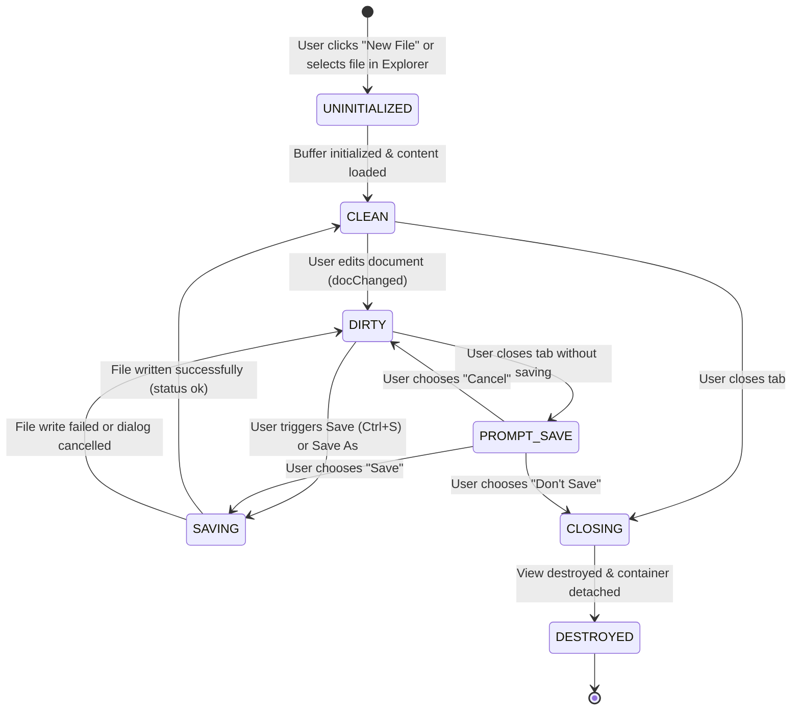
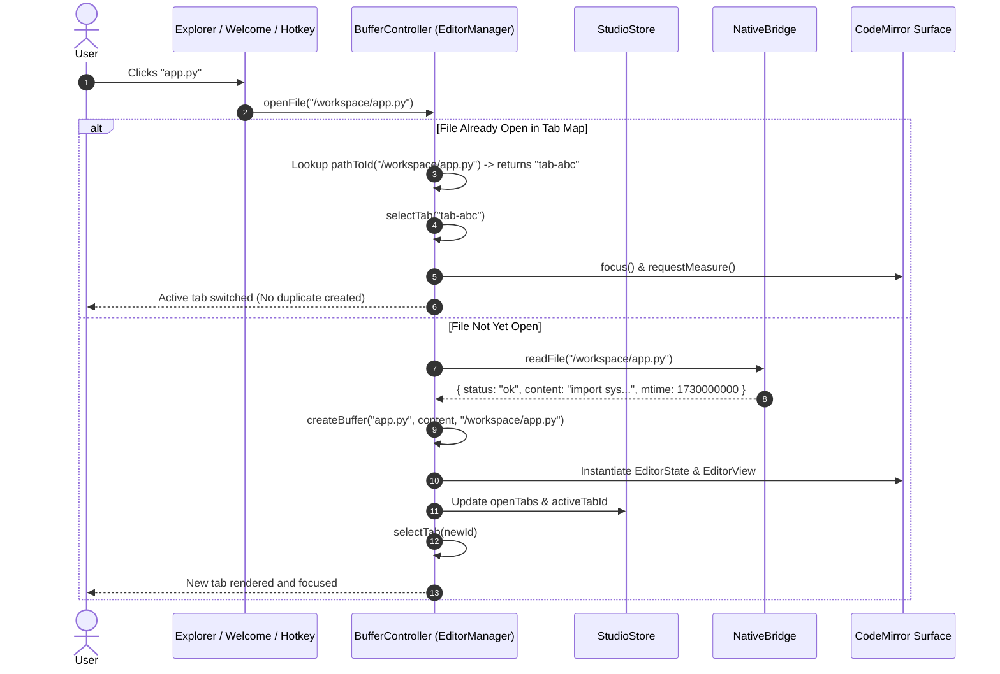
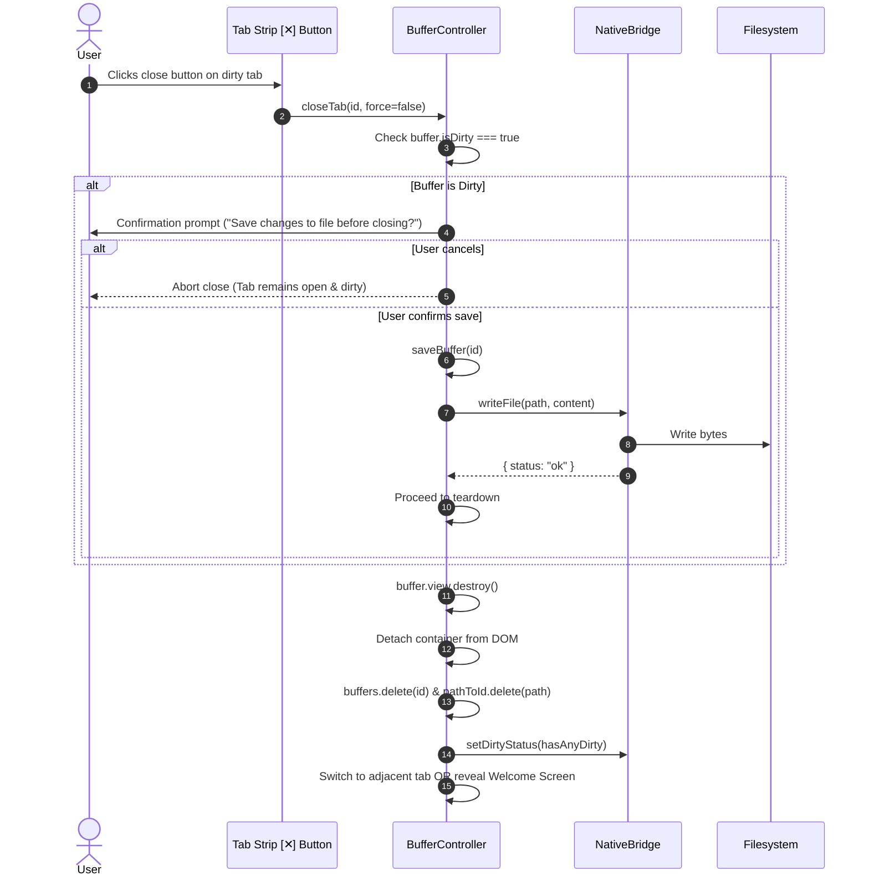

# High-Level Design (HLD): Editor Buffer Controller

**Document ID:** `ORX-HLD-EDITOR-BUFFER-CONTROLLER-V1`  
**Version:** `1.0` (Document Memory Lifecycle & Persistence Architecture)  
**Target Codebase:** `DeskAI`  
**Target Files:**
* `src/deskai/static/js/editor.js`
* `src/deskai/static/js/bridge.js`
* `src/deskai/static/js/state.js`
* `src/deskai/static/js/events.js`
* `src/deskai/static/css/components.css`
* `src/deskai/static/css/tokens.css`
**Status:** Approved  
**Date:** October 28, 2026  

---

## 1. Architectural Overview & Objective

The **Editor Buffer Controller** is the headless document state manager and data persistence coordinator for the Multi-Tab Editor Stage (`#editorStage`). Operating within `EditorManager` in `src/deskai/static/js/editor.js`, it coordinates the in-memory representation, file system synchronization, dirty modification tracking, and lifecycle transitions for all open code and text documents in the DeskAI IDE.

```text
┌─────────────────────────────────────────────────────────────────────────────┐
│                            UI PRESENTATION LAYER                            │
│   ┌───────────────────────────────┐     ┌───────────────────────────────┐   │
│   │   Editor Tab Strip            │     │   CodeMirror Surface Host     │   │
│   │   (#editorTabStrip)           │     │   (#codeEditorHost)           │   │
│   └───────────────┬───────────────┘     └───────────────┬───────────────┘   │
└───────────────────┼─────────────────────────────────────┼───────────────────┘
                    ▼                                     ▼
┌─────────────────────────────────────────────────────────────────────────────┐
│                      EDITOR BUFFER CONTROLLER (CORE)                        │
│                                                                             │
│   ┌─────────────────────────────────────────────────────────────────────┐   │
│   │ Buffer Registry: Map<string, BufferEntity> (id -> Entity)           │   │
│   │ Path Index:      Map<string, string>       (canonicalPath -> id)    │   │
│   │ Active Selection: activeTabId: string | null                        │   │
│   └──────────────────────────────────┬──────────────────────────────────┘   │
│                                      │                                      │
│   ┌──────────────────────────────────▼──────────────────────────────────┐   │
│   │ Lifecycle Operations:                                               │   │
│   │  • createBuffer()     • openFile()         • selectTab()            │   │
│   │  • saveBuffer()       • saveBufferAs()     • saveActiveBuffer()     │   │
│   │  • closeBuffer()      • closeAllBuffers()  • revertBuffer()         │   │
│   │  • markDirty()        • syncStore()        • checkDiskDrift()       │   │
│   └──────────────────────────────────┬──────────────────────────────────┘   │
└──────────────────────────────────────┼──────────────────────────────────────┘
                    ┌──────────────────┴──────────────────┐
                    ▼                                     ▼
┌──────────────────────────────────────┐  ┌───────────────────────────────────┐
│     STATE SYNCHRONIZATION LAYER      │  │     PERSISTENCE & SYSTEM BRIDGE   │
│  • StudioStore (store.js)            │  │  • NativeBridge.readFile()        │
│  • Reactive state.editor.openTabs    │  │  • NativeBridge.writeFile()       │
│  • WelcomeScreenController sync      │  │  • NativeBridge.saveFileDialog()  │
│                                      │  │  • NativeBridge.setDirtyStatus()  │
└──────────────────────────────────────┘  └───────────────────────────────────┘
```

### 1.1 Problem Statement & Implementation Reality
Desktop IDEs require deterministic, crash-resilient buffer management. A naive text editing model risks critical failures:
1. **Silent Data Loss:** Closing tabs or quitting the application while files have unsaved changes without explicit user confirmation.
2. **Duplicate Buffer Desynchronization:** Opening the same file twice (e.g. from file tree, welcome screen, or terminal link) creating two out-of-sync buffers pointing to the same disk path.
3. **Ghost Buffer Memory Leaks:** Destroying tab elements without destroying the underlying CodeMirror `EditorView` or removing event listeners, leading to memory bloat.
4. **State Desynchronization:** Inconsistency between the visual tab strip, the reactive `StudioStore`, and the Python runtime's native window close interception.
5. **Disk Write Collisions & External Drift:** Overwriting files that were modified externally without detecting drift or warning the user.

### 1.2 Target Architectural State
The enhanced Editor Buffer Controller establishes:
* **Canonical Path Indexing:** In-memory map indexing canonicalized absolute file paths to tab IDs, guaranteeing that opening an already-open file switches to its existing tab rather than duplicating the buffer.
* **Guarded Unsaved Lifecycle:** Multi-tier dirty protection (`isDirty` flag, aggregate `hasAnyDirty` status sent to `NativeBridge.setDirtyStatus`, and guarded `closeBuffer` confirmation prompting before teardown).
* **Deterministic Teardown:** Complete cleanup of CodeMirror `EditorView` (`view.destroy()`), detachment of DOM containers, removal from memory maps, and store synchronization.
* **Seamless Save & Save-As Workflows:** Automatic discrimination between named disk files (direct write) and scratch/untitled buffers (triggering native OS save file dialog).
* **Zero XSS & Path Sandbox Compliance:** Strict text-node DOM creation and backend path traversal enforcement.

---

## 2. Architectural Decisions & Scope

* **D1 (Map-Based Entity Indexing):** Buffers are stored in a primary `Map<string, BufferEntity>` keyed by random UUID-based IDs (`tab-${uuid}`). A secondary reverse-index `Map<string, string>` maps normalized absolute paths to buffer IDs for $O(1)$ duplicate lookup.
* **D2 (Strict CodeMirror Decoupling):** The buffer controller manages the lifecycle of CodeMirror `EditorState` and `EditorView`. If CodeMirror is not yet loaded or running in a headless test environment, the controller functions transparently using a pure memory model without throwing errors.
* **D3 (Two-Tier Dirty Verification):** Dirty state is tracked via document change events (`EditorView.updateListener`). When changes occur, `isDirty` is set to `true`, and aggregate status is computed across all open buffers. `NativeBridge.setDirtyStatus(hasAnyDirty)` updates native window close handlers.
* **D4 (Zero-Framework Reactive Store Binding):** Every buffer mutation (`create`, `select`, `close`, `save`, `markDirty`) synchronizes with `store.state.editor.openTabs` and `store.state.editor.activeTabId`, notifying subscribed components without framework overhead.
* **D5 (Guard Rail Confirmation):** Closing a dirty buffer requires confirmation (`Save`, `Don't Save`, `Cancel`). Passing `force = true` bypasses confirmation only for explicit programmatic teardown.

---

## 3. Threat Model & Security Architecture (P0)

### 3.1 Path Traversal & Unauthorized Workspace Escape
* **Threat:** Malicious file paths (e.g., `../../etc/shadow` or symlink redirection outside workspace root) passed to `openFile` or `saveBuffer`.
* **Mitigation:**
  * All filesystem operations execute through `NativeBridge.readFile()` and `NativeBridge.writeFile()`.
  * The Python backend enforces canonicalization (`os.path.realpath`) and validates path containment inside `workspace_root` via `is_safe_workspace_path()`. Unsanctioned paths return HTTP 403 / status `error`.

### 3.2 DOM-Based XSS Injection via Document Content and Metadata
* **Threat:** File contents containing script tags or malicious filenames (e.g. `<svg onload=alert(1)>`) injected into tab headers, tooltips, or preview banners.
* **Mitigation:**
  * Strict DOM construction: filenames and paths are rendered strictly with `textContent` and `setAttribute`. Zero `innerHTML`.
  * CodeMirror 6 treats all file content as raw text streams rendered into structured syntax tokens, avoiding native HTML evaluation.

### 3.3 Data Loss via Premature Window / Tab Closure
* **Threat:** Closing the IDE window or closing multiple tabs while uncommitted code exists, resulting in developer data loss.
* **Mitigation:**
  * The buffer controller maintains aggregate dirty status. Any dirty buffer causes `NativeBridge.setDirtyStatus(true)` to be transmitted to the native Python backend.
  * The backend PyWebView window lifecycle catches `closing` events and displays a native prompt if dirty status is active.

---

## 4. Component State Machine & Lifecycle

A document buffer transitions through distinct states during its lifecycle:



---

## 5. Sequence Flows

### 5.1 Open File & Duplicate Prevention Flow



### 5.2 Guarded Save & Teardown Flow



---

## 6. Verification & Test Plan

1. **New Scratch Buffer Creation:** Verifies creating an untitled buffer without a disk path, setting initial content, and displaying default icon `📄`.
2. **Duplicate Path Interception:** Verifies that calling `openFile` with an already opened canonical path activates the existing tab without appending a new tab to `#editorTabStrip`.
3. **Dirty Modification Tracking:** Verifies that modifying the CodeMirror document sets `isDirty: true`, renders the `●` indicator on the tab, and invokes `NativeBridge.setDirtyStatus(true)`.
4. **Clean Save Execution:** Verifies that saving a modified buffer writes content to disk, clears `isDirty`, removes the dirty indicator, and updates `NativeBridge.setDirtyStatus(false)` when no dirty tabs remain.
5. **Save-As for Scratch Buffers:** Verifies that saving an untitled buffer with `path: null` triggers `NativeBridge.saveFileDialog`, binds the selected file path, updates tab title and file icon badge.
6. **Guarded Close Confirmation:** Verifies that closing a dirty tab prompts for confirmation, aborts when dismissed, and closes cleanly when saved or forced.
7. **Complete Teardown & Garbage Collection:** Verifies that closing a tab calls `view.destroy()`, detaches `.editor-view-container` from `#codeEditorHost`, and prunes the memory map.
8. **Bulk Teardown & Welcome Screen Transition:** Verifies that closing all tabs seamlessly activates `WelcomeScreenController.sync()` and displays `#welcomeScreen`.
