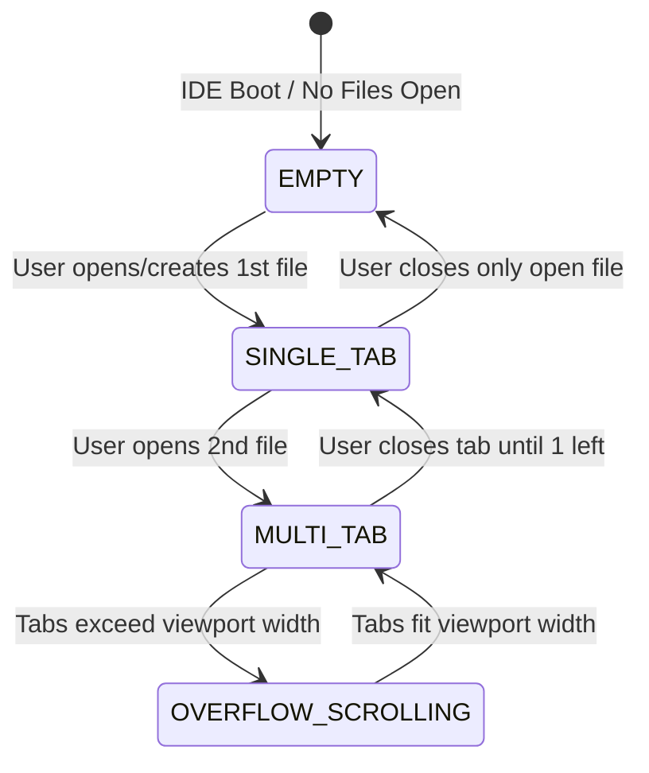

# High-Level Design (HLD): Editor Tab Strip

**Document ID:** `ORX-HLD-EDITOR-TAB-STRIP-V1`  
**Version:** `1.0` (Multi-Buffer Tab Navigation & Dirty Tracking Architecture)  
**Target Codebase:** `DeskAI`  
**Target Files:**
* `src/deskai/static/index.html`
* `src/deskai/static/js/editor.js`
* `src/deskai/static/js/events.js`
* `src/deskai/static/js/bridge.js`
* `src/deskai/static/js/state.js`
* `src/deskai/static/css/components.css`
* `src/deskai/static/css/tokens.css`
**Status:** Approved  
**Date:** October 28, 2026  

---

## 1. Architectural Overview & Objective

The **Editor Tab Strip** (`#editorTabStrip`) is the horizontal navigation bar docked at the upper boundary of the Multi-Tab Editor Stage (`#editorStage`). It serves as the primary visual control for managing multiple concurrently open document buffers, switching between active CodeMirror 6 surfaces, displaying unsaved dirty modifications, and facilitating safe tab teardown.

### 1.1 Problem Statement & Gaps in Initial Architecture
In early iterations, `#editorTabStrip` provided only rudimentary tab rendering with significant architectural limitations:
1. **Unprotected Buffer Teardown:** Clicking `✕` immediately destroyed the CodeMirror view and discarded buffer state without prompting to save unsaved modifications, risking developer data loss.
2. **Missing Mouse & Wheel Ergonomics:** Middle-click (mouse button 1) did not close tabs, and vertical mouse wheel scrolling did not translate to horizontal tab strip navigation when many tabs were open.
3. **Uniform File Presentation:** All files displayed a generic document emoji (`📄`) without file-type differentiation (Python, JavaScript, Markdown, JSON, CSS, etc.).
4. **Context Menu Absence:** Developers lacked rapid bulk tab actions (e.g., *Close Other Tabs*, *Close Tabs to the Right*, *Copy File Path*).
5. **Partial WAI-ARIA Tablist Support:** While `role="tablist"` and `role="tab"` existed, key navigation was restricted to Left/Right arrows, omitting standard desktop conventions (`Home`, `End`, `Delete`, `Ctrl+PageDown`/`Ctrl+PageUp`).

### 1.2 Target Architectural State
The enhanced Editor Tab Strip operates as a robust, keyboard-operable, accessible WAI-ARIA tablist container:
* **Interactive Buffer Lifecycle:** Coordinated via `EditorManager` in `src/deskai/static/js/editor.js` with instant active buffer switching and smooth integration with `WelcomeScreenController`.
* **Guarded Dirty Teardown:** Closing a buffer with `isDirty === true` triggers an in-app confirmation modal (*Save*, *Don't Save*, *Cancel*) before destructive teardown.
* **Ergonomic Horizontal Navigation:** Automatic wheel translation (`wheel` event converted to `scrollLeft`), smooth `scrollIntoView()` on tab activation, and middle-click tab closure.
* **Semantic File Badges:** Distinct icon badges based on file extensions.
* **Strict Security Sandbox:** Filenames and paths are rendered strictly using `createElement` and `textContent`, preventing DOM-based XSS injection.

```text
┌─────────────────────────────────────────────────────────────────────────────┐
│ #editorTabStrip [role="tablist", aria-label="Open Files"]                   │
│ ┌───────────────────────┬───────────────────────┬─────────────────────────┐ │
│ │ 🐍 main.py        [✕] │ 📄 app.js       ● [✕] │ 📝 README.md        [✕] │ │
│ │ (aria-selected="true")│ (aria-selected="false)│ (aria-selected="false") │ │
│ └───────────────────────┴───────────────────────┴─────────────────────────┘ │
├─────────────────────────────────────────────────────────────────────────────┤
│ #editorViewport (Active CodeMirror Surface or Welcome Screen)               │
└─────────────────────────────────────────────────────────────────────────────┘
```

---

## 2. Architectural Decisions & Scope

* **D1 (Scope & Boundaries):** The Editor Tab Strip manages developer editor buffers only. Background AI agent execution buffers or diff previews are routed through the UEC state machine and dedicated diff review modes; they never silently pollute the user's open tab strip.
* **D2 (Rendering Strategy & Zero Frameworks):** Strict Vanilla ES6 JavaScript. All tab DOM nodes, badges, labels, and close buttons are created exclusively via `document.createElement` and `textContent`. **Never use `innerHTML` or string interpolation with untrusted filenames.**
* **D3 (State Synchronization):** Reactive two-way synchronization with `StudioStore` (`store.state.editor.openTabs` and `store.state.editor.activeTabId`). Mutating tab collections notifies store subscribers and native bridge dirty status handlers (`NativeBridge.setDirtyStatus()`).
* **D4 (Dirty File Protection):** Closing an unsaved tab must never lose user code silently. Closing triggers an asynchronous save prompt dialog.

---

## 3. Threat Model & Security Architecture (P0)

### 3.1 DOM-Based XSS Injection via Malicious Filenames
* **Attack Vector:** An untrusted workspace contains files or directories named with HTML tags or script injection payloads (e.g. `.py` or `"><script>fetch(...)`). If rendered into the tab strip via `innerHTML` or template literals, malicious JavaScript executes in the privileged PyWebView environment.
* **Mitigation:**
  * Mandatory enforcement of `document.createElement("span")` and `.textContent = buffer.name`.
  * The file's canonical path is stored in dataset properties (`data-tab-id`, `data-path`) and tooltip attributes (`title`) via `setAttribute` without HTML interpretation.

### 3.2 Unsanctioned Filesystem Access & Path Traversal
* **Attack Vector:** Tampered tab data pointing to paths outside the validated workspace directory (e.g., `../../../../etc/shadow`).
* **Mitigation:**
  * Saving or reloading tabs executes exclusively through `NativeBridge.writeFile()` and `NativeBridge.readFile()`.
  * The Python backend enforces path canonicalization (`canonicalize_path()`) and strict workspace containment (`is_safe_workspace_path()`). Any attempt to access files outside `workspace_root` is rejected with `Access denied`.

### 3.3 Dirty Buffer Exit Gate
* **Attack Vector:** Closing a window or closing all tabs while unsaved code exists could cause permanent data loss.
* **Mitigation:**
  * The tab strip continuously computes aggregate dirty state (`hasAnyDirty = Array.from(buffers.values()).some(b => b.isDirty)`).
  * `NativeBridge.setDirtyStatus(hasAnyDirty)` updates native window close handlers, intercepting window exit with native unsaved changes confirmation.

---

## 4. Component Architecture & UI State Machine

The Editor Tab Strip transitions across three primary operational states based on the active buffer count:



### 4.1 State Matrix

| State | Tab Count | Container Layout | Active Tab | Behavior |
| :--- | :--- | :--- | :--- | :--- |
| **`EMPTY`** | `0` | `height: 34px`, no child tabs | `null` | `#welcomeScreen` active; tab strip remains empty placeholder. |
| **`SINGLE_TAB`** | `1` | 1 `.editor-tab` rendered | Active tab id | `#welcomeScreen` hidden; CodeMirror editor active; single tab selected (`aria-selected="true"`). |
| **`MULTI_TAB`** | `2+` (fits width) | Horizontal flex row | Selected tab id | Arrow navigation active; clicking tab switches buffer instantly. |
| **`OVERFLOW_SCROLLING`** | `2+` (exceeds width) | Horizontal scroll container (`overflow-x: auto`) | Selected tab id | Horizontal wheel translation active; activating a tab executes `scrollIntoView()`. |

---

## 5. End-to-End Interaction & Data Flow

```text
[User Action: Click Tab / Click Close (✕) / Middle-Click / Arrow Key]
                                   │
                                   ▼
                   [Event Delegation in events.js]
                                   │
        ┌──────────────────────────┼──────────────────────────┐
        ▼                          ▼                          ▼
 [Action: select-tab]      [Action: tab-close]       [Key: Arrow/Home/End]
        │                          │                          │
        ▼                          ▼                          ▼
[EditorManager.selectTab]  [Check isDirty?]          [Roving Tabindex Update]
  - activeTabId updated      ├── Yes: Show Save Dialog  - focus moved to target
  - CodeMirror view focused  └── No: Destroy buffer     - EditorManager.selectTab
  - update aria-selected           │                          │
        │                          ▼                          ▼
        └──────────────────────────┴──────────────────────────┘
                                   │
                                   ▼
                      [StudioStore State Sync]
                      - store.state.editor.openTabs
                      - store.state.editor.activeTabId
                      - NativeBridge.setDirtyStatus()
```

### 5.1 Step-by-Step Scenarios

#### Scenario A: Opening a File Buffer
1. Developer opens a file via Explorer, Quick Open (`Ctrl+P`), or Welcome Screen CTA (`[Create New File]`).
2. `EditorManager.createBuffer(name, content, path)` assigns an unguessable buffer ID (`tab-<uuid>`).
3. The buffer instance is saved in `this.buffers` (Map).
4. `this.renderTabs()` builds the tab DOM elements using `document.createElement`.
5. Semantic file icon is resolved via `detectFileIcon(name)`.
6. Store is updated: `store.state.editor.openTabs` reflects all open tabs.
7. `EditorManager.selectTab(id)` marks the tab `aria-selected="true"`, `tabindex="0"`, displays its container, and hides `#welcomeScreen`.

#### Scenario B: Unsaved Modification (Dirty State)
1. Developer modifies text in CodeMirror 6.
2. CodeMirror's `EditorView.updateListener` detects `update.docChanged === true`.
3. `EditorManager.markDirty(id, true)` marks `buffer.isDirty = true`.
4. A warning indicator `●` (`.tab-dirty-indicator`) is rendered next to the tab label.
5. `NativeBridge.setDirtyStatus(true)` alerts the window lifecycle manager.

#### Scenario C: Guarded Tab Teardown (Close with Unsaved Changes)
1. Developer clicks `✕` or presses `Ctrl+W` on an unsaved tab.
2. `EditorManager.closeTab(id)` detects `buffer.isDirty === true`.
3. An in-app confirmation dialog opens: *"Do you want to save the changes you made to <filename>?"*.
   * **If Save:** Invokes `EditorManager.saveActiveBuffer()`; on success, teardown proceeds.
   * **If Don't Save:** Teardown proceeds immediately, discarding buffer modifications.
   * **If Cancel:** Teardown aborts; buffer remains open and active.
4. On approved teardown:
   * CodeMirror `view.destroy()` is called.
   * Container DOM node is removed.
   * `this.buffers.delete(id)` removes buffer from memory.
   * If closing active tab, adjacent tab is selected. If 0 tabs remain, `#welcomeScreen` is displayed.

#### Scenario D: Middle-Click Tab Closure
1. Developer clicks any tab using the middle mouse button (mouse button 1 / wheel click).
2. Auxiliary click handler (`auxclick`) intercepts `e.button === 1`.
3. Invokes guarded `EditorManager.closeTab(tabId)`.

---

## 6. Component Contracts & Data Interfaces

### 6.1 DOM Hierarchy Contract

```html
<div class="tab-strip" id="editorTabStrip" role="tablist" aria-label="Open Files">
  <!-- Dynamic Tab Instance -->
  <div 
    class="editor-tab" 
    role="tab" 
    id="tab-{id}"
    data-tab-id="{id}" 
    aria-selected="true" 
    aria-controls="editorViewport" 
    tabindex="0" 
    data-action="select-tab" 
    data-param="{id}"
    title="{canonicalPath}">
    
    <span class="tab-icon" aria-hidden="true">🐍</span>
    <span class="tab-label">{filename}</span>
    <span class="tab-dirty-indicator" aria-label="Unsaved changes">●</span>
    
    <button 
      type="button"
      class="tab-close-btn" 
      data-action="tab-close" 
      data-param="{id}" 
      aria-label="Close {filename}">✕</button>
  </div>
</div>
```

### 6.2 Buffer Model Contract (`EditorBuffer`)

```typescript
interface EditorBuffer {
  id: string;              // Unique tab id ("tab-a1b2c3d4")
  name: string;            // Filename ("main.py")
  path: string | null;     // Absolute canonical path or null for untitled
  content: string;         // Current buffer text
  isDirty: boolean;        // Whether buffer has unsaved edits
  state: EditorState;      // CodeMirror 6 EditorState
  view: EditorView;        // CodeMirror 6 EditorView
  container: HTMLElement;  // DOM wrapper attached to #codeEditorHost
}
```

### 6.3 Store State Contract (`store.state.editor`)

```json
{
  "editor": {
    "openTabs": [
      {
        "id": "tab-8f3b211a",
        "name": "main.py",
        "path": "/home/user/projects/app/main.py",
        "isDirty": false
      }
    ],
    "activeTabId": "tab-8f3b211a"
  }
}
```

---

## 7. Accessibility (WCAG 2.1 AA) Compliance

1. **WAI-ARIA Tablist Pattern:**
   * Container element possesses `role="tablist"` and `aria-label="Open Files"`.
   * Individual tab items possess `role="tab"`, `aria-selected="true|false"`, and `aria-controls="editorViewport"`.
2. **Roving Tabindex & Keyboard Navigation:**
   * The currently active tab has `tabindex="0"`; all other tabs have `tabindex="-1"`.
   * Standard keyboard interactions:
     * `ArrowRight` / `ArrowLeft`: Move focus and select next/previous tab (with wrap-around).
     * `Home`: Move focus and select the first tab.
     * `End`: Move focus and select the last tab.
     * `Delete`: Close the currently focused tab.
3. **Contrast Compliance:**
   * Tab labels (`--text-secondary` `#9ca0a6` on `--bg-header` `#17181b`): Contrast ratio **7.1:1** (exceeds 4.5:1 AA).
   * Active tab label (`--color-primary` `#d99b26` on `--bg-surface` `#1a1b1f`): Accent ratio **4.7:1** (exceeds 4.5:1 AA).
   * Dirty indicator (`--color-warning` `#f59e0b`): Accessible non-text indicator with `aria-label="Unsaved changes"`.
4. **Forced Colors / High Contrast Mode:**
   * Active tab displays an explicit border-bottom: `border-bottom: 2px solid Highlight;`.

---

## 8. Verification & Test Strategy

| Test Identifier | Category | Verification Target |
| :--- | :--- | :--- |
| **`TC-ETS-01`** | DOM & Semantics | Verify `#editorTabStrip` has `role="tablist"` and tabs have `role="tab"`, `aria-selected`, `aria-controls`. |
| **`TC-ETS-02`** | Dynamic Tab Addition | `createBuffer()` renders a new `.editor-tab` with icon, filename, and close button. |
| **`TC-ETS-03`** | Tab Selection Switch | Clicking a tab or calling `selectTab()` activates the corresponding buffer and updates CodeMirror visibility. |
| **`TC-ETS-04`** | Keyboard Roving Focus | ArrowLeft, ArrowRight, Home, and End navigate and cycle through tabs. |
| **`TC-ETS-05`** | Middle-Click Teardown | Middle-clicking a tab triggers `closeTab()` on that buffer. |
| **`TC-ETS-06`** | Dirty Indicator Render | Mutating buffer content displays `.tab-dirty-indicator` (`●`). |
| **`TC-ETS-07`** | Guarded Dirty Close | Closing an unsaved tab displays confirmation dialog before destroying buffer. |
| **`TC-ETS-08`** | Empty State Handoff | Closing the last open tab restores `#welcomeScreen` with workspace hub state. |
| **`TC-ETS-09`** | XSS Filename Defense | Filenames containing `<script>` or HTML tags render strictly as text entities. |

---

## 9. Traceability Matrix

| Requirement / Gap | HLD Design Reference | Target Code Module |
| :--- | :--- | :--- |
| Guarded Dirty Close | Section 1.2, 5.1 (Scenario C) | `src/deskai/static/js/editor.js` |
| Middle-Click Close | Section 1.2, 5.1 (Scenario D) | `src/deskai/static/js/events.js` |
| Semantic File Icons | Section 1.2, 5.1 (Scenario A) | `src/deskai/static/js/editor.js` |
| Horizontal Wheel Scrolling | Section 1.2, 4.1 | `src/deskai/static/js/events.js` |
| WCAG 2.1 AA Keyboard Roving | Section 7 | `src/deskai/static/js/editor.js` |
| Safe DOM XSS Defense | Section 3.1 | `src/deskai/static/js/editor.js` |
