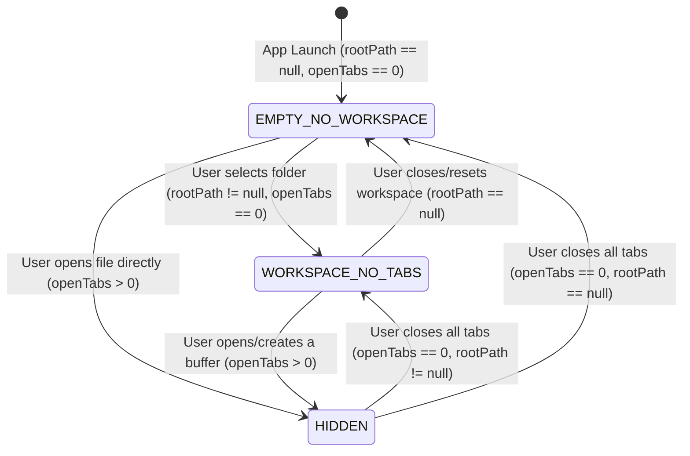

# High-Level Design (HLD): Welcome Screen Overlay

**Document ID:** `ORX-HLD-WELCOME-SCREEN-OVERLAY-V1`  
**Version:** `1.0` (Reactive State-Driven Studio Hub Architecture)  
**Target Codebase:** `DeskAI`  
**Target Files:**
* `src/deskai/static/index.html`
* `src/deskai/static/js/welcome.js` (or embedded controller in `editor.js`)
* `src/deskai/static/js/editor.js`
* `src/deskai/static/js/events.js`
* `src/deskai/static/js/bridge.js`
* `src/deskai/static/js/state.js`
* `src/deskai/static/css/components.css`
* `src/deskai/static/css/tokens.css`
* `src/deskai/bridge/api.py`
**Status:** Approved  
**Date:** October 28, 2026  

---

## 1. Architectural Overview & Objective

The **Welcome Screen Overlay** (`#welcomeScreen`) is the primary fallback and empty-state canvas hosted inside the Multi-Tab Editor Stage (`#editorStage` > `#editorViewport`). It is displayed whenever there are no active, open editor tab buffers (`store.state.editor.openTabs.length === 0` or `activeTabId === null`).

### 1.1 Problem Statement & Implementation Reality
In the initial codebase, `#welcomeScreen` existed merely as a static, disconnected HTML container:
```html
<div class="welcome-screen" id="welcomeScreen">
  <h2>Welcome to DeskAI</h2>
  <p>Select a project folder to begin.</p>
  <button class="primary-btn" data-action="open-folder-dialog">Open Project Folder</button>
</div>
```
This placeholder suffered from four critical architectural defects:
1. **Unreactive & Decoupled State:** When a user opened a directory via `NativeBridge.selectFolder()`, the global state `store.state.workspace.rootPath` updated, but `#welcomeScreen` never changed its presentation. If no file was immediately opened, the overlay continued to urge the user to "Select a project folder to begin."
2. **Bridge Readiness Race Condition:** `NativeBridge.selectFolder()` lacked an explicit readiness check (`await this.whenReady()`). Calling it during early startup or before pywebview API injection silently failed with a console warning and `{ status: "cancelled", path: null }`.
3. **No Workspace Empty State:** When all tabs are closed in an active workspace, users were shown the initial startup screen rather than a contextual workspace hub (with quick actions: Create File, Open File, Open in Terminal, and workspace recent files).
4. **Accessibility & Focus Gaps:** The element lacked semantic roles (`role="region"`), keyboard roving focus management, and accessible labels.

### 1.2 Target Architectural State
The enhanced Welcome Screen Overlay serves as an intelligent, reactive hub operating under three clear functional states:
1. **`EMPTY_NO_WORKSPACE` (Fresh Launch):** Welcomes the developer, exposes primary CTAs to open a project directory or open an isolated file, displays a list of persisted recent projects, and provides a keyboard shortcut cheat sheet.
2. **`WORKSPACE_NO_TABS` (Workspace Loaded, No Active Tabs):** Contextually displays the active workspace root folder name and path, provides quick actions (New File, Open File in Workspace, Open Terminal Here), and displays recently closed files.
3. **`HIDDEN` (1+ Tabs Open):** Gracefully hidden via CSS (`display: none;` or `hidden=""`, with `aria-hidden="true"`), surrendering focus entirely to the active CodeMirror 6 editor surface.

```text
┌─────────────────────────────────────────────────────────────────────────────┐
│ [Editor Tab Strip]                                                          │
├─────────────────────────────────────────────────────────────────────────────┤
│ .editor-viewport #editorViewport                                            │
│   ┌───────────────────────────────────────────────────────────────────────┐ │
│   │ .welcome-screen #welcomeScreen (role="region", aria-label="Welcome")  │ │
│   │                                                                       │ │
│   │   ⚡ DeskAI Studio                                                    │ │
│   │   Local-First AI Developer Studio                                     │ │
│   │                                                                       │ │
│   │   ┌───────────────────────────┐   ┌───────────────────────────────┐   │ │
│   │   │ Primary Actions           │   │ Keyboard Shortcuts            │   │ │
│   │   │ [Open Project Folder]     │   │ Open Folder     Ctrl+O        │   │ │
│   │   │ [Open File]               │   │ New File        Ctrl+N        │   │ │
│   │   │ [New File]                │   │ Toggle Drawer   Ctrl+`        │   │ │
│   │   └───────────────────────────┘   │ Focus AI Chat   Ctrl+L        │   │ │
│   │   ┌───────────────────────────┐   └───────────────────────────────┘   │ │
│   │   │ Recent Projects           │                                       │ │
│   │   │ 📁 my-app  (/home/.../app)│                                       │ │
│   │   └───────────────────────────┘                                       │ │
│   └───────────────────────────────────────────────────────────────────────┘ │
│   <div id="codeEditorHost" hidden></div>                                    │
└─────────────────────────────────────────────────────────────────────────────┘
```

---

## 2. Architectural Decisions & Scope

* **D1 (Scope & Purpose):** The Welcome Screen Overlay is an interactive developer navigation surface. It provides immediate project bootstrap actions and keyboard discoverability. AI agent execution flows are strictly isolated; AI execution does not inject unsolicited actions into the welcome screen.
* **D2 (Rendering Strategy):** Strict Vanilla ES6 JavaScript. No third-party UI framework (React, Vue, Svelte). All dynamic elements (such as recent project lists and workspace metadata) MUST be constructed exclusively via `document.createElement` and `textContent`. **Never use `innerHTML` or `insertAdjacentHTML` with unsanitized paths or file names.**
* **D3 (State Synchronization):** Reactive binding to `StudioStore` (`store.state.workspace.rootPath` and `store.state.editor.openTabs`). The screen dynamically recalculates its view model whenever workspace or tab states change.
* **D4 (Persistence):** Recent workspace history is persisted in browser `localStorage` under key `deskai_recent_projects`, capped at 5 entries, with automatic schema validation and path hygiene.

---

## 3. Threat Model & Security Architecture (P0)

Because DeskAI runs in a privileged local desktop environment with native OS shell and filesystem access, the Welcome Screen is subject to strict security constraints:

### 3.1 DOM-Based XSS Prevention
* **Attack Vector:** An attacker crafts a workspace folder or file containing HTML/JavaScript payloads (e.g. `repo-`). If rendered via `innerHTML`, arbitrary script execution could occur within the privileged PyWebView webview context.
* **Mitigation:**
  * Strict prohibition of `innerHTML` for dynamic content.
  * All folder names, paths, and metadata are assigned strictly via `.textContent`.
  * MANIFEST-pinned DOMPurify is used as an invariant secondary guard if formatted strings are ever parsed.

### 3.2 Path Traversal & Unauthorized Workspace Access
* **Attack Vector:** Manipulating recent project paths in `localStorage` to point to sensitive system directories (e.g. `/etc`, `/root`, `C:\Windows\System32`).
* **Mitigation:**
  * All folder selection and workspace switching passes through `NativeBridge.selectFolder()` or `bridge.api.select_folder()`.
  * Server-side path canonicalization (`canonicalize_path()`) and system root filtering (`is_disallowed_workspace_root()`) strictly reject attempts to open sensitive system directories.
  * Stored recent project entries are verified against `is_disallowed_workspace_root` before being passed to the bridge.

### 3.3 PyWebView Origin Authorization
* **Attack Vector:** Webview navigation or cross-origin iframe trying to trigger `window.pywebview.api.select_folder()`.
* **Mitigation:**
  * Every native bridge invocation verifies local loopback origin via `self._is_origin_allowed()` (`http://127.0.0.1:{port}`).
  * Dialog calls from unverified origins return `{"status": "error", "message": "Unauthorized origin"}`.

---

## 4. Component Architecture & UI State Machine

The Welcome Screen Overlay operates as a finite state machine governed by the presence of an active workspace and open editor buffers:



### 4.1 State Matrix

| State | Condition | Overlay Display | Focus Target | Visible Sections |
| :--- | :--- | :--- | :--- | :--- |
| **`EMPTY_NO_WORKSPACE`** | `rootPath === null` && `openTabs.length === 0` | `display: flex;` | Primary CTA: `[Open Project Folder]` | Brand Header, Primary CTAs (Open Folder, Open File), Recent Projects, Global Shortcuts |
| **`WORKSPACE_NO_TABS`** | `rootPath !== null` && `openTabs.length === 0` | `display: flex;` | Primary CTA: `[New File]` | Workspace Active Banner, Quick Actions (New File, Open File, Open Terminal), Workspace Recent Files, Workspace Shortcuts |
| **`HIDDEN`** | `openTabs.length > 0` | `display: none;` (or `hidden=""`) | Active CodeMirror Editor | None (CodeMirror host visible and active) |

---

## 5. End-to-End Interaction & Data Flow

```text
[User Action: Launch App / Close Tab / Open Folder]
                        │
                        ▼
            [StudioStore State Mutation]
            - store.state.workspace.rootPath
            - store.state.editor.openTabs
                        │
                        ▼
         [WelcomeScreenController.sync()]
                        │
         ┌──────────────┴──────────────┐
         ▼                             ▼
  [openTabs.length > 0]       [openTabs.length === 0]
         │                             │
         ▼                             ▼
   [State: HIDDEN]            [Evaluate rootPath]
   - welcomeScreen.hidden=true         │
   - codeEditorHost.hidden=false ┌─────┴────────────────┐
   - focus -> CodeMirror View    ▼                      ▼
                          [rootPath == null]     [rootPath != null]
                                 │                      │
                                 ▼                      ▼
                     [State: EMPTY_NO_WORKSPACE] [State: WORKSPACE_NO_TABS]
                     - Render Open Folder CTA    - Render Workspace Banner
                     - Render Recent Projects    - Render New File / Open File
                     - Focus -> Primary Button   - Focus -> Primary Button
```

### 5.1 Step-by-Step Scenarios

#### Scenario A: First Launch & Opening a Project Folder
1. User starts DeskAI. State is initialized: `workspace.rootPath = null`, `editor.openTabs = []`.
2. `WelcomeScreenController` mounts, renders `EMPTY_NO_WORKSPACE` view, and places focus on the `#welcomePrimaryBtn` ("Open Project Folder").
3. User clicks "Open Project Folder" or presses `Enter`.
4. Event listener delegates to `case "open-folder-dialog"`.
5. `NativeBridge.selectFolder()` awaits bridge readiness, then calls `window.pywebview.api.select_folder()`.
6. OS folder picker opens; user selects `/home/user/projects/my-app`.
7. Bridge validates path safety and returns `{ status: "ok", path: "...", name: "my-app" }`.
8. `events.js` mutates `store.state.workspace.rootPath = dir.path`.
9. The controller subscription triggers: state switches to `WORKSPACE_NO_TABS`.
10. The overlay updates in-place: header shows `📁 my-app`, buttons offer `[New File]`, `[Open File in Workspace]`, `[Open Terminal Here]`.

#### Scenario B: Creating a Buffer & Transitioning to Hidden
1. User clicks `[New File]` on the workspace welcome screen.
2. `EditorManager.createBuffer("untitled.py", "")` creates the buffer and appends tab.
3. `openTabs.length` becomes `1`.
4. `EditorManager.selectTab(id)` hides `#welcomeScreen` and displays `#codeEditorHost`.
5. CodeMirror 6 mounts the editor and requests keyboard focus.

#### Scenario C: Closing All Open Tabs
1. User closes the last open editor tab.
2. `EditorManager.closeTab(id)` detects `this.buffers.size === 0`.
3. `this.activeTabId = null`.
4. `WelcomeScreenController.sync()` is called.
5. Because `rootPath` is active, it transitions to `WORKSPACE_NO_TABS`.
6. Focus is restored to the primary CTA (`#welcomeNewFileBtn`).

---

## 6. Component Contracts & Data Interface

### 6.1 DOM Structure Contract

```html
<div class="welcome-screen" id="welcomeScreen" role="region" aria-label="Welcome and Quick Actions">
  <div class="welcome-card" id="welcomeCard">
    <!-- Rendered dynamically by WelcomeScreenController via createElement/textContent -->
  </div>
</div>
```

### 6.2 StudioStore Reactive State Binding

```javascript
// State bindings observed by WelcomeScreenController:
store.subscribe("workspace.rootPath", (newPath) => {
  welcomeController.sync();
});

store.subscribe("editor.openTabs", (tabs) => {
  welcomeController.sync();
});
```

### 6.3 LocalStorage Persistence Schema

```json
{
  "deskai_recent_projects": [
    {
      "name": "my-app",
      "path": "/home/user/projects/my-app",
      "lastOpened": 1793136000000
    }
  ]
}
```

---

## 7. Accessibility (WCAG 2.1 AA) Compliance

1. **Screen Reader Landmark:** The container has `role="region"` and `aria-label="Welcome and Quick Actions"`. When hidden, it explicitly receives `aria-hidden="true"`.
2. **Keyboard Navigation & Visible Focus:**
   * All interactive elements are standard `<button>` elements with `tabindex="0"`.
   * Visible focus indicators adhere to `--border-focus` (`#d99b26`) with a 2px outline and 2px offset.
   * Roving focus automatically places focus on the first interactive button upon state transition.
3. **Contrast Compliance:**
   * Headline text (`--text-primary` `#ededed` on `--bg-surface` `#1a1b1f`): Contrast ratio **15.8:1** (exceeds 4.5:1 AA and 7.0:1 AAA).
   * Secondary descriptions (`--text-secondary` `#9ca0a6` on `--bg-surface` `#1a1b1f`): Contrast ratio **7.1:1** (exceeds 4.5:1 AA).
   * Primary button (`--text-btn-primary` `#121315` on `--color-primary` `#d99b26`): Contrast ratio **7.7:1** (exceeds AAA).
4. **Forced Colors / High Contrast:**
   * Buttons include explicit borders compatible with `forced-colors: active` using system keywords (`ButtonText`, `Highlight`).

---

## 8. Verification & Test Strategy

| Test Identifier | Category | Verification Target |
| :--- | :--- | :--- |
| **`TC-WSO-01`** | DOM & Semantics | Verify `#welcomeScreen` has `role="region"`, accessible name, and standard layout. |
| **`TC-WSO-02`** | State: `EMPTY_NO_WORKSPACE` | Fresh launch renders Open Folder, Open File, and shortcut cheatsheet. |
| **`TC-WSO-03`** | State: `WORKSPACE_NO_TABS` | Setting `rootPath` dynamically switches screen to show workspace name and New File CTA. |
| **`TC-WSO-04`** | State: `HIDDEN` | Creating a buffer hides `#welcomeScreen` and displays CodeMirror host. |
| **`TC-WSO-05`** | Tab Teardown Restore | Closing all buffers restores `#welcomeScreen` in `WORKSPACE_NO_TABS` mode. |
| **`TC-WSO-06`** | Bridge Readiness | Clicking "Open Project Folder" awaits `NativeBridge.whenReady()` without dropping request. |
| **`TC-WSO-07`** | Keyboard Accessibility | Tab roving and `Enter` key activates buttons with visible `:focus-visible` styling. |
| **`TC-WSO-08`** | XSS Sanitization | Recent project paths containing `<script>` or HTML tags render strictly as text. |

---

## 9. Traceability Matrix

| Requirement / Finding | HLD Design Reference | Target Code Module |
| :--- | :--- | :--- |
| Unreactive Welcome Screen | Section 1.2, 4.1 | `src/deskai/static/js/welcome.js` |
| Native Bridge Readiness Gap | Section 1.1, 5.1 | `src/deskai/static/js/bridge.js` |
| Zero InnerHTML / XSS Defense | Section 2 (D2), 3.1 | `src/deskai/static/js/welcome.js` |
| WCAG 2.1 AA Compliance | Section 7 | `src/deskai/static/css/components.css` |
| State-driven Workspace Hub | Section 4, 6 | `src/deskai/static/js/welcome.js`, `editor.js` |
