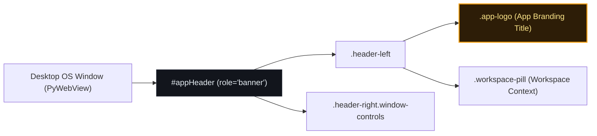

# High-Level Design (HLD): App Branding Title

**Document ID:** `ORX-HLD-APP-BRANDING-TITLE-V1`  
**Version:** `1.0` (Window Control Bar Subcomponent Architecture)  
**Parent Component:** `window-control-bar`  
**Target Codebase:** `DeskAI`  
**Target Files:**
* `src/deskai/static/index.html`
* `src/deskai/static/css/components.css`
* `src/deskai/static/css/tokens.css`
* `src/deskai/static/js/app.js`
**Status:** Approved  
**Date:** October 28, 2026  

---

## 1. Architectural Overview & Objective

The **App Branding Title** (`.app-logo` within `.header-left`) is the primary visual anchor and brand identifier anchored at the far-left position of the frameless top navigation bar (`#appHeader`, `role="banner"`).

It presents the identity of the IDE:
1. **Brand Mark & Logotype:** Displays the DeskAI symbol (`⚡`) accompanied by the application logotype text (`DeskAI`).
2. **Frameless Drag Pass-Through:** Resides within the top frameless draggable header region (`-webkit-app-region: drag`), allowing users to click and drag the native window across monitors without text selection interference.
3. **Accessibility & Landmark Semantics:** Operates under the WAI-ARIA `banner` landmark, offering clear application identity to screen readers without introducing disruptive focus stops.
4. **Design Token Integrity:** Strictly styled using centralized CSS variables from `tokens.css` (`--color-amber`, `--text-base`, `--font-mono`, `--header-height`).

```text
┌─────────────────────────────────────────────────────────────────────────────┐
│ #appHeader.app-header.pywebview-drag-region [role="banner"]                 │
│ ┌───────────────────────────────────────────────┐ ┌───────────────────────┐ │
│ │ .header-left                                  │ │ .header-right         │ │
│ │ ┌───────────────────┐ ┌─────────────────────┐ │ │ [.win-min][.win-max]  │ │
│ │ │ ⚡ DeskAI         │ │ DeskAI / main       │ │ │ [.win-close]          │ │
│ │ │ (.app-logo)       │ │ (.workspace-pill)   │ │ │                       │ │
│ │ └───────────────────┘ └─────────────────────┘ │ │                       │ │
│ └───────────────────────────────────────────────┘ └───────────────────────┘ │
└─────────────────────────────────────────────────────────────────────────────┘
```

---

## 2. Problem Statement & Functional Requirements

### 2.1 Problem Statement
In desktop IDE applications featuring frameless window decorations (no native OS titlebar), the top header serves a dual purpose:
- It must act as the primary window drag handle for OS window managers (Windows DWM, Linux Wayland/X11, macOS Quartz).
- It must convey brand identity, active project context, and state clearly.

If the branding title contains selectable text or intercepts pointer drags without proper `-webkit-app-region` specifications:
1. User dragging over the logo triggers browser text selection rather than native window movement.
2. Accessibility screen readers may lack a structured heading or readable application name.
3. Inconsistent font rendering or raw color usage breaks design token purity.

### 2.2 Functional Requirements (FR)
* **FR-ABT-01:** Render the application brand glyph (`⚡`) and logotype (`DeskAI`) with high contrast against `--bg-header`.
* **FR-ABT-02:** Support frameless window dragging across the branding surface without text selection.
* **FR-ABT-03:** Comply with WAI-ARIA 1.2 landmark standards without creating unnecessary tab-stops.
* **FR-ABT-04:** Guarantee zero raw hex/rgb color definitions outside `tokens.css`.

---

## 3. High-Level Architecture & Component Relationships



### 3.1 Interaction with Frameless Drag Region
- The containing header `#appHeader` has `-webkit-app-region: drag`.
- `.app-logo` allows dragging to pass through to the OS window manager (inherited `drag` or explicitly un-blocked).
- Interactive adjacent elements (e.g. `.workspace-pill`, window control buttons) explicitly specify `-webkit-app-region: no-drag`.

---

## 4. Accessibility & Semantics Strategy

1. **Landmark Hierarchy:**
   - The root container `#appHeader` defines `role="banner"`.
   - `.app-logo` has accessible naming via text content or `aria-label="DeskAI Studio"`.
   - Brand glyph `⚡` is marked with `aria-hidden="true"` when rendered via dedicated vector/span to avoid screen reader stutter ("lightning bolt DeskAI").
2. **Keyboard Navigation:**
   - As a branding display surface, `.app-logo` is non-interactive and does not accept `tabindex="0"`, preventing keyboard navigation traps.
3. **Contrast Compliance:**
   - Brand color `--color-amber` (`#f59e0b`) on `--bg-header` (`#12151c`) delivers a contrast ratio exceeding `7.5:1`, surpassing WCAG AAA requirements for large text.

---

## 5. Security & Hygiene Boundaries

1. **Zero Raw Hex/RGB:** All styling must reference `--color-amber`, `--bg-header`, `--text-base`, and `--space-*` tokens.
2. **Zero Dynamic Injection (`innerHTML`):** Branding markup is statically declared in `index.html`. No script dynamically re-injects raw HTML.
3. **User Select Protection:** `user-select: none;` prevents accidental text selection highlights during mouse drag gestures.

---

## 6. Verification & Acceptance Criteria

| ID | Criterion | Verification Method |
|---|---|---|
| **AC-ABT-01** | Logo text and icon display correctly inside `#appHeader .header-left` | Playwright DOM selector assertion |
| **AC-ABT-02** | Logo color matches `--color-amber` token variable | Computed style check in Chromium |
| **AC-ABT-03** | Element has `user-select: none` and does not trap tab focus | Playwright CSS & keyboard tab traversal |
| **AC-ABT-04** | Titlebar banner role and accessibility tree structure valid | Playwright ARIA snapshot check |
