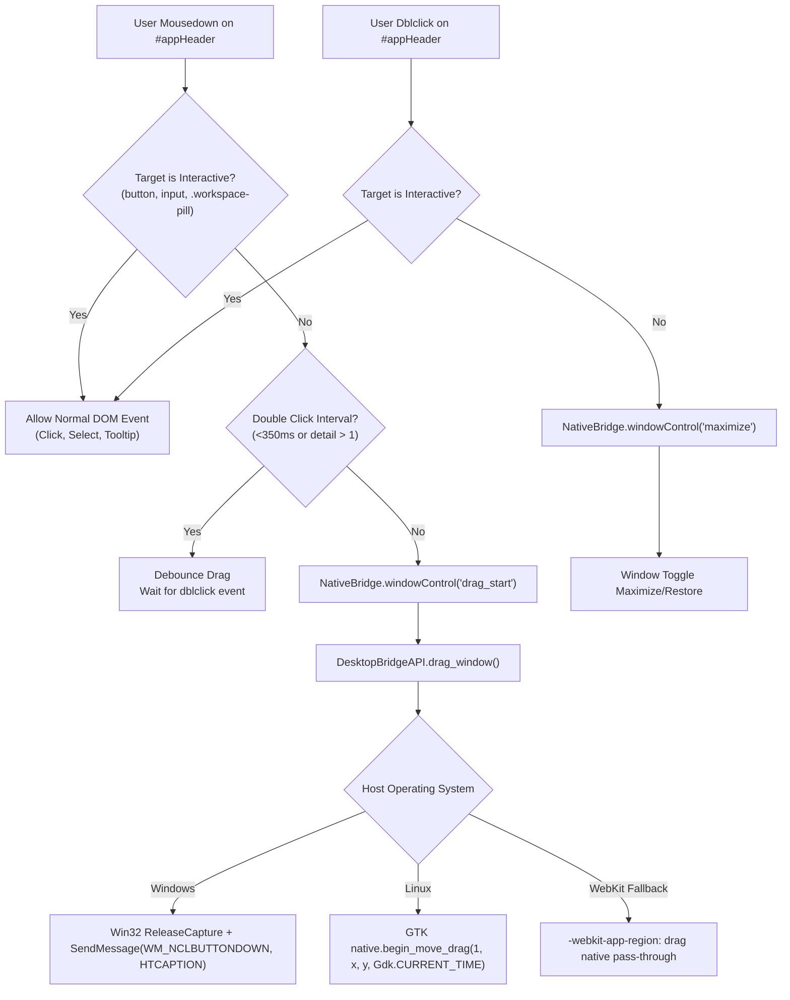

# High-Level Design (HLD): Window Drag Region

**Document ID:** `ORX-HLD-WINDOW-DRAG-REGION-V1`  
**Version:** `1.0` (Window Control Bar Subcomponent Architecture)  
**Parent Component:** `window-control-bar`  
**Target Codebase:** `DeskAI`  
**Target Files:**
* `src/deskai/static/index.html`
* `src/deskai/static/css/components.css`
* `src/deskai/static/css/tokens.css`
* `src/deskai/static/js/events.js`
* `src/deskai/static/js/bridge.js`
* `src/deskai/bridge/api.py`
**Status:** Approved  
**Date:** October 28, 2026  

---

## 1. Architectural Overview & Objective

The **Window Drag Region** is the top frameless window grab surface spanning the full width of `#appHeader`. In frameless desktop applications (where standard OS titlebars and borders are suppressed), this component serves as the primary physical interaction zone for moving and docking the application window across desktop monitors.

It achieves three primary objectives:
1. **Universal Multi-Platform Window Dragging:** Integrates native OS window move drag across Windows (`WM_NCLBUTTONDOWN` with `HTCAPTION`), Linux (Wayland / GTK GDK `begin_move_drag`), and macOS (WebKit native drag regions).
2. **Double-Click Maximize / Restore:** Detects double-clicks across non-interactive areas of `#appHeader` and triggers native maximize/restore toggling via `NativeBridge.windowControl("maximize")`.
3. **Interactive Exclusion Protection (`no-drag`):** Preserves interactivity for all child controls (buttons, workspace pill, dialog triggers) using `-webkit-app-region: no-drag` and click target inspection.

```text
┌─────────────────────────────────────────────────────────────────────────────┐
│ #appHeader.app-header.pywebview-drag-region [-webkit-app-region: drag]      │
│ ┌──────────────────────────────┐                ┌─────────────────────────┐ │
│ │ ⚡ DeskAI  [DeskAI / main]   │  [DRAG ZONE]   │ [─] [□] [✕]             │ │
│ │ (drag)     (no-drag)         │  (dblclick=max)│ (no-drag)               │ │
│ └──────────────────────────────┘                └─────────────────────────┘ │
└─────────────────────────────────────────────────────────────────────────────┘
```

---

## 2. Problem Statement & Functional Requirements

### 2.1 Problem Statement
Without a dedicated, resilient window drag region:
- A frameless window cannot be repositioned by mouse drag, trapping the user on multi-monitor setups.
- WebKit's `-webkit-app-region: drag` alone does not reliably trigger OS window management on certain Linux Wayland compositors (GNOME Mutter, KDE KWin) and Windows non-client areas.
- If interactive buttons (such as Minimize, Maximize, and Close) are not strictly isolated in `-webkit-app-region: no-drag` zones, clicks are consumed by the OS drag manager rather than triggering DOM click handlers.
- Fast double-clicks to maximize can be preempted if the initial `mousedown` immediately locks the window into a drag loop.

### 2.2 Functional Requirements (FR)
* **FR-WDR-01:** Declare `-webkit-app-region: drag` on `.app-header` and `.pywebview-drag-region`.
* **FR-WDR-02:** Enforce `-webkit-app-region: no-drag` on all interactive child controls (`.header-right`, `.win-btn`, `.workspace-pill`).
* **FR-WDR-03:** Provide programmatic mousedown fallback in `events.js` dispatching `NativeBridge.windowControl("drag_start", null, timestamp)` on primary button (`e.button === 0`).
* **FR-WDR-04:** Support double-click on `#appHeader` to toggle maximize/restore state, ignoring double-clicks on interactive child elements.
* **FR-WDR-05:** Prevent drag initiation on secondary (`button !== 0`) clicks.
* **FR-WDR-06:** Enforce origin validation in `DesktopBridgeAPI.drag_window()`.

---

## 3. High-Level Architecture & Platform Strategy



---

## 4. Exclusion & Interaction Boundaries

1. **CSS Boundaries:**
   - Container `#appHeader`: `-webkit-app-region: drag`.
   - Brand Logo `#appLogo`: Inherent drag pass-through (`user-select: none`).
   - Workspace Pill `#headerWorkspacePill`: `-webkit-app-region: no-drag`.
   - Window Control Group `.window-controls`: `-webkit-app-region: no-drag`.
   - Buttons `.win-btn`: `-webkit-app-region: no-drag`.

2. **JavaScript Guarding:**
   - Both `mousedown` and `dblclick` handlers use `e.target.closest("button, input, textarea, .workspace-pill, [data-action]")` to guarantee that interactive elements retain 100% of their pointer events.

---

## 5. Security & Origin Sandboxing

1. **Origin Verification:**
   - Any invocation of `drag_window()` or `window_control("drag_start")` verifies `self._is_origin_allowed()` against the loopback origin.
2. **Timing Guard:**
   - Timestamp parameters prevent replay attacks and synthetic event flooding.

---

## 6. Verification & Acceptance Criteria

| ID | Criterion | Verification Method |
|---|---|---|
| **AC-WDR-01** | `#appHeader` has `-webkit-app-region: drag` and `user-select: none` | Playwright computed style inspection |
| **AC-WDR-02** | Interactive elements have `-webkit-app-region: no-drag` | Playwright computed style assertion |
| **AC-WDR-03** | Mousedown on drag region triggers `windowControl('drag_start')` | Playwright bridge mock call verification |
| **AC-WDR-04** | Mousedown on interactive button does NOT trigger drag | Playwright bridge mock call verification |
| **AC-WDR-05** | Dblclick on drag region triggers `windowControl('maximize')` | Playwright bridge mock call verification |
| **AC-WDR-06** | Dblclick on button or pill does NOT trigger maximize | Playwright event propagation assertion |
| **AC-WDR-07** | Right-click (`button === 2`) does NOT trigger window drag | Playwright event button check |
