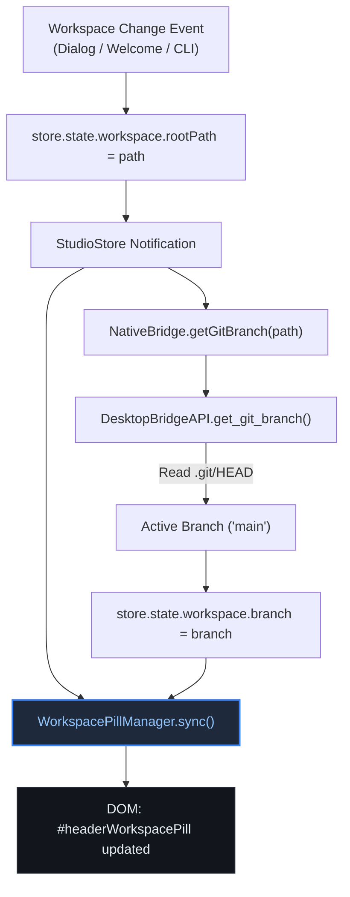

# High-Level Design (HLD): Workspace Branch Pill

**Document ID:** `ORX-HLD-WORKSPACE-BRANCH-PILL-V1`  
**Version:** `1.0` (Window Control Bar Subcomponent Architecture)  
**Parent Component:** `window-control-bar`  
**Target Codebase:** `DeskAI`  
**Target Files:**
* `src/deskai/static/index.html`
* `src/deskai/static/css/components.css`
* `src/deskai/static/css/tokens.css`
* `src/deskai/static/js/state.js`
* `src/deskai/static/js/app.js`
* `src/deskai/static/js/bridge.js`
* `src/deskai/bridge/api.py`
**Status:** Approved  
**Date:** October 28, 2026  

---

## 1. Architectural Overview & Objective

The **Workspace Branch Pill** (`#headerWorkspacePill` within `.header-left`) is the contextual environment badge situated adjacent to the branding title in the top navigation bar (`#appHeader`, `role="banner"`).

It provides immediate spatial awareness of the user's active development workspace:
1. **Workspace Identification:** Displays the active folder name (e.g. `DeskAI`) or `'No Folder Opened'` when in an empty state.
2. **VCS Branch Indicator:** Displays the active Git branch (e.g. `/ main`) fetched via lightweight local repository inspection.
3. **Tooltip Disambiguation:** Sets `title` attribute with the canonical filesystem path of the workspace root, disambiguating multiple projects sharing identical folder names.
4. **Reactive State Binding:** Subscribes to `store.subscribe("workspace.rootPath")` and `store.subscribe("workspace.branch")`, updating automatically without imperative manual DOM manipulation across separate event listeners.
5. **No-Drag Boundary:** Marked with `-webkit-app-region: no-drag` ensuring pointer events (hover tooltips, future click-to-switch dropdowns) are not captured by native window drag managers.

```text
┌─────────────────────────────────────────────────────────────────────────────┐
│ #appHeader.app-header [role="banner"]                                       │
│ ┌─────────────────────────────────────────────────────────────────────────┐ │
│ │ .header-left                                                            │ │
│ │ ┌───────────────────┐ ┌───────────────────────────────────────────────┐ │ │
│ │ │ ⚡ DeskAI         │ │ 📁 DeskAI / ⎇ main                            │ │ │
│ │ │ (.app-logo)       │ │ (#headerWorkspacePill role="status")         │ │ │
│ │ │                   │ │ (title="/mnt/Data/Workspaces/.../DeskAI")     │ │ │
│ │ └───────────────────┘ └───────────────────────────────────────────────┘ │ │
│ └─────────────────────────────────────────────────────────────────────────┘ │
└─────────────────────────────────────────────────────────────────────────────┘
```

---

## 2. Problem Statement & Functional Requirements

### 2.1 Problem Statement
In initial builds of DeskAI:
- The workspace pill had hardcoded static text (`DeskAI / main`) in `index.html`.
- Multiple unrelated event handlers (`open-folder-dialog`, `open-file-dialog`, `open-recent-project` in `events.js`) imperatively queried `document.getElementById("headerWorkspacePill")` and replaced text content, leading to fragmented state synchronization.
- If the workspace was switched via CLI arguments, welcome screen cards, or external bridge calls, the pill was not notified.
- No Git branch inspection mechanism existed in `DesktopBridgeAPI`; branch text was either hardcoded or missing.
- Long project paths caused visual overflow into the window controls area on smaller displays without text truncation safeguards.

### 2.2 Functional Requirements (FR)
* **FR-WBP-01:** Dynamically display active folder name and Git branch in format `{Folder} / {Branch}` or `{Folder}` if branch is unavailable.
* **FR-WBP-02:** Display `"No Folder Opened"` when `store.state.workspace.rootPath` is `null` or empty.
* **FR-WBP-03:** Provide a canonical full path tooltip via `title` attribute.
* **FR-WBP-04:** Reactively synchronize via `StudioStore` subscriptions to `workspace.rootPath` and `workspace.branch`.
* **FR-WBP-05:** Provide backend RPC `get_git_branch(target_path)` in `DesktopBridgeAPI` to detect active branches without heavy subprocess overhead.
* **FR-WBP-06:** Enforce `-webkit-app-region: no-drag`, maximum width clamping (`max-width: 240px`), and ellipsis truncation.
* **FR-WBP-07:** Conform strictly to Design System tokens (zero raw hex/rgb outside `tokens.css`).

---

## 3. High-Level Architecture & Component Relationships



---

## 4. Accessibility & Semantics Strategy

1. **Role & Announcements:**
   - `#headerWorkspacePill` defines `role="status"` with `aria-live="polite"` (or descriptive `aria-label`).
   - Example `aria-label`: `"Active workspace: DeskAI, branch: main"`.
   - When no folder is open: `aria-label="Workspace: No folder opened"`.
2. **Tooltip & Inspection:**
   - `title` attribute delivers standard browser tooltip without blocking screen readers or keyboard navigation.
3. **Contrast:**
   - Background: `var(--bg-surface)` (`#161a23`).
   - Text: `var(--text-secondary)` (`#94a3b8`).
   - Contrast ratio exceeds `5.8:1` against `--bg-header`, fully compliant with WCAG AA.

---

## 5. Security & Sandboxing Boundaries

1. **Path Traversal Protection:**
   - Displayed folder name is derived by sanitizing path delimiters (`/` and `\`) to extract only the terminal directory segment.
   - The tooltip reflects canonical paths but does not execute external links or evaluate unsafe HTML.
2. **Zero Dynamic Injection (`innerHTML`):**
   - Rendering uses purely `textContent` and `setAttribute()`.
3. **Low-Overhead Git Detection:**
   - Backend reads `.git/HEAD` directly from disk using standard file I/O rather than executing un-sandboxed shell commands.

---

## 6. Verification & Acceptance Criteria

| ID | Criterion | Verification Method |
|---|---|---|
| **AC-WBP-01** | Empty workspace state displays `"No Folder Opened"` | Playwright DOM check on boot without folder |
| **AC-WBP-02** | Setting workspace root updates text to `{Folder} / {Branch}` | Playwright state mutation test |
| **AC-WBP-03** | Full path tooltip is reflected in `title` attribute | Playwright attribute assertion |
| **AC-WBP-04** | Backend `get_git_branch` correctly resolves branch from `.git/HEAD` | Python unit test in `test_workspace_branch_pill.py` |
| **AC-WBP-05** | Element has `-webkit-app-region: no-drag` | Playwright computed style assertion |
| **AC-WBP-06** | Text overflow is clamped with ellipsis (`text-overflow: ellipsis`) | CSS token and layout check |
